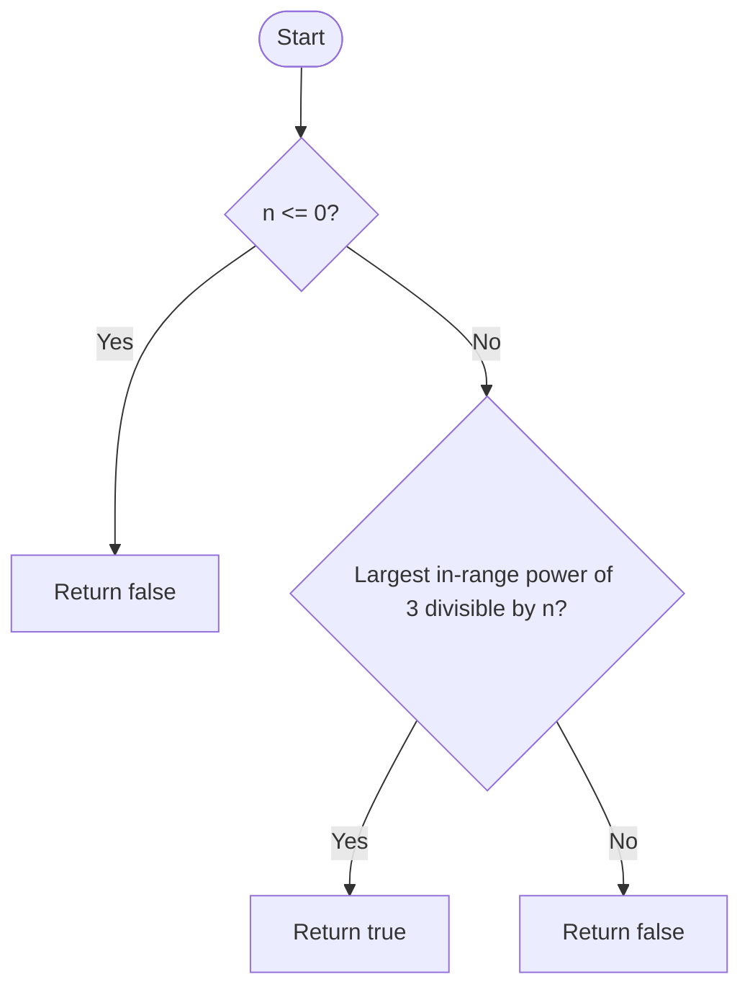

# Power of Three — LeetCode 326

## 1. Understanding

दिलेला signed 32-bit integer 3 च्या integer power (`1,3,9,...`) आहे का तपासा. Positive power only; zero/negative false.

## 2. Worked examples and edges

- `1`, `3`, `27` → true; `45`, `0`, `-3` → false.
- 32-bit signed rangeमधील सर्वात मोठी power `3^19=1162261467`.
- Source च्या test vectorमध्ये `3486784401` हा `int` rangeबाहेरचा initializer आहे; standard C++ मध्ये narrowing compile error होऊ शकतो. Source बदललेला नाही.

## 3. Pattern identification + cheat sheet

| Clue                              | Pattern                       | कारण                          |
| --------------------------------- | ----------------------------- | ----------------------------- |
| Integer is exact fixed-base power | Divisibility by maximum power | Rangeमध्ये base powersचा गुणक |
| Repeated multiply by 3            | Recursion/loop                | Candidate sequence            |
| Signed integer boundary           | Number theory + bounds        | Max valid power आधी ठरवा      |

## 4. Approaches

- Repeated division by 3 until not divisible: O(log n), O(1); common alternative.
- Source `isPowerOfThree_Division`: check `maxPower % n == 0`, O(1) time/space for positive `n`.
- Source recursive multiplication: O(log n) time, O(log n) stack.
- Base-3 digit/property किंवा floating logarithm equality avoid करा; precision errors possible.

## 5. Flowchart

32-bit signed rangeमध्ये 3 च्या powersची divisibility फक्त exact powerसाठी खरी ठरते.

## 6. Algorithm / intuition

`3^19=1162261467` ही int rangeमधील सर्वात मोठी power आहे. सामान्य divisibility trick म्हणून `3^19 % n == 0` तपासता येते. Source मात्र `3^20=3486784401` तपासतो; `n` हा positive int असल्याने त्याचे divisors rangeमध्ये `3^0` ते `3^19` एवढेच असू शकतात, त्यामुळे ही तपासणीही योग्य.

## 7. Code explanation

`isPowerOfThree_Division` `n<=0` reject करून `3486784401` (`3^20`, long long literal) modulo तपासतो. `isPowerOfThree_Recursive` helper `pv=1` पासून multiply-by-3 करतो; `n==pv` true, overshoot false. Source test listचा out-of-range `int` item हा demo compile blocker आहे.

## 8. Dry run

> **मराठी:** प्रत्येक महत्त्वाच्या step नंतर variable ची value trace करा.
> `n=27`:
> | candidate `pv` | comparison |
> |---:|---|
> | 1 | below 27 |
> | 3 | below 27 |
> | 9 | below 27 |
> | 27 | equal → true |
> `n=45`: maximum power modulo 45 nonzero → false.

## 9. Complexity

> **मराठी:** Input size आणि प्रत्येक operation कितीदा चालतो यावरून complexity ठरवा.
> Division method O(1) time/O(1) space (fixed-width integer). Recursive method O(log₃ n) time and stack.

## 10. Correctness

> **मराठी:** Invariant किंवा तर्क वापरून algorithm योग्य उत्तर देतो हे समजून घ्या.
> If n is `3^k` within range, it divides `3^19`. Conversely, every positive divisor of `3^19` has only prime factor 3, so it must be a power of 3. Recursive method checks the complete sequence `3^0,3^1,...` until equality or overshoot.

## 11. Mistakes and interview traps

> **मराठी:** Boundary, duplicate आणि off-by-one cases स्वतंत्रपणे तपासा.

- Reject `n<=0` before modulo/division reasoning.
- Correct maximum power for signed 32-bit is `3^19`, not `3^20`.
- `3486784401` needs a wide integer type; source vector narrows it to int and may not compile.
- Floating-point `log(n)/log(3)` can round near integer values.

## 12. Quick revision

> **मराठी:** दोन मिनिटांच्या revision साठी pattern, मुख्य कल्पना आणि complexity आठवा.
> For 32-bit positive n, `1162261467 % n == 0`; or repeatedly multiply 1 by 3.

## 13. Related problems / variations

> **मराठी:** प्रश्नात काय दिले आहे आणि नेमके काय शोधायचे आहे, हे आधी स्पष्ट करा.
> Power of Two, Power of Four, integer factorization, repeated division by a base.

## 14. Self-assessment

> **मराठी:** उत्तर न पाहता प्रश्न सोडवा आणि तुमच्या निवडीचे कारण सांगा.

1. Why use `3^19`, not `3^20`?
2. Why does divisibility prove a power of three?
3. What is the demo vector narrowing issue?
4. Why avoid floating-point logarithms?
