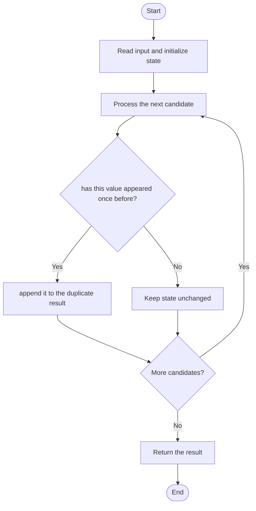

# 3289 — The Two Sneaky Numbers of Digitville

## 1. Problem understanding and constraints

An array contains values from the expected range, with exactly two values appearing twice. Return those repeated values in either order. **थोडक्यात:** काय मोजायचे/निवडायचे ते आधी स्पष्ट करा; मगच code निवडा.

## 2. Stepwise example and edge cases

> **मराठी:** प्रश्नात काय दिले आहे आणि नेमके काय शोधायचे आहे, हे आधी स्पष्ट करा.
> `nums=[0,1,1,0]` → `[0,1]`. **Edge cases:** check smallest valid input, ties/boundaries, and empty/no-match outcomes where constraints allow them.

## 3. Pattern identification — clue table

Frequency counting or set membership for two duplicates. हा मुख्य pattern आहे.
| Clue | What it suggests |
|---|---|
| Output depends on frequency counting or set membership for two duplicates. | Keep only the relevant state; avoid unrelated recomputation |
| Need to preserve the stated condition | State an invariant before coding |
| Input scan/order matters | Update once per item and test boundaries |

## 4. Multiple approaches

Nested duplicate search is correct but `O(n²)`. A hash set is expected `O(n)` time and `O(n)` space; the source uses a frequency/counting strategy. **योग्य निवड:** source मध्ये असलेली method आणि तिच्या मर्यादा वेगळ्या ओळखा.

## 5. Flowchart

Flow समजताना decision condition आणि update invariant शी जुळतात का ते तपासा.

## 6. Selected algorithm and intuition

> **मराठी:** मुख्य observation समजल्यावर algorithm चे steps लक्षात ठेवणे सोपे होते.
> A value is sneaky exactly when it is encountered for the second time.

## 7. Code-specific explanation

> **मराठी:** Code मधील variable आणि condition यांचा algorithm मधील उद्देश समजून घ्या.
> `LeetCode\3289\3289.cpp` — `getSneakyNumbers` sorts the input in place, scans adjacent equal values, and appends each repeated number once. The general demo permits more repeats, but the LeetCode input guarantees two sneaky values.

## 8. Dry run

> **मराठी:** प्रत्येक महत्त्वाच्या step नंतर variable ची value trace करा.
> | Step | State / action |
> |---:|---|
> | 1 | Sorted `[0,0,1,1]`: equal pair 0 → save 0 |
> | 2 | equal pair 1 → save 1. |

## 9. Complexity

> **मराठी:** Input size आणि प्रत्येक operation कितीदा चालतो यावरून complexity ठरवा.
> `O(n log n)` time for sorting and `O(1)` auxiliary space beyond the returned vector (sort stack is implementation-dependent).

## 10. Correctness

> **मराठी:** Invariant किंवा तर्क वापरून algorithm योग्य उत्तर देतो हे समजून घ्या.
> Sorting makes equal values adjacent. The scan reports a value when it sees an equal neighbor and skips past the pair, so each repeated value is returned once for the promised duplicate pattern.

## 11. Mistakes and interview traps

> **मराठी:** Boundary, duplicate आणि off-by-one cases स्वतंत्रपणे तपासा.

- Do not add a duplicate more than once if generalized inputs allow more occurrences.
- Output order is not constrained.
- Respect the problem's value range if using a direct array.

## 12. Quick revision

**झटपट:** A value is sneaky exactly when it is encountered for the second time. Pattern ओळखा, condition तपासा, आणि answer एकदाच योग्य पद्धतीने update करा.

## 13. Related patterns and variations

> **मराठी:** या clues मुळे योग्य pattern ओळखता येतो; constraints आणि relations नीट तपासा.
> Hash sets; frequency arrays; duplicate detection.

## 14. Self-assessment

> **मराठी:** उत्तर न पाहता प्रश्न सोडवा आणि तुमच्या निवडीचे कारण सांगा.

1. Why is either output order acceptable?
2. When should the value be appended?
3. What changes if values are not in a small range?
