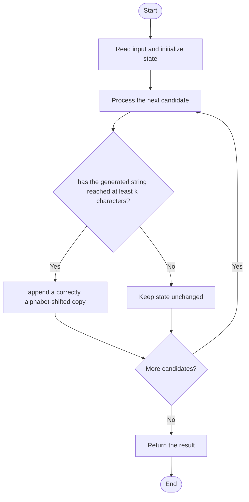

# 3304 — Find the K-th Character in String Game I

## 1. Problem understanding and constraints

Start with `a`; each operation appends a copy of the current string with every character advanced by one alphabet letter. Return the 1-indexed kth character. **थोडक्यात:** काय मोजायचे/निवडायचे ते आधी स्पष्ट करा; मगच code निवडा.

## 2. Stepwise example and edge cases

> **मराठी:** प्रश्नात काय दिले आहे आणि नेमके काय शोधायचे आहे, हे आधी स्पष्ट करा.
> The strings begin `a → ab → abbc → abbccd`; k=5 gives `c`. **Edge cases:** check smallest valid input, ties/boundaries, and empty/no-match outcomes where constraints allow them.

## 3. Pattern identification — clue table

Doubling construction; recursive half/block mapping can avoid building the string. हा मुख्य pattern आहे.
| Clue | What it suggests |
|---|---|
| Output depends on doubling construction | Keep only the relevant state; avoid unrelated recomputation |
| Need to preserve the stated condition | State an invariant before coding |
| Input scan/order matters | Update once per item and test boundaries |

## 4. Multiple approaches

Direct simulation is conceptually correct for small k. The source's `kthCharacter` builds the string but its shift expression `(i+1)%122` is incorrect for letters near `y`/`z` (it produces control characters rather than wrapping to `a`); do not treat it as fully correct. Correct shifting is modulo 26 over alphabet indices. **योग्य निवड:** source मध्ये असलेली method आणि तिच्या मर्यादा वेगळ्या ओळखा.

## 5. Flowchart

Flow समजताना decision condition आणि update invariant शी जुळतात का ते तपासा.

## 6. Selected algorithm and intuition

> **मराठी:** मुख्य observation समजल्यावर algorithm चे steps लक्षात ठेवणे सोपे होते.
> Each round doubles length; the appended half is the previous half shifted by one. Character values must wrap in the 26-letter alphabet.

## 7. Code-specific explanation

> **मराठी:** Code मधील variable आणि condition यांचा algorithm मधील उद्देश समजून घ्या.
> `LeetCode\3304\3304.cpp` — `kthCharacter` stores the whole string until its length exceeds k, then returns `Result[k-1]`. The indexing is 1-based at input and 0-based in C++; the source's character wrap is a correctness bug.

## 8. Dry run

> **मराठी:** प्रत्येक महत्त्वाच्या step नंतर variable ची value trace करा.
> | Step | State / action |
> |---:|---|
> | 1 | For k=5: build `a`, `ab`, `abbc`, `abbcc...` |
> | 2 | index 4 is `c`. |

## 9. Complexity

> **मराठी:** Input size आणि प्रत्येक operation कितीदा चालतो यावरून complexity ठरवा.
> Source simulation uses `O(k)` time and `O(k)` memory; output length is the next power of two ≥k. Correctness requires shifting `((c-'a'+1)%26)+'a'`.

## 10. Correctness

> **मराठी:** Invariant किंवा तर्क वापरून algorithm योग्य उत्तर देतो हे समजून घ्या.
> With a correct modulo-26 shift, each appended block is exactly the defined transform of the prior string; repeated doubling therefore constructs the sequence, and index k-1 is the desired character. The checked-in modulo-122 expression breaks this proof for letters near z.

## 11. Mistakes and interview traps

> **मराठी:** Boundary, duplicate आणि off-by-one cases स्वतंत्रपणे तपासा.

- `k` is 1-indexed.
- Wrap `z` to `a`, not ASCII modulo 122.
- For large k, use the bit/reverse mapping rather than materializing all prefixes.

## 12. Quick revision

**झटपट:** Each round doubles length; the appended half is the previous half shifted by one. Character values must wrap in the 26-letter alphabet. Pattern ओळखा, condition तपासा, आणि answer एकदाच योग्य पद्धतीने update करा.

## 13. Related patterns and variations

> **मराठी:** या clues मुळे योग्य pattern ओळखता येतो; constraints आणि relations नीट तपासा.
> Divide-and-conquer string indexing; binary representation; recursive sequence lookup.

## 14. Self-assessment

> **मराठी:** उत्तर न पाहता प्रश्न सोडवा आणि तुमच्या निवडीचे कारण सांगा.

1. What is the correct alphabet shift expression?
2. Why does the generated string double?
3. Where does 1-based indexing change to 0-based?
