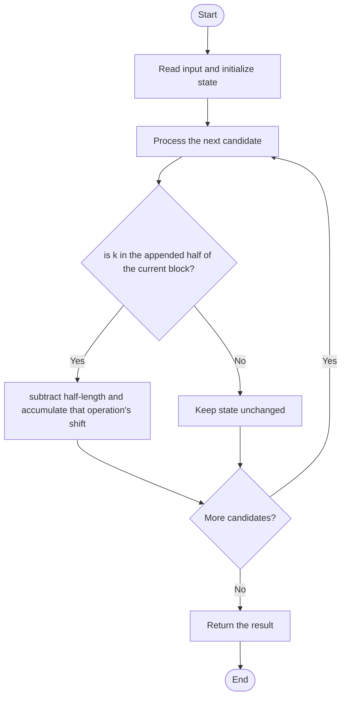

# 3307 — Find the K-th Character in String Game II

## 1. Problem understanding and constraints

The string doubles per operation; operation 0 copies the block, operation 1 copies it with each letter shifted by one. Find the 1-indexed kth character without necessarily building a huge string. **थोडक्यात:** काय मोजायचे/निवडायचे ते आधी स्पष्ट करा; मगच code निवडा.

## 2. Stepwise example and edge cases

> **मराठी:** प्रश्नात काय दिले आहे आणि नेमके काय शोधायचे आहे, हे आधी स्पष्ट करा.
> `operations=[0,1]`: sequence goes `a → aa → aabb`; k=4 is `b`. **Edge cases:** check smallest valid input, ties/boundaries, and empty/no-match outcomes where constraints allow them.

## 3. Pattern identification — clue table

Reverse block mapping / count set-bit ancestor operations. हा मुख्य pattern आहे.
| Clue | What it suggests |
|---|---|
| Output depends on reverse block mapping / count set-bit ancestor operations. | Keep only the relevant state; avoid unrelated recomputation |
| Need to preserve the stated condition | State an invariant before coding |
| Input scan/order matters | Update once per item and test boundaries |

## 4. Multiple approaches

Simulation is correct but uses O(k) memory and may not scale. Source also has bit-based reverse logic, which is efficient; floating-point `log2` and index assumptions deserve care at bounds. **योग्य निवड:** source मध्ये असलेली method आणि तिच्या मर्यादा वेगळ्या ओळखा.

## 5. Flowchart

Flow समजताना decision condition आणि update invariant शी जुळतात का ते तपासा.

## 6. Selected algorithm and intuition

> **मराठी:** मुख्य observation समजल्यावर algorithm चे steps लक्षात ठेवणे सोपे होते.
> Trace k backward: if it lies in an appended half, subtract that half's length and add the corresponding operation's shift; repeat until position 1.

## 7. Code-specific explanation

> **मराठी:** Code मधील variable आणि condition यांचा algorithm मधील उद्देश समजून घ्या.
> `LeetCode\3307\3307.cpp` — `kthCharacterSim` builds integer shift values. `kthCharacterBitLogic` walks backward using powers of two and sums operation flags modulo 26.

## 8. Dry run

> **मराठी:** प्रत्येक महत्त्वाच्या step नंतर variable ची value trace करा.
> | Step | State / action |
> |---:|---|
> | 1 | k=4, operations `[0,1]`: highest block is length 2 |
> | 2 | k→2 and add op[1]=1 |
> | 3 | then k→1 and add op[0]=0 |
> | 4 | character=`b`. |

## 9. Complexity

> **मराठी:** Input size आणि प्रत्येक operation कितीदा चालतो यावरून complexity ठरवा.
> Simulation `O(k)` time/space. Reverse method `O(log k)` time and `O(1)` extra space.

## 10. Correctness

> **मराठी:** Invariant किंवा तर्क वापरून algorithm योग्य उत्तर देतो हे समजून घ्या.
> Each appended-half position maps to the same offset in the previous block, with an added shift exactly when that operation is 1. Repeating reaches the original `a`; accumulated shifts modulo 26 give the character.

## 11. Mistakes and interview traps

> **मराठी:** Boundary, duplicate आणि off-by-one cases स्वतंत्रपणे तपासा.

- Use 1-based k consistently.
- Operation index corresponds to the block level.
- Prefer integer bit operations over floating-point power calculations for robust bounds.

## 12. Quick revision

**झटपट:** Trace k backward: if it lies in an appended half, subtract that half's length and add the corresponding operation's shift; repeat until position 1. Pattern ओळखा, condition तपासा, आणि answer एकदाच योग्य पद्धतीने update करा.

## 13. Related patterns and variations

> **मराठी:** या clues मुळे योग्य pattern ओळखता येतो; constraints आणि relations नीट तपासा.
> Binary lifting; recursive strings; bit decomposition.

## 14. Self-assessment

> **मराठी:** उत्तर न पाहता प्रश्न सोडवा आणि तुमच्या निवडीचे कारण सांगा.

1. How does a position in the appended half map backward?
2. When is a shift added?
3. What is the reverse algorithm's time?
