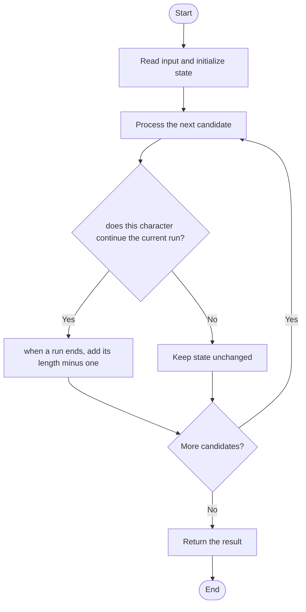

# 3330 — Find the Original Typed String I

## 1. Problem understanding and constraints

A key may have been held too long, causing one run of identical adjacent characters to be longer than intended. Count all possible original strings, including the unchanged one; at most one run is affected. **थोडक्यात:** काय मोजायचे/निवडायचे ते आधी स्पष्ट करा; मगच code निवडा.

## 2. Stepwise example and edge cases

> **मराठी:** प्रश्नात काय दिले आहे आणि नेमके काय शोधायचे आहे, हे आधी स्पष्ट करा.
> `word="abbcccc"`: the run of four c's contributes three extra choices; total choices are 1 plus each run's excess. **Edge cases:** check smallest valid input, ties/boundaries, and empty/no-match outcomes where constraints allow them.

## 3. Pattern identification — clue table

Run-length encoding; count local excess choices. हा मुख्य pattern आहे.
| Clue | What it suggests |
|---|---|
| Output depends on run-length encoding | Keep only the relevant state; avoid unrelated recomputation |
| Need to preserve the stated condition | State an invariant before coding |
| Input scan/order matters | Update once per item and test boundaries |

## 4. Multiple approaches

Trying every deletion position is correct but repeats equivalent cases. A single scan of equal-character runs is linear and is the source approach. **योग्य निवड:** source मध्ये असलेली method आणि तिच्या मर्यादा वेगळ्या ओळखा.

## 5. Flowchart

Flow समजताना decision condition आणि update invariant शी जुळतात का ते तपासा.

## 6. Selected algorithm and intuition

> **मराठी:** मुख्य observation समजल्यावर algorithm चे steps लक्षात ठेवणे सोपे होते.
> For a run of length L, there are L-1 ways to shorten it by one or more extra held presses while keeping at least one character.

## 7. Code-specific explanation

> **मराठी:** Code मधील variable आणि condition यांचा algorithm मधील उद्देश समजून घ्या.
> `LeetCode\3330\3330.cpp` — `possibleStringCount` initializes answer to 1 for the unchanged string, then adds `runLength-1` for each run.

## 8. Dry run

> **मराठी:** प्रत्येक महत्त्वाच्या step नंतर variable ची value trace करा.
> | Step | State / action |
> |---:|---|
> | 1 | Runs in `abbcccc`: lengths 1,2,4 |
> | 2 | add 0+1+3 to base 1 → 5 possibilities. |

## 9. Complexity

> **मराठी:** Input size आणि प्रत्येक operation कितीदा चालतो यावरून complexity ठरवा.
> `O(n)` time and `O(1)` extra space.

## 10. Correctness

> **मराठी:** Invariant किंवा तर्क वापरून algorithm योग्य उत्तर देतो हे समजून घ्या.
> Each possible original differs by shortening one observed run by at least one while leaving it nonempty; a run of length L gives L-1 choices. The constraint allows only one held-key event, so these run choices are disjoint; adding the unchanged string counts all possibilities.

## 11. Mistakes and interview traps

> **मराठी:** Boundary, duplicate आणि off-by-one cases स्वतंत्रपणे तपासा.

- Include the original string as one possibility.
- Add L-1, not L.
- Do not multiply run choices because only one key hold occurred.

## 12. Quick revision

**झटपट:** For a run of length L, there are L-1 ways to shorten it by one or more extra held presses while keeping at least one character. Pattern ओळखा, condition तपासा, आणि answer एकदाच योग्य पद्धतीने update करा.

## 13. Related patterns and variations

> **मराठी:** या clues मुळे योग्य pattern ओळखता येतो; constraints आणि relations नीट तपासा.
> Run-length encoding; string scans; counting local variants.

## 14. Self-assessment

> **मराठी:** उत्तर न पाहता प्रश्न सोडवा आणि तुमच्या निवडीचे कारण सांगा.

1. How many choices does a run of length L contribute?
2. Why is the initial answer one?
3. Why don't we multiply across runs?
