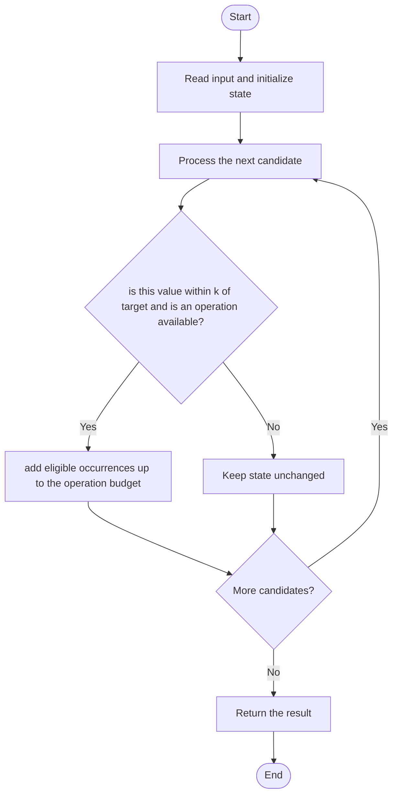

# 3346 — Maximum Frequency of an Element After Performing Operations I

## 1. Problem understanding and constraints

Each operation may add any integer in `[-k,k]` to one chosen element; use at most `numOperations` operations to maximize equal values. A target need not already occur in the input. **थोडक्यात:** काय मोजायचे/निवडायचे ते आधी स्पष्ट करा; मगच code निवडा.

## 2. Stepwise example and edge cases

> **मराठी:** प्रश्नात काय दिले आहे आणि नेमके काय शोधायचे आहे, हे आधी स्पष्ट करा.
> `nums=[0,10], k=5, numOperations=2`: change both values to the absent target 5, giving frequency 2. **Edge cases:** best target may not occur in the input; operation budget may be smaller than the number of reachable values.

## 3. Pattern identification — clue table

Interval coverage / sweep-line frequency over candidate target values. हा मुख्य pattern आहे.
| Clue | What it suggests |
|---|---|
| Output depends on interval coverage / sweep-line frequency over candidate target values. | Keep only the relevant state; avoid unrelated recomputation |
| Need to preserve the stated condition | State an invariant before coding |
| Input scan/order matters | Update once per item and test boundaries |

## 4. Multiple approaches

Brute force over all reachable target values is correct but must account for every target in value±k ranges. The checked-in global `maxFrequency` is not fully correct: it only tries existing values, so it can miss an optimal target absent from the input. Do not describe that routine as a general solution. **योग्य निवड:** source मध्ये असलेली method आणि तिच्या मर्यादा वेगळ्या ओळखा.

## 5. Flowchart

Flow समजताना decision condition आणि update invariant शी जुळतात का ते तपासा.

## 6. Selected algorithm and intuition

> **मराठी:** मुख्य observation समजल्यावर algorithm चे steps लक्षात ठेवणे सोपे होते.
> For target t, count values in `[t-k,t+k]`; at most `numOperations` of those can be changed, plus values already equal to t. Maximize over targets.

## 7. Code-specific explanation

> **मराठी:** Code मधील variable आणि condition यांचा algorithm मधील उद्देश समजून घ्या.
> `LeetCode\3346\3346.cpp` — The source builds a frequency map and tests only its existing keys. This has `O(u²)` time and `O(u)` space but misses target 5 in the example; the standalone demo does not expose this failure.

## 8. Dry run

> **मराठी:** प्रत्येक महत्त्वाच्या step नंतर variable ची value trace करा.
> | Step | State / action |
> |---:|---|
> | 1 | Target 5 is within distance 5 of both 0 and 10; two operations give count 2 |
> | 2 | 1 is distance 2. Two operations yield count 2. Checked-in code never tests 3, demonstrating the gap. |

## 9. Complexity

> **मराठी:** Input size आणि प्रत्येक operation कितीदा चालतो यावरून complexity ठरवा.
> Checked-in routine: `O(u²)` time, `O(u)` space; its answer is not guaranteed correct. A correct bounded-domain/sweep approach enumerates reachable targets with interval counts.

## 10. Correctness

> **मराठी:** Invariant किंवा तर्क वापरून algorithm योग्य उत्तर देतो हे समजून घ्या.
> For a fixed target, only values within distance k can be converted, and only numOperations conversions are allowed. A correct method evaluates this count for all relevant targets. The current implementation tests only present values, so it misses target 5 in the example and has no general correctness guarantee.

## 11. Mistakes and interview traps

> **मराठी:** Boundary, duplicate आणि off-by-one cases स्वतंत्रपणे तपासा.

- The optimal target may not be present in nums.
- Greedy iteration over an unordered map can change which values consume the budget.
- Distinguish a source implementation from the correct intended approach; source is preserved, not repaired.

## 12. Quick revision

**झटपट:** For target t, count values in `[t-k,t+k]`; at most `numOperations` of those can be changed, plus values already equal to t. Maximize over targets. Pattern ओळखा, condition तपासा, आणि answer एकदाच योग्य पद्धतीने update करा.

## 13. Related patterns and variations

> **मराठी:** या clues मुळे योग्य pattern ओळखता येतो; constraints आणि relations नीट तपासा.
> Sweep line over intervals; difference arrays; frequency maximization.

## 14. Self-assessment

> **मराठी:** उत्तर न पाहता प्रश्न सोडवा आणि तुमच्या निवडीचे कारण सांगा.

1. Can the best target be absent from the input?
2. What interval can convert to target t?
3. Why is unordered-map greedy allocation unsafe?
