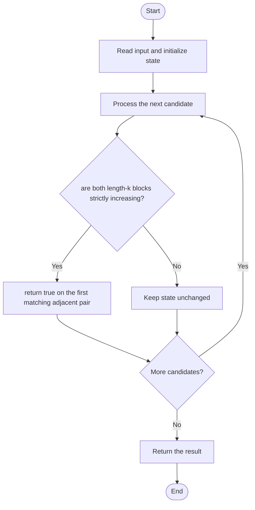

# 3349 — Adjacent Increasing Subarrays Detection I

## 1. Problem understanding and constraints

Determine whether there are two adjacent subarrays of length k and each is strictly increasing. They must be consecutive blocks: first `[i,i+k)` and second `[i+k,i+2k)`. **थोडक्यात:** काय मोजायचे/निवडायचे ते आधी स्पष्ट करा; मगच code निवडा.

## 2. Stepwise example and edge cases

> **मराठी:** प्रश्नात काय दिले आहे आणि नेमके काय शोधायचे आहे, हे आधी स्पष्ट करा.
> `nums=[2,3,1,4], k=2`: `[2,3]` and `[1,4]` are both increasing, so true. **Edge cases:** check smallest valid input, ties/boundaries, and empty/no-match outcomes where constraints allow them.

## 3. Pattern identification — clue table

Fixed-size adjacent windows plus monotonic-run validation. हा मुख्य pattern आहे.
| Clue | What it suggests |
|---|---|
| Output depends on fixed-size adjacent windows plus monotonic-run validation. | Keep only the relevant state; avoid unrelated recomputation |
| Need to preserve the stated condition | State an invariant before coding |
| Input scan/order matters | Update once per item and test boundaries |

## 4. Multiple approaches

Checking every pair directly is correct but `O(nk)`. The source helper checks increasing order for both blocks; run-based preprocessing could reduce it to O(n), but is not what the code does. **योग्य निवड:** source मध्ये असलेली method आणि तिच्या मर्यादा वेगळ्या ओळखा.

## 5. Flowchart

Flow समजताना decision condition आणि update invariant शी जुळतात का ते तपासा.

## 6. Selected algorithm and intuition

> **मराठी:** मुख्य observation समजल्यावर algorithm चे steps लक्षात ठेवणे सोपे होते.
> Slide the start of the first block; for each start verify both length-k ranges and return on the first valid pair.

## 7. Code-specific explanation

> **मराठी:** Code मधील variable आणि condition यांचा algorithm मधील उद्देश समजून घ्या.
> `LeetCode\3349\3349.cpp` — `isStrictlyIncreasing(nums,start,k)` checks neighboring pairs; `hasIncreasingSubarrays` tries each adjacent-block start.

## 8. Dry run

> **मराठी:** प्रत्येक महत्त्वाच्या step नंतर variable ची value trace करा.
> | Step | State / action |
> |---:|---|
> | 1 | For `[2,3,1,4]`, start 0: first pair 2<3, second pair 1<4 → true. |

## 9. Complexity

> **मराठी:** Input size आणि प्रत्येक operation कितीदा चालतो यावरून complexity ठरवा.
> Source approach `O(nk)` time and `O(1)` auxiliary space. A precomputed increasing-run length can achieve `O(n)`.

## 10. Correctness

> **मराठी:** Invariant किंवा तर्क वापरून algorithm योग्य उत्तर देतो हे समजून घ्या.
> The loop visits every possible starting index for the first block. The helper accepts exactly when every adjacent pair inside that block is strictly increasing; applying it to both adjacent blocks matches the definition.

## 11. Mistakes and interview traps

> **मराठी:** Boundary, duplicate आणि off-by-one cases स्वतंत्रपणे तपासा.

- The second subarray starts exactly at `start+k`.
- Strictly increasing uses `<`, not `<=`.
- Ensure both blocks fit within the array.

## 12. Quick revision

**झटपट:** Slide the start of the first block; for each start verify both length-k ranges and return on the first valid pair. Pattern ओळखा, condition तपासा, आणि answer एकदाच योग्य पद्धतीने update करा.

## 13. Related patterns and variations

> **मराठी:** या clues मुळे योग्य pattern ओळखता येतो; constraints आणि relations नीट तपासा.
> Sliding windows; increasing runs; monotonic arrays.

## 14. Self-assessment

> **मराठी:** उत्तर न पाहता प्रश्न सोडवा आणि तुमच्या निवडीचे कारण सांगा.

1. Where does the second block begin?
2. Does equality preserve increasing order?
3. How can run lengths improve time?
