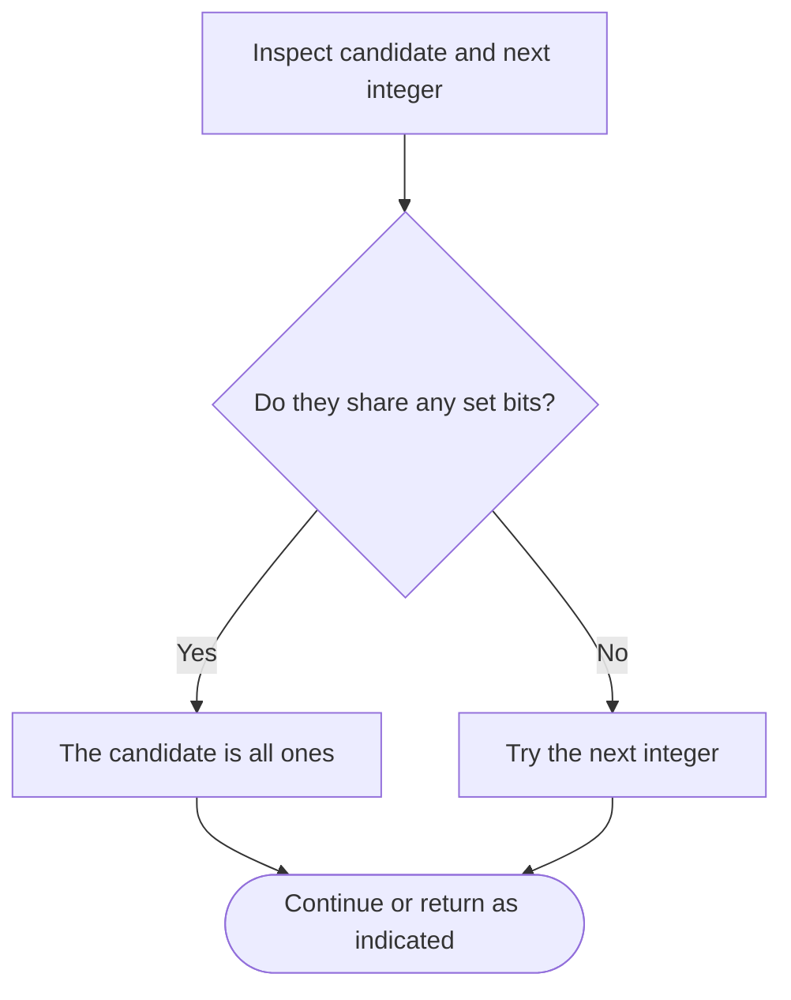

# Smallest Number With All Set Bits — LeetCode 3370

## Problem and judge interface

int smallestNumber(int n); return the least x at least n whose binary digits are all ones.

## Identification evidence

The loop increments candidates until (n+1)&n is zero, the all-ones boundary test; this uniquely matches problem 3370.

## Main flow

```mermaid
flowchart TD
 A([Start]) --> B[Start from input candidate n]
 B --> C[Test the all-ones bit condition]
 C --> D{Is (n+1) AND n zero?}
 D -- Yes --> E[Return candidate]
 D -- No --> F[Increment and test again]
 E --> G{More work remains?}
 F --> G
 G -- Yes --> C
 G -- No --> H([Return result])
```

## Important branch / loop



## Core logic and invariants

For an all-ones binary value, adding one clears all its set bits and shifts the carry beyond them, so n AND (n+1) is zero. Candidates are checked in increasing order.

## Complexity

O(log n) candidate checks in the worst case and O(1) auxiliary space.

## Comparison and optimization

This uses a simple candidate scan; computing the next all-ones bit width directly could avoid the loop but is not implemented.

## Compile and run

The `.cpp` is the original standalone source, including its local `main()` demonstration where present. Compile and run from the repository root with a C++17 compiler:

```text
g++ -std=c++17 LeetCode\3370\3370.cpp -o solution.exe
.\solution.exe
```

For LeetCode, adapt the implementation to the required class/method signature and omit the local `main()` and demonstration helpers; use the judge-provided node types. Notes above identify method-name or behavior differences. The moved source bytes have not been edited.
