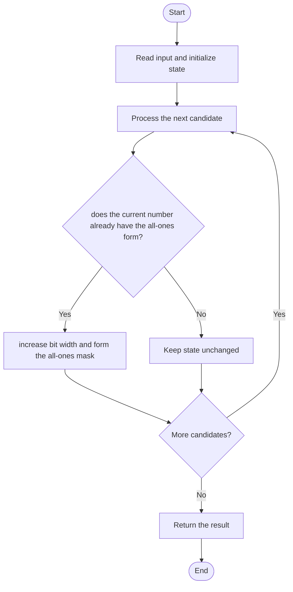

# 3370 — Smallest Number With All Set Bits

## 1. Problem understanding and constraints

Find the smallest integer greater than or equal to n whose binary representation consists entirely of ones. Such values are `1,3,7,15,...`. **थोडक्यात:** काय मोजायचे/निवडायचे ते आधी स्पष्ट करा; मगच code निवडा.

## 2. Stepwise example and edge cases

> **मराठी:** प्रश्नात काय दिले आहे आणि नेमके काय शोधायचे आहे, हे आधी स्पष्ट करा.
> `n=5` (101₂): next all-ones value is 7 (111₂). **Edge cases:** check smallest valid input, ties/boundaries, and empty/no-match outcomes where constraints allow them.

## 3. Pattern identification — clue table

Bitmask boundary / next Mersenne number. हा मुख्य pattern आहे.
| Clue | What it suggests |
|---|---|
| Output depends on bitmask boundary / next mersenne number. | Keep only the relevant state; avoid unrelated recomputation |
| Need to preserve the stated condition | State an invariant before coding |
| Input scan/order matters | Update once per item and test boundaries |

## 4. Multiple approaches

Incrementing until all bits are ones is correct but can take many steps. Use bit length to construct `(1<<b)-1`; the source checks or constructs the next all-set-bit boundary. **योग्य निवड:** source मध्ये असलेली method आणि तिच्या मर्यादा वेगळ्या ओळखा.

## 5. Flowchart

Flow समजताना decision condition आणि update invariant शी जुळतात का ते तपासा.

## 6. Selected algorithm and intuition

> **मराठी:** मुख्य observation समजल्यावर algorithm चे steps लक्षात ठेवणे सोपे होते.
> For bit length b, the largest b-bit value is all ones; choose the smallest such width that covers n.

## 7. Code-specific explanation

> **मराठी:** Code मधील variable आणि condition यांचा algorithm मधील उद्देश समजून घ्या.
> `LeetCode\3370\3370.cpp` — `smallestNumber` increments n one value at a time until `((n+1)&n)==0`; this bit test recognizes an all-ones binary value.

## 8. Dry run

> **मराठी:** प्रत्येक महत्त्वाच्या step नंतर variable ची value trace करा.
> | Step | State / action |
> |---:|---|
> | 1 | n=5 |
> | 2 | 5+1=6 is not a power of two, so use 3 bits: `(1<<3)-1=7`. |

## 9. Complexity

> **मराठी:** Input size आणि प्रत्येक operation कितीदा चालतो यावरून complexity ठरवा.
> The checked-in loop takes `O(answer-n)` iterations (worst-case proportional to the gap to the next all-ones value) and `O(1)` space. A direct bit-width construction could do this in `O(1)` machine-word operations.

## 10. Correctness

> **मराठी:** Invariant किंवा तर्क वापरून algorithm योग्य उत्तर देतो हे समजून घ्या.
> The identity `(n+1)&n == 0` holds for positive n exactly when n is all ones in binary. Scanning upward from the input and returning the first value satisfying this predicate therefore returns the smallest valid number.

## 11. Mistakes and interview traps

> **मराठी:** Boundary, duplicate आणि off-by-one cases स्वतंत्रपणे तपासा.

- Handle exact all-ones inputs without moving to the next width.
- Avoid overflowing a signed shift at the type's bit width.
- `n+1` being a power of two is equivalent to n having all lower bits set.

## 12. Quick revision

**झटपट:** For bit length b, the largest b-bit value is all ones; choose the smallest such width that covers n. Pattern ओळखा, condition तपासा, आणि answer एकदाच योग्य पद्धतीने update करा.

## 13. Related patterns and variations

> **मराठी:** या clues मुळे योग्य pattern ओळखता येतो; constraints आणि relations नीट तपासा.
> Bit masks; Mersenne numbers; powers of two.

## 14. Self-assessment

> **मराठी:** उत्तर न पाहता प्रश्न सोडवा आणि तुमच्या निवडीचे कारण सांगा.

1. What sequence of values satisfies the condition?
2. How does bit length determine the answer?
3. What does `(n+1)&n==0` tell you?
