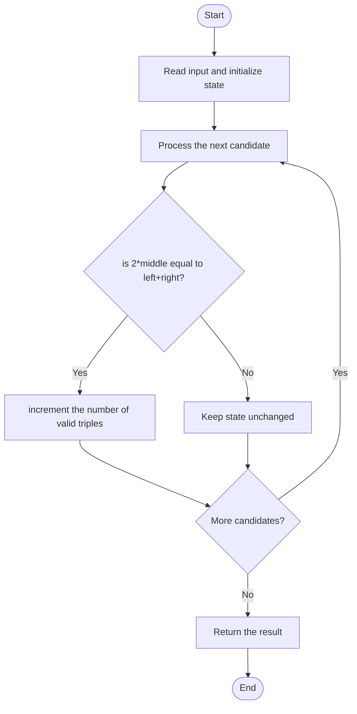

# 3392 — Count Subarrays of Length Three With a Condition

## 1. Problem understanding and constraints

Count length-three windows where the middle value equals the average of the two ends; equivalently, twice the middle equals the end sum. The exact integer comparison avoids floating-point averages. **थोडक्यात:** काय मोजायचे/निवडायचे ते आधी स्पष्ट करा; मगच code निवडा.

## 2. Stepwise example and edge cases

> **मराठी:** प्रश्नात काय दिले आहे आणि नेमके काय शोधायचे आहे, हे आधी स्पष्ट करा.
> `[1,2,1]`: 2×2=1+1, so this one window qualifies. **Edge cases:** check smallest valid input, ties/boundaries, and empty/no-match outcomes where constraints allow them.

## 3. Pattern identification — clue table

Fixed-size sliding window / local arithmetic predicate. हा मुख्य pattern आहे.
| Clue | What it suggests |
|---|---|
| Output depends on fixed-size sliding window / local arithmetic predicate. | Keep only the relevant state; avoid unrelated recomputation |
| Need to preserve the stated condition | State an invariant before coding |
| Input scan/order matters | Update once per item and test boundaries |

## 4. Multiple approaches

For each triple, a direct check is optimal; prefix sums or nested loops add no value. The source checks each index with two neighbors. **योग्य निवड:** source मध्ये असलेली method आणि तिच्या मर्यादा वेगळ्या ओळखा.

## 5. Flowchart

Flow समजताना decision condition आणि update invariant शी जुळतात का ते तपासा.

## 6. Selected algorithm and intuition

> **मराठी:** मुख्य observation समजल्यावर algorithm चे steps लक्षात ठेवणे सोपे होते.
> Only centers with both a left and right neighbor can form a length-three subarray.

## 7. Code-specific explanation

> **मराठी:** Code मधील variable आणि condition यांचा algorithm मधील उद्देश समजून घ्या.
> `LeetCode\3392\3392.cpp` — `countSubarrays` loops over middle indices and compares the scaled center to the endpoints; it does not allocate windows.

## 8. Dry run

> **मराठी:** प्रत्येक महत्त्वाच्या step नंतर variable ची value trace करा.
> | Step | State / action |
> |---:|---|
> | 1 | Triple `[1,2,1]`: center=2 |
> | 2 | `2*2 == 1+1` → increment answer to 1. |

## 9. Complexity

> **मराठी:** Input size आणि प्रत्येक operation कितीदा चालतो यावरून complexity ठरवा.
> `O(n)` time and `O(1)` extra space.

## 10. Correctness

> **मराठी:** Invariant किंवा तर्क वापरून algorithm योग्य उत्तर देतो हे समजून घ्या.
> Every length-three subarray has exactly one middle index, and the loop visits each such index once. The equality is algebraically equivalent to the required average condition, so each valid window contributes exactly one.

## 11. Mistakes and interview traps

> **मराठी:** Boundary, duplicate आणि off-by-one cases स्वतंत्रपणे तपासा.

- Iterate middle indices from 1 through n-2.
- Use equality after multiplying by 2, not integer division.
- The result counts windows, not distinct values.

## 12. Quick revision

**झटपट:** Only centers with both a left and right neighbor can form a length-three subarray. Pattern ओळखा, condition तपासा, आणि answer एकदाच योग्य पद्धतीने update करा.

## 13. Related patterns and variations

> **मराठी:** या clues मुळे योग्य pattern ओळखता येतो; constraints आणि relations नीट तपासा.
> Fixed-size windows; local predicates; arithmetic invariants.

## 14. Self-assessment

> **मराठी:** उत्तर न पाहता प्रश्न सोडवा आणि तुमच्या निवडीचे कारण सांगा.

1. Why use 2×middle?
2. Which index range contains valid centers?
3. Can two windows share elements?
