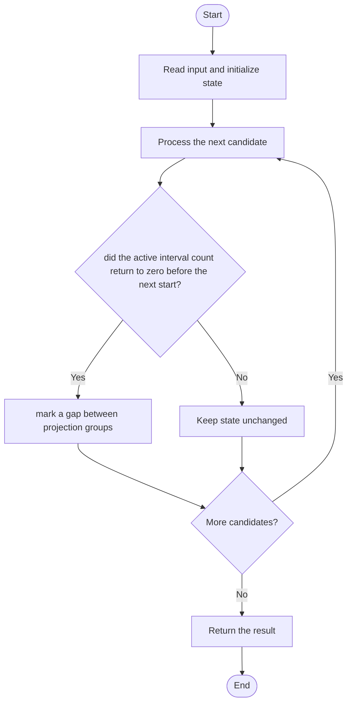

# 3394 — Check if Grid can be Cut into Sections

## 1. Problem understanding and constraints

Given non-overlapping rectangles in an n×n grid, determine whether two parallel cuts can divide the grid into three non-empty sections without cutting through any rectangle. A gap between rectangle projections is a legal cut. **थोडक्यात:** काय मोजायचे/निवडायचे ते आधी स्पष्ट करा; मगच code निवडा.

## 2. Stepwise example and edge cases

> **मराठी:** प्रश्नात काय दिले आहे आणि नेमके काय शोधायचे आहे, हे आधी स्पष्ट करा.
> Three rectangles in separate x-ranges `[0,1]`, `[2,3]`, `[4,5]` permit two vertical cuts, so true. **Edge cases:** check smallest valid input, ties/boundaries, and empty/no-match outcomes where constraints allow them.

## 3. Pattern identification — clue table

Sweep line over interval endpoints; count separated groups. हा मुख्य pattern आहे.
| Clue | What it suggests |
|---|---|
| Output depends on sweep line over interval endpoints | Keep only the relevant state; avoid unrelated recomputation |
| Need to preserve the stated condition | State an invariant before coding |
| Input scan/order matters | Update once per item and test boundaries |

## 4. Multiple approaches

Testing each possible coordinate pair is possible but wasteful. The source sorts start/end events for x and y and checks whether there are at least three separated groups. Merging overlapping projections is an equivalent simpler formulation. **योग्य निवड:** source मध्ये असलेली method आणि तिच्या मर्यादा वेगळ्या ओळखा.

## 5. Flowchart

Flow समजताना decision condition आणि update invariant शी जुळतात का ते तपासा.

## 6. Selected algorithm and intuition

> **मराठी:** मुख्य observation समजल्यावर algorithm चे steps लक्षात ठेवणे सोपे होते.
> Project rectangles onto one axis; a cut is possible between disjoint projection groups. Either x or y axis can provide the two cuts.

## 7. Code-specific explanation

> **मराठी:** Code मधील variable आणि condition यांचा algorithm मधील उद्देश समजून घ्या.
> `LeetCode\3394\3394.cpp` — `checkValidCuts` builds event lists for both axes, sorts them, then checks each. `intersection` scans ordered start/end events; local source also prints debug messages from the helper.

## 8. Dry run

> **मराठी:** प्रत्येक महत्त्वाच्या step नंतर variable ची value trace करा.
> | Step | State / action |
> |---:|---|
> | 1 | Projection intervals `[0,1],[2,3],[4,5]`: each interval closes before the next begins → 3 groups → two separating gaps. |

## 9. Complexity

> **मराठी:** Input size आणि प्रत्येक operation कितीदा चालतो यावरून complexity ठरवा.
> `O(R log R)` time and `O(R)` extra space for R rectangles.

## 10. Correctness

> **मराठी:** Invariant किंवा तर्क वापरून algorithm योग्य उत्तर देतो हे समजून घ्या.
> A legal cut exists exactly in a coordinate gap not covered by any rectangle projection. Sorting endpoints identifies every such gap; three groups provide two cuts and therefore three non-empty sections. Checking both axes covers vertical and horizontal solutions.

## 11. Mistakes and interview traps

> **मराठी:** Boundary, duplicate आणि off-by-one cases स्वतंत्रपणे तपासा.

- A cut cannot pass through a rectangle interior.
- Need two gaps, hence at least three groups.
- Process equal endpoints consistently for touching rectangles; event ordering matters.

## 12. Quick revision

**झटपट:** Project rectangles onto one axis; a cut is possible between disjoint projection groups. Either x or y axis can provide the two cuts. Pattern ओळखा, condition तपासा, आणि answer एकदाच योग्य पद्धतीने update करा.

## 13. Related patterns and variations

> **मराठी:** या clues मुळे योग्य pattern ओळखता येतो; constraints आणि relations नीट तपासा.
> Sweep line; interval merging; projection geometry.

## 14. Self-assessment

> **मराठी:** उत्तर न पाहता प्रश्न सोडवा आणि तुमच्या निवडीचे कारण सांगा.

1. Why do three groups imply two cuts?
2. Why test both axes?
3. How should touching intervals be treated?
