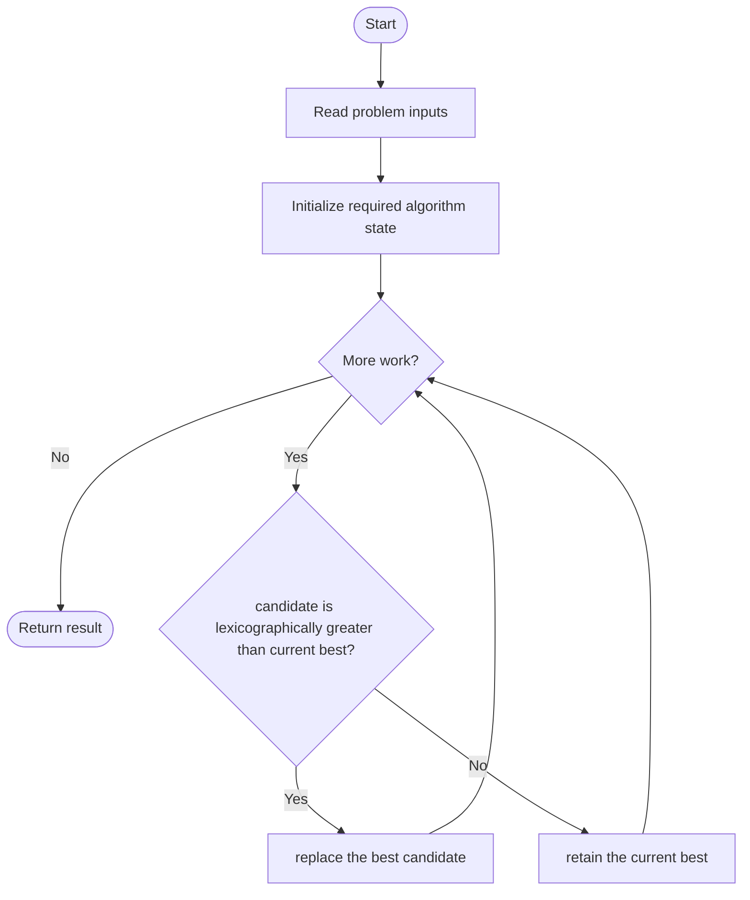
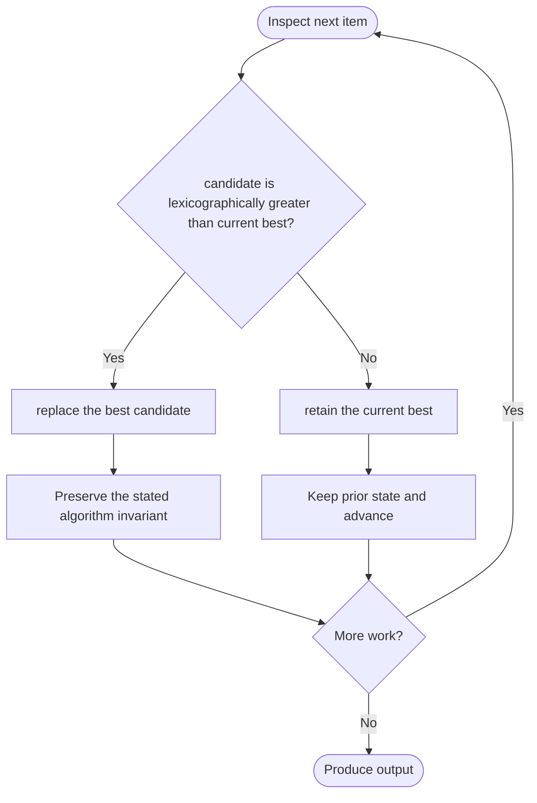

# Find the Lexicographically Largest String From the Box I

**LeetCode ID:** 3403
**Source file(s):** `3403.cpp` (originally `answerString.cpp`)
**Identification evidence:** The original filename, declared signature, and distinctive behavior described below uniquely identify this problem; no number was inferred from a filename alone.

## Expected input/output or judge interface

string answerString(string word, int numFriends). Inputs follow the problem constraints; the output is the documented scalar, sequence, or design-object behavior. The description below reflects the implementation actually present in the source.

## Main flow



## Important branch and loop flow



## Core logic and invariant

Sets the maximum piece length to n-(numFriends-1), considers each start position with that length capped by the remaining suffix, and returns the lexicographically greatest candidate.
The key branch/loop rule above is applied once per relevant item; the algorithm relies on that rule to preserve its state and produce the required result.

## Optimization / comparison

Considers only the longest allowed candidate per start, rather than enumerating every possible partition.

## Complexity

Worst-case O(n^2) time from substring construction/comparison; temporary strings may use O(n^2) total work.

## Compile and run

The repository file includes a standalone demonstration `main()`; it is not a raw LeetCode submission unit. From the repository root, with a C++17 compiler:

```powershell
g++ -std=c++17 LeetCode\3403\3403.cpp -o solution.exe
.\solution.exe
```

For LeetCode's class-method judge, copy the relevant class/method or design-class API and omit the demo `main()` and local harness. Adapt free-function implementations to the requested `Solution` class signature where necessary. See the source caveat above for any compile blocker.
