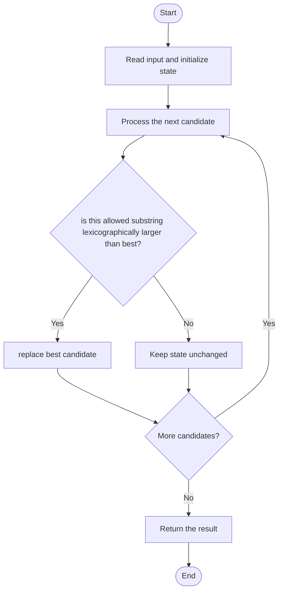

# 3403 — Find the Lexicographically Largest String From the Box I

## 1. Problem understanding and constraints

Split the word among `numFriends` people under the problem's length restriction; return the lexicographically largest possible piece. The maximum candidate length is `n-numFriends+1`. **थोडक्यात:** काय मोजायचे/निवडायचे ते आधी स्पष्ट करा; मगच code निवडा.

## 2. Stepwise example and edge cases

> **मराठी:** प्रश्नात काय दिले आहे आणि नेमके काय शोधायचे आहे, हे आधी स्पष्ट करा.
> `word="dbca", numFriends=2`: candidates can be length at most 3; compare valid substrings and choose the lexicographically largest. **Edge cases:** check smallest valid input, ties/boundaries, and empty/no-match outcomes where constraints allow them.

## 3. Pattern identification — clue table

Bounded-length substring comparison; lexicographic maximum. हा मुख्य pattern आहे.
| Clue | What it suggests |
|---|---|
| Output depends on bounded-length substring comparison | Keep only the relevant state; avoid unrelated recomputation |
| Need to preserve the stated condition | State an invariant before coding |
| Input scan/order matters | Update once per item and test boundaries |

## 4. Multiple approaches

Enumerating every valid substring and comparing is correct, though quadratic. A suffix-array/string-index approach is unnecessary for the source constraints; source scans candidate starts and compares allowed pieces. **योग्य निवड:** source मध्ये असलेली method आणि तिच्या मर्यादा वेगळ्या ओळखा.

## 5. Flowchart

Flow समजताना decision condition आणि update invariant शी जुळतात का ते तपासा.

## 6. Selected algorithm and intuition

> **मराठी:** मुख्य observation समजल्यावर algorithm चे steps लक्षात ठेवणे सोपे होते.
> At any start, only a bounded prefix can be given to one friend because the others need at least one character each.

## 7. Code-specific explanation

> **मराठी:** Code मधील variable आणि condition यांचा algorithm मधील उद्देश समजून घ्या.
> `LeetCode\3403\3403.cpp` — `answerString` handles the one-friend case by returning the whole word; otherwise it considers each start and a substring capped at `n-numFriends+1`.

## 8. Dry run

> **मराठी:** प्रत्येक महत्त्वाच्या step नंतर variable ची value trace करा.
> | Step | State / action |
> |---:|---|
> | 1 | For `word="dbca", friends=2`, maximum piece length=3 |
> | 2 | start 0 gives `dbc`, start 1 gives `bca` |
> | 3 | `dbc` wins. |

## 9. Complexity

> **मराठी:** Input size आणि प्रत्येक operation कितीदा चालतो यावरून complexity ठरवा.
> Source candidate comparisons can take `O(nL)` time where L=`n-numFriends+1` (worst `O(n²)`); `O(L)` auxiliary space for substrings.

## 10. Correctness

> **मराठी:** Invariant किंवा तर्क वापरून algorithm योग्य उत्तर देतो हे समजून घ्या.
> Each possible piece begins at some index and cannot exceed the length bound; the scan examines all such starts and selects the greatest allowed candidate. The single-friend case has the whole word as the only piece.

## 11. Mistakes and interview traps

> **मराठी:** Boundary, duplicate आणि off-by-one cases स्वतंत्रपणे तपासा.

- Cap piece length based on the other friends.
- Lexicographic order is not the same as length order.
- Handle `numFriends==1` separately.

## 12. Quick revision

**झटपट:** At any start, only a bounded prefix can be given to one friend because the others need at least one character each. Pattern ओळखा, condition तपासा, आणि answer एकदाच योग्य पद्धतीने update करा.

## 13. Related patterns and variations

> **मराठी:** या clues मुळे योग्य pattern ओळखता येतो; constraints आणि relations नीट तपासा.
> String comparison; substring enumeration; suffix arrays.

## 14. Self-assessment

> **मराठी:** उत्तर न पाहता प्रश्न सोडवा आणि तुमच्या निवडीचे कारण सांगा.

1. Why is maximum length n-friends+1?
2. Can a shorter string beat a longer one lexicographically?
3. Why special-case one friend?
