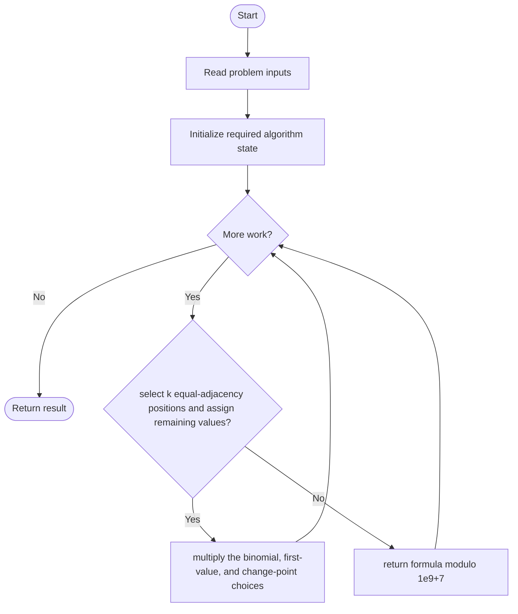
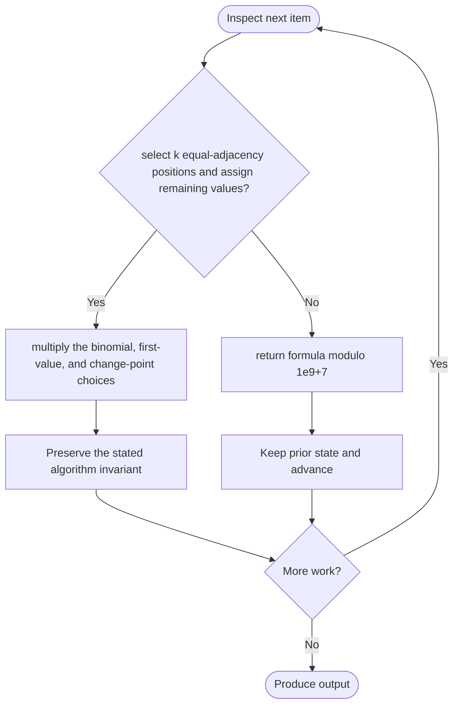

# Count the Number of Arrays with K Matching Adjacent Elements

**LeetCode ID:** 3405

**Source file(s):** `3405.cpp` (originally `countGoodArrays.cpp`)

**Identification evidence:** The original filename, declared signature, and distinctive behavior described below uniquely identify this problem; no number was inferred from a filename alone.

## Expected input/output or judge interface

countGoodArrays(int n,int m,int k) in Solution1/2/3. Inputs follow the problem constraints; the output is the documented scalar, sequence, or design-object behavior. The description below reflects the implementation actually present in the source.

## Main flow



## Important branch and loop flow



## Core logic and invariant

Uses C(n-1,k)*m*(m-1)^(n-k-1) modulo 1e9+7; compares per-call factorial work with precomputed factorial and inverse-factorial tables.

The key branch/loop rule above is applied once per relevant item; the algorithm relies on that rule to preserve its state and produce the required result.

## Optimization / comparison

Precomputed factorial tables avoid repeated modular exponentiation; fixed table bound is MX=100000.

## Complexity

Optimized versions: O(MX) one-time precompute, O(log n) exponentiation per call, O(MX) storage. Solution1 recomputes modular powers per factorial.

## Compile and run

The repository file includes a standalone demonstration `main()`; it is not a raw LeetCode submission unit. From the repository root, with a C++17 compiler:

```powershell
g++ -std=c++17 LeetCode\3405\3405.cpp -o solution.exe
.\solution.exe
```

For LeetCode's class-method judge, copy the relevant class/method or design-class API and omit the demo `main()` and local harness. Adapt free-function implementations to the requested `Solution` class signature where necessary. See the source caveat above for any compile blocker.
