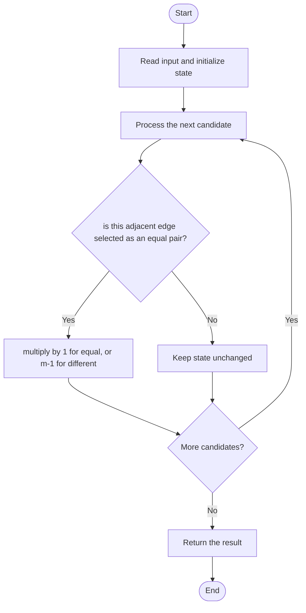

# 3405 — Count the Number of Arrays with K Matching Adjacent Elements

## 1. Problem understanding and constraints

Count length-n arrays over m values with exactly k equal adjacent pairs, modulo 1,000,000,007. There are n-1 adjacent pairs. **थोडक्यात:** काय मोजायचे/निवडायचे ते आधी स्पष्ट करा; मगच code निवडा.

## 2. Stepwise example and edge cases

> **मराठी:** प्रश्नात काय दिले आहे आणि नेमके काय शोधायचे आहे, हे आधी स्पष्ट करा.
> `n=3,m=2,k=1`: choose the first value (2), choose which of two edges matches (2), and the other edge differs in 1 way → 4. **Edge cases:** check smallest valid input, ties/boundaries, and empty/no-match outcomes where constraints allow them.

## 3. Pattern identification — clue table

Combinatorics: choose equal edges, then multiply independent choices. हा मुख्य pattern आहे.
| Clue | What it suggests |
|---|---|
| Output depends on combinatorics: choose equal edges, then multiply independent choices. | Keep only the relevant state; avoid unrelated recomputation |
| Need to preserve the stated condition | State an invariant before coding |
| Input scan/order matters | Update once per item and test boundaries |

## 4. Multiple approaches

Enumerating all mⁿ arrays is infeasible. Source contains direct factorial/inverse-factorial combinatorics and optimized precomputation variants; use combinations with modular exponentiation. **योग्य निवड:** source मध्ये असलेली method आणि तिच्या मर्यादा वेगळ्या ओळखा.

## 5. Flowchart

Flow समजताना decision condition आणि update invariant शी जुळतात का ते तपासा.

## 6. Selected algorithm and intuition

> **मराठी:** मुख्य observation समजल्यावर algorithm चे steps लक्षात ठेवणे सोपे होते.
> Choose k of n-1 edges that stay equal. Each remaining edge must change to one of m-1 values.

## 7. Code-specific explanation

> **मराठी:** Code मधील variable आणि condition यांचा algorithm मधील उद्देश समजून घ्या.
> `LeetCode\3405\3405.cpp` — The source exposes three solution classes/variants for `countGoodArrays`; optimized versions precompute factorials and inverse factorials. Formula: `m*C(n-1,k)*(m-1)^(n-k-1)`.

## 8. Dry run

> **मराठी:** प्रत्येक महत्त्वाच्या step नंतर variable ची value trace करा.
> | Step | State / action |
> |---:|---|
> | 1 | n=3,m=2,k=1: `2*C(2,1)*1^(1)=4`. |

## 9. Complexity

> **मराठी:** Input size आणि प्रत्येक operation कितीदा चालतो यावरून complexity ठरवा.
> Recomputing factorials can be `O(n)` per call; precomputed factorial/inverse factorial gives `O(1)` combinatorial query after `O(MX)` initialization. Power is `O(log n)`; memory `O(MX)`.

## 10. Correctness

> **मराठी:** Invariant किंवा तर्क वापरून algorithm योग्य उत्तर देतो हे समजून घ्या.
> Every array is uniquely determined by its first value and each transition. Choose exactly k transition positions that keep the prior value; each other position has exactly m-1 choices. This counts every valid array once.

## 11. Mistakes and interview traps

> **मराठी:** Boundary, duplicate आणि off-by-one cases स्वतंत्रपणे तपासा.

- There are n-1 edges, not n.
- Use exactly k equal adjacent pairs.
- Modular division requires a modular inverse; respect the source's fixed `MX` bound.

## 12. Quick revision

**झटपट:** Choose k of n-1 edges that stay equal. Each remaining edge must change to one of m-1 values. Pattern ओळखा, condition तपासा, आणि answer एकदाच योग्य पद्धतीने update करा.

## 13. Related patterns and variations

> **मराठी:** या clues मुळे योग्य pattern ओळखता येतो; constraints आणि relations नीट तपासा.
> Stars and bars; modular combinations; transition counting.

## 14. Self-assessment

> **मराठी:** उत्तर न पाहता प्रश्न सोडवा आणि तुमच्या निवडीचे कारण सांगा.

1. Why are there n-1 adjacent positions?
2. Why does a changed position have m-1 choices?
3. What is the role of inverse factorials?
