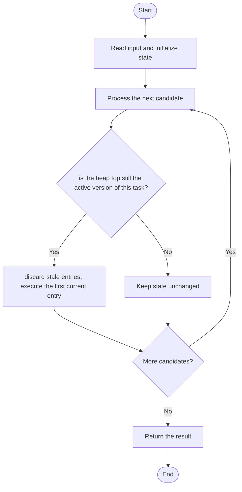

# 3408 — Design Task Manager

## 1. Problem understanding and constraints

Support adding tasks, changing priority, removing tasks, and executing the task with highest priority; ties choose the greatest taskId. Each task belongs to a user. **थोडक्यात:** काय मोजायचे/निवडायचे ते आधी स्पष्ट करा; मगच code निवडा.

## 2. Stepwise example and edge cases

> **मराठी:** प्रश्नात काय दिले आहे आणि नेमके काय शोधायचे आहे, हे आधी स्पष्ट करा.
> Add `(user=7,task=10,priority=4)` and `(8,12,4)`; executing top returns user 8 and removes task 12 because equal priority breaks by larger id. **Edge cases:** check smallest valid input, ties/boundaries, and empty/no-match outcomes where constraints allow them.

## 3. Pattern identification — clue table

Design data structure: ordered priority plus task lookup; lazy deletion for updates. हा मुख्य pattern आहे.
| Clue | What it suggests |
|---|---|
| Output depends on design data structure: ordered priority plus task lookup | Keep only the relevant state; avoid unrelated recomputation |
| Need to preserve the stated condition | State an invariant before coding |
| Input scan/order matters | Update once per item and test boundaries |

## 4. Multiple approaches

A vector scan is correct and simple but makes top/execution `O(n)`. The source also has a priority-queue/map implementation; heap updates use lazy stale entries and are more scalable. **योग्य निवड:** source मध्ये असलेली method आणि तिच्या मर्यादा वेगळ्या ओळखा.

## 5. Flowchart

Flow समजताना decision condition आणि update invariant शी जुळतात का ते तपासा.

## 6. Selected algorithm and intuition

> **मराठी:** मुख्य observation समजल्यावर algorithm चे steps लक्षात ठेवणे सोपे होते.
> Store task metadata by taskId for edit/remove, and order active tasks by `(priority,taskId)` descending.

## 7. Code-specific explanation

> **मराठी:** Code मधील variable आणि condition यांचा algorithm मधील उद्देश समजून घ्या.
> `LeetCode\3408\3408.cpp` — Source includes vector-backed and priority-queue-backed managers. The heap version pushes revised priorities and discards stale entries when queried; tie-break must favor larger taskId.

## 8. Dry run

> **मराठी:** प्रत्येक महत्त्वाच्या step नंतर variable ची value trace करा.
> | Step | State / action |
> |---:|---|
> | 1 | Heap entries `(4,10),(4,12)`: highest pair is `(4,12)` → execute user 8/task 12 |
> | 2 | remove it from active lookup. |

## 9. Complexity

> **मराठी:** Input size आणि प्रत्येक operation कितीदा चालतो यावरून complexity ठरवा.
> Vector variant operations can be `O(n)`. Heap variant add/edit `O(log n)`, remove `O(1)` logically plus lazy cleanup, execution amortized `O(log n)`; storage can include stale entries.

## 10. Correctness

> **मराठी:** Invariant किंवा तर्क वापरून algorithm योग्य उत्तर देतो हे समजून घ्या.
> The active map is authoritative for current task state. Heap ordering prioritizes greater priority then greater taskId; removing stale versions until the top matches active state returns exactly the required task.

## 11. Mistakes and interview traps

> **मराठी:** Boundary, duplicate आणि off-by-one cases स्वतंत्रपणे तपासा.

- Tie-break uses larger taskId.
- Editing must invalidate old heap entries logically.
- Executing removes the task, not just its heap node.

## 12. Quick revision

**झटपट:** Store task metadata by taskId for edit/remove, and order active tasks by `(priority,taskId)` descending. Pattern ओळखा, condition तपासा, आणि answer एकदाच योग्य पद्धतीने update करा.

## 13. Related patterns and variations

> **मराठी:** या clues मुळे योग्य pattern ओळखता येतो; constraints आणि relations नीट तपासा.
> Priority queues; lazy deletion; indexed heaps; ordered maps.

## 14. Self-assessment

> **मराठी:** उत्तर न पाहता प्रश्न सोडवा आणि तुमच्या निवडीचे कारण सांगा.

1. What is the tie-break rule?
2. Why are stale heap entries safe?
3. Which structure maps taskId to current state?
