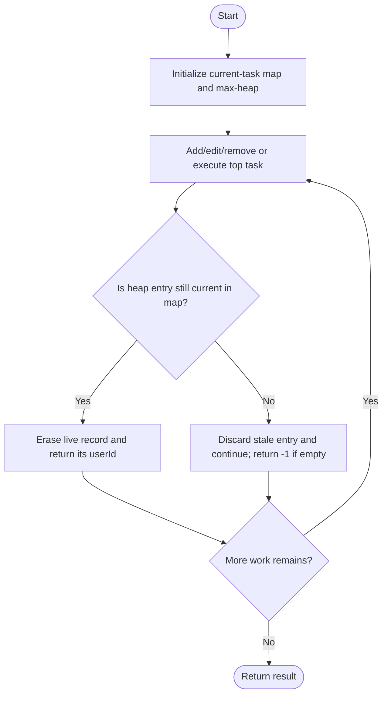
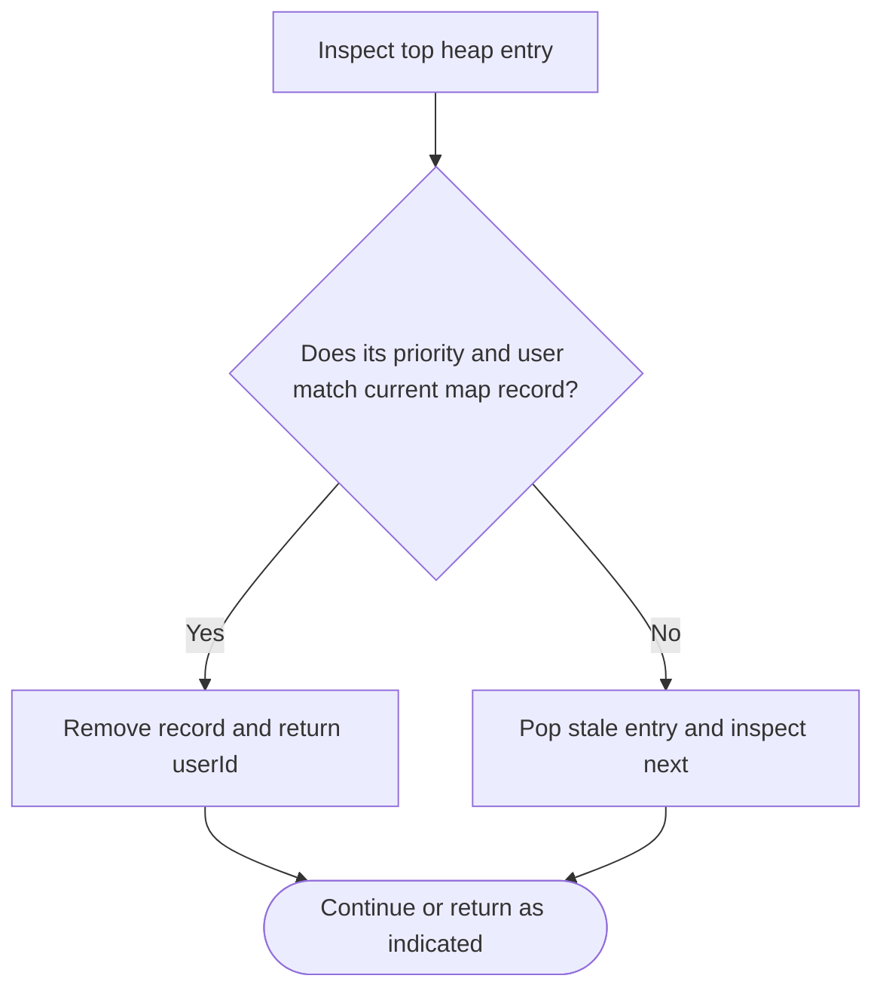

# Design Task Manager — LeetCode 3408

## Problem and judge interface

Constructor from (userId,taskId,priority) triples; add, edit, rmv and execTop. Judge execTop returns and removes the user ID of the highest-priority task.

## Identification evidence

The class and operation names plus user/task/priority triples uniquely identify problem 3408.

## Main flow



## Important branch / loop



## Core logic and invariants

Two variants exist. Vector version scans tasks. TaskManagerPQ uses a max-heap and map, pushing replacements on edit and lazily discarding stale heap entries. Important source deviations: vector execTop returns taskId and does not remove; vector rmv erases only one element after remove_if. PQ variant returns/removes userId as required, assuming valid operations.

## Complexity

Vector operations O(T). PQ add/edit O(log H), remove expected O(1), execTop amortized O(log H) over heap entries; O(H) space including stale entries.

## Comparison and optimization

Heap/map improves top selection via lazy invalidation. The vector class name conflicts with the expected class, and its behavior is not judge-correct; source preserved without modification.

## Compile and run

The `.cpp` is the original standalone source, including its local `main()` demonstration where present. Compile and run from the repository root with a C++17 compiler:

```text
g++ -std=c++17 LeetCode\3408\3408.cpp -o solution.exe
.\solution.exe
```

For LeetCode, adapt the implementation to the required class/method signature and omit the local `main()` and demonstration helpers; use the judge-provided node types. Notes above identify method-name or behavior differences. The moved source bytes have not been edited.
