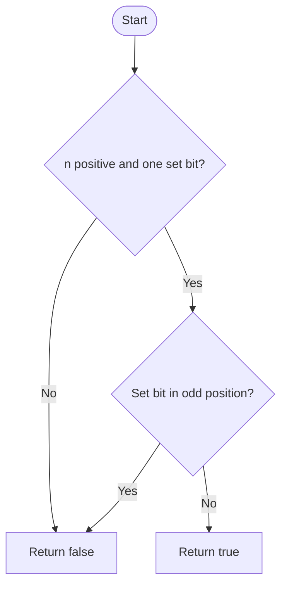

# Power of Four — LeetCode 342

## 1. Understanding

दिलेला integer `4^k` (k≥0) आहे का ते ठरवा. Positive powers: `1,4,16,64,...`.

## 2. Worked examples and edges

- `1`, `16`, `256` → true.
- `8` power of two आहे पण power of four नाही; `5`, `0`, `-4` → false.
- `1024=2^10` → false कारण exponent odd.

## 3. Pattern identification + cheat sheet

| Clue                      | Pattern          | कारण                             |
| ------------------------- | ---------------- | -------------------------------- |
| Power of four             | Bit manipulation | One set bit at even bit position |
| Repeated multiply by base | Recursion        | Compare sequence 1,4,16...       |
| Power-of-two prerequisite | Bit test         | Exactly one set bit              |

## 4. Approaches

- Source `isPowerOfFourBitwise`: power-of-two check plus even-position mask — O(1), O(1).
- Source recursive multiply by 4 — O(log₄ n) time, O(log₄ n) stack.
- Repeated divide by 4 — O(log n), O(1), simple alternative.
- Power-of-two test alone चुकीचा; `8` पास होईल.

## 5. Flowchart

एकच set bit असणे पुरेसे नाही; bit positions 0,2,4,... पैकी असावा.

## 6. Algorithm / intuition

`n&(n-1)==0` single set bit तपासतो. `0xAAAAAAAA` मध्ये odd-index bit positionsचे mask आहे; त्यांच्याशी AND शून्य असेल तर set bit even positionवर आहे, म्हणजे 4 ची power.

## 7. Code explanation

`isPowerOfFourBitwise` positive check, power-of-two check आणि mask check combine करतो. `isPowerOfFourRecursive` helper `k=1` पासून multiply-by-4 करतो, equality किंवा overshootवर थांबतो.

## 8. Dry run

> **मराठी:** प्रत्येक महत्त्वाच्या step नंतर variable ची value trace करा.
> `n=16 (10000₂)`:
> | Check | Value | Result |
> |---|---|---|
> | positive | yes | continue |
> | `n&(n-1)` | `10000 & 01111 = 0` | one bit |
> | `n&0xAAAAAAAA` | 0 | bit even-positioned |
> | final | | true |
> `n=8 (1000₂)` mask hits bit 3 → false.

## 9. Complexity

> **मराठी:** Input size आणि प्रत्येक operation कितीदा चालतो यावरून complexity ठरवा.
> Bitwise method O(1) time/O(1) space. Recursive method O(log₄ n) time and recursion stack.

## 10. Correctness

> **मराठी:** Invariant किंवा तर्क वापरून algorithm योग्य उत्तर देतो हे समजून घ्या.
> First bit condition ensures exactly one set bit, so n is a power of two. The mask rejects that sole bit if it occupies an odd position; powers of four have their sole bit at even positions (`4^k=2^(2k)`). Thus both conditions together are necessary and sufficient.

## 11. Mistakes and interview traps

- Positive guard आवश्यक: zero bit test पास करू शकतो.
- `8` power of two आहे, पण fourची नाही.
- Mask positionsची indexing bit 0 पासून करा.
- Recursive helper negative/zero valuesला `k=1` ओलांडल्यावर false देतो.

## 12. Quick revision

> **मराठी:** दोन मिनिटांच्या revision साठी pattern, मुख्य कल्पना आणि complexity आठवा.
> `n>0 && (n&(n-1))==0 && (n&0xAAAAAAAA)==0`.

## 13. Related problems / variations

> **मराठी:** प्रश्नात काय दिले आहे आणि नेमके काय शोधायचे आहे, हे आधी स्पष्ट करा.
> Power of Two, Power of Three, count set bits, check one set bit at a selected parity.

## 14. Self-assessment

1. `8` दुसरी condition का fail करतो?
2. `0xAAAAAAAA` कोणते positions mark करतो?
3. Power-of-two check काय निश्चित करतो?
4. `n=1` power of four का?
