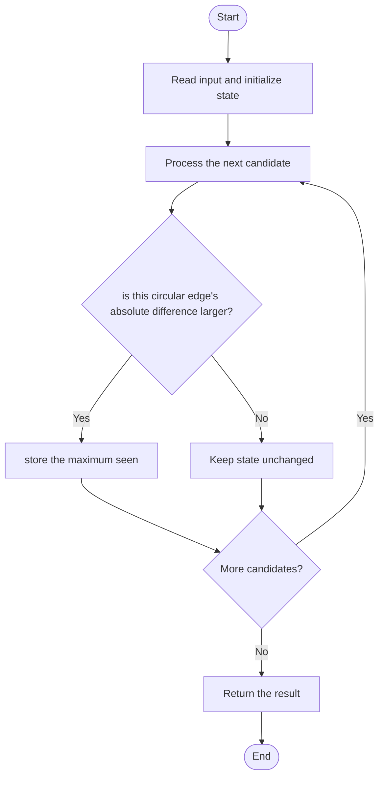

# 3423 — Maximum Difference Between Adjacent Elements in a Circular Array

## 1. Problem understanding and constraints

Return the largest absolute difference between every pair of circular neighbors, including last-to-first. For one element, the circular self-difference is zero. **थोडक्यात:** काय मोजायचे/निवडायचे ते आधी स्पष्ट करा; मगच code निवडा.

## 2. Stepwise example and edge cases

> **मराठी:** प्रश्नात काय दिले आहे आणि नेमके काय शोधायचे आहे, हे आधी स्पष्ट करा.
> `nums=[1,2,4]`: adjacent differences 1,2, and wraparound |4-1|=3; answer 3. **Edge cases:** check smallest valid input, ties/boundaries, and empty/no-match outcomes where constraints allow them.

## 3. Pattern identification — clue table

Linear scan with one wraparound comparison. हा मुख्य pattern आहे.
| Clue | What it suggests |
|---|---|
| Output depends on linear scan with one wraparound comparison. | Keep only the relevant state; avoid unrelated recomputation |
| Need to preserve the stated condition | State an invariant before coding |
| Input scan/order matters | Update once per item and test boundaries |

## 4. Multiple approaches

Build a duplicated array and scan, or compare the wraparound explicitly. The source optimized method performs one pass and checks the last-first pair. **योग्य निवड:** source मध्ये असलेली method आणि तिच्या मर्यादा वेगळ्या ओळखा.

## 5. Flowchart

Flow समजताना decision condition आणि update invariant शी जुळतात का ते तपासा.

## 6. Selected algorithm and intuition

> **मराठी:** मुख्य observation समजल्यावर algorithm चे steps लक्षात ठेवणे सोपे होते.
> There are n circular edges: n-1 consecutive pairs plus one edge closing the circle.

## 7. Code-specific explanation

> **मराठी:** Code मधील variable आणि condition यांचा algorithm मधील उद्देश समजून घ्या.
> `LeetCode\3423\3423.cpp` — `maxAdjacentDistanceOptimized` scans neighbors and then handles `nums[n-1]` with `nums[0]`; the original method demonstrates the same result less directly.

## 8. Dry run

> **मराठी:** प्रत्येक महत्त्वाच्या step नंतर variable ची value trace करा.
> | Step | State / action |
> |---:|---|
> | 1 | `[1,2,4]`: |1-2|=1, |2-4|=2, |4-1|=3 → max 3. |

## 9. Complexity

> **मराठी:** Input size आणि प्रत्येक operation कितीदा चालतो यावरून complexity ठरवा.
> `O(n)` time and `O(1)` extra space.

## 10. Correctness

> **मराठी:** Invariant किंवा तर्क वापरून algorithm योग्य उत्तर देतो हे समजून घ्या.
> The scan evaluates each of the n circular edges exactly once, including the closing edge. Taking the maximum absolute difference therefore returns the definition's result.

## 11. Mistakes and interview traps

> **मराठी:** Boundary, duplicate आणि off-by-one cases स्वतंत्रपणे तपासा.

- Do not omit the last-to-first edge.
- Use absolute value.
- Handle n=1 if outside constraints.

## 12. Quick revision

**झटपट:** There are n circular edges: n-1 consecutive pairs plus one edge closing the circle. Pattern ओळखा, condition तपासा, आणि answer एकदाच योग्य पद्धतीने update करा.

## 13. Related patterns and variations

> **मराठी:** या clues मुळे योग्य pattern ओळखता येतो; constraints आणि relations नीट तपासा.
> Circular arrays; rolling neighbors; cyclic scans.

## 14. Self-assessment

> **मराठी:** उत्तर न पाहता प्रश्न सोडवा आणि तुमच्या निवडीचे कारण सांगा.

1. How many edges does a circular array have?
2. Which edge is easily missed?
3. What is the answer for one element?
