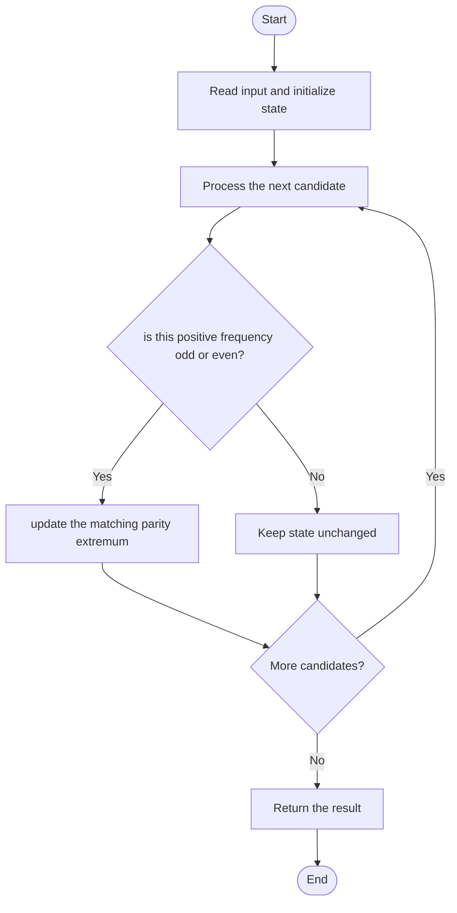

# 3442 — Maximum Difference Between Even and Odd Frequency I

## 1. Problem understanding and constraints

Among lowercase letters, choose one character with odd frequency and one with even frequency; maximize odd minus even. The problem guarantees both categories exist. **थोडक्यात:** काय मोजायचे/निवडायचे ते आधी स्पष्ट करा; मगच code निवडा.

## 2. Stepwise example and edge cases

> **मराठी:** प्रश्नात काय दिले आहे आणि नेमके काय शोधायचे आहे, हे आधी स्पष्ट करा.
> If `a` occurs 5 times and `b` occurs 2 times, their difference is 3. **Edge cases:** check smallest valid input, ties/boundaries, and empty/no-match outcomes where constraints allow them.

## 3. Pattern identification — clue table

Frequency table plus extrema by parity. हा मुख्य pattern आहे.
| Clue | What it suggests |
|---|---|
| Output depends on frequency table plus extrema by parity. | Keep only the relevant state; avoid unrelated recomputation |
| Need to preserve the stated condition | State an invariant before coding |
| Input scan/order matters | Update once per item and test boundaries |

## 4. Multiple approaches

Sorting all characters is correct but unnecessary. Source has map/sort and fixed 26-counter methods; fixed counters give a compact linear scan. **योग्य निवड:** source मध्ये असलेली method आणि तिच्या मर्यादा वेगळ्या ओळखा.

## 5. Flowchart

Flow समजताना decision condition आणि update invariant शी जुळतात का ते तपासा.

## 6. Selected algorithm and intuition

> **मराठी:** मुख्य observation समजल्यावर algorithm चे steps लक्षात ठेवणे सोपे होते.
> The best pair is the largest odd frequency minus the smallest positive even frequency.

## 7. Code-specific explanation

> **मराठी:** Code मधील variable आणि condition यांचा algorithm मधील उद्देश समजून घ्या.
> `LeetCode\3442\3442.cpp` — `maxDifference_vector` counts lowercase letters, tracks largest odd and smallest even positive counts, then subtracts. The map version sorts/counts more generally.

## 8. Dry run

> **मराठी:** प्रत्येक महत्त्वाच्या step नंतर variable ची value trace करा.
> | Step | State / action |
> |---:|---|
> | 1 | Counts `a:5,b:2,c:1,d:4`: max odd=5, min even=2 → 3. |

## 9. Complexity

> **मराठी:** Input size आणि प्रत्येक operation कितीदा चालतो यावरून complexity ठरवा.
> `O(n+σ)` time and `O(σ)` space for alphabet size σ=26.

## 10. Correctness

> **मराठी:** Invariant किंवा तर्क वापरून algorithm योग्य उत्तर देतो हे समजून घ्या.
> Any valid selection consists of one odd and one even positive frequency. Maximizing their difference independently requires the maximum odd and minimum even; scanning all counts finds both.

## 11. Mistakes and interview traps

> **मराठी:** Boundary, duplicate आणि off-by-one cases स्वतंत्रपणे तपासा.

- Even frequency must be positive; zero is not a chosen character.
- Maximize odd minus even, not absolute difference.
- The lowercase alphabet assumption enables 26 slots.

## 12. Quick revision

**झटपट:** The best pair is the largest odd frequency minus the smallest positive even frequency. Pattern ओळखा, condition तपासा, आणि answer एकदाच योग्य पद्धतीने update करा.

## 13. Related patterns and variations

> **मराठी:** या clues मुळे योग्य pattern ओळखता येतो; constraints आणि relations नीट तपासा.
> Frequency arrays; parity buckets; extrema tracking.

## 14. Self-assessment

> **मराठी:** उत्तर न पाहता प्रश्न सोडवा आणि तुमच्या निवडीचे कारण सांगा.

1. Which odd frequency should be selected?
2. Can zero count as an even-frequency character?
3. Why is absolute difference wrong?
