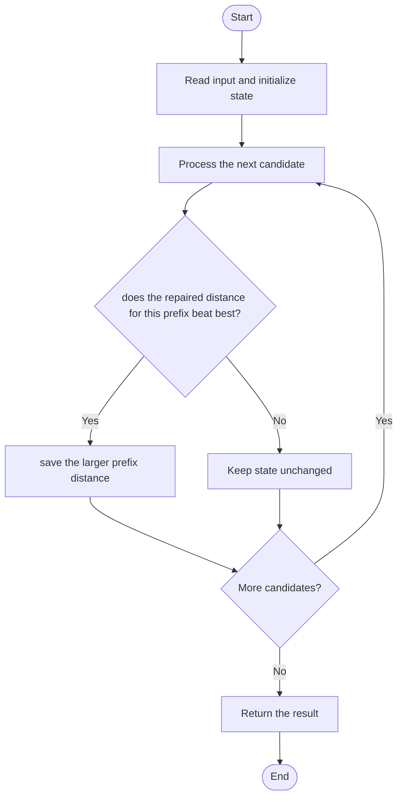

# 3443 — Maximum Manhattan Distance After K Changes

## 1. Problem understanding and constraints

A string of N/S/E/W moves traces a path. You may change at most k moves to maximize the greatest Manhattan distance reached at any prefix. **थोडक्यात:** काय मोजायचे/निवडायचे ते आधी स्पष्ट करा; मगच code निवडा.

## 2. Stepwise example and edge cases

> **मराठी:** प्रश्नात काय दिले आहे आणि नेमके काय शोधायचे आहे, हे आधी स्पष्ट करा.
> For `str="EW"`, k=0, prefix distances are 1 then 0; the answer is 1, not the final displacement 0. **Edge cases:** check smallest valid input, ties/boundaries, and empty/no-match outcomes where constraints allow them.

## 3. Pattern identification — clue table

Prefix scan; maximize base displacement plus bounded repair gain. हा मुख्य pattern आहे.
| Clue | What it suggests |
|---|---|
| Output depends on prefix scan | Keep only the relevant state; avoid unrelated recomputation |
| Need to preserve the stated condition | State an invariant before coding |
| Input scan/order matters | Update once per item and test boundaries |

## 4. Multiple approaches

Trying all choices of changed directions is exponential. `maxDistanceDetailed` correctly checks every prefix in one pass. The source's `maxDistanceOptimized` computes only the final displacement and is incorrect when an earlier prefix is farther (for example `"EW"`, k=0). **योग्य निवड:** source मध्ये असलेली method आणि तिच्या मर्यादा वेगळ्या ओळखा.

## 5. Flowchart

Flow समजताना decision condition आणि update invariant शी जुळतात का ते तपासा.

## 6. Selected algorithm and intuition

> **मराठी:** मुख्य observation समजल्यावर algorithm चे steps लक्षात ठेवणे सोपे होते.
> For each prefix, raw distance is `|N-S|+|E-W|`. A change can improve distance by at most 2, capped by wasted steps and `2*k`; retain the maximum over prefixes.

## 7. Code-specific explanation

> **मराठी:** Code मधील variable आणि condition यांचा algorithm मधील उद्देश समजून घ्या.
> `LeetCode\3443\3443.cpp` — `maxDistanceDetailed` updates directional counts per character and keeps the best repaired prefix distance. `maxDistanceOptimized` counts the whole string once and returns only its repaired final distance, so it is not equivalent to the required maximum-over-prefixes result.

## 8. Dry run

> **मराठी:** प्रत्येक महत्त्वाच्या step नंतर variable ची value trace करा.
> | Step | State / action |
> |---:|---|
> | 1 | For `"EW"`, k=0: after E distance=1 |
> | 2 | after W distance=0 |
> | 3 | best prefix remains 1. |

## 9. Complexity

> **मराठी:** Input size आणि प्रत्येक operation कितीदा चालतो यावरून complexity ठरवा.
> Correct detailed method: `O(n)` time and `O(1)` extra space. The incorrect whole-string variant is also `O(n)`/`O(1)` but does not solve the stated maximum-prefix task.

## 10. Correctness

> **मराठी:** Invariant किंवा तर्क वापरून algorithm योग्य उत्तर देतो हे समजून घ्या.
> For each prefix, its base Manhattan distance is the directional imbalance. Replacing a wasted step can improve that distance by at most two, up to `min(2*k,wasted)`. The detailed method computes this bound for every prefix and retains the maximum, so it considers the best attainable point along the path.

## 11. Mistakes and interview traps

> **मराठी:** Boundary, duplicate आणि off-by-one cases स्वतंत्रपणे तपासा.

- Track every prefix, not only the final displacement.
- A direction change improves Manhattan distance by at most 2.
- `maxDistanceOptimized` in this source is incorrect for the full problem; use `maxDistanceDetailed`.

## 12. Quick revision

**झटपट:** For each prefix, raw distance is `|N-S|+|E-W|`. A change can improve distance by at most 2, capped by wasted steps and `2*k`; retain the maximum over prefixes. Pattern ओळखा, condition तपासा, आणि answer एकदाच योग्य पद्धतीने update करा.

## 13. Related patterns and variations

> **मराठी:** या clues मुळे योग्य pattern ओळखता येतो; constraints आणि relations नीट तपासा.
> Manhattan geometry; greedy prefix optimization; bounded modifications.

## 14. Self-assessment

> **मराठी:** उत्तर न पाहता प्रश्न सोडवा आणि तुमच्या निवडीचे कारण सांगा.

1. Why can one change improve distance by at most two?
2. Why inspect every prefix?
3. What caps the number of useful changes?
