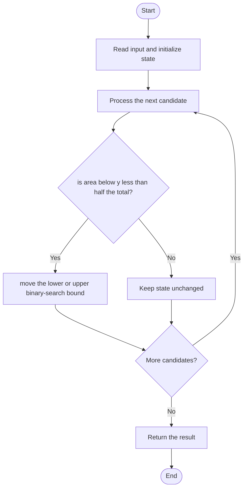

# 3453 — Separate Squares I

## 1. Problem understanding and constraints

Find a horizontal y-coordinate that splits the total area of axis-aligned squares equally above and below. Overlapping square areas are counted independently. Return a floating-point coordinate. **थोडक्यात:** काय मोजायचे/निवडायचे ते आधी स्पष्ट करा; मगच code निवडा.

## 2. Stepwise example and edge cases

> **मराठी:** प्रश्नात काय दिले आहे आणि नेमके काय शोधायचे आहे, हे आधी स्पष्ट करा.
> Two disjoint unit squares spanning y=0..1 and y=2..3 have equal area at y=1.5. **Edge cases:** check smallest valid input, ties/boundaries, and empty/no-match outcomes where constraints allow them.

## 3. Pattern identification — clue table

Monotone predicate + binary search on answer. हा मुख्य pattern आहे.
| Clue | What it suggests |
|---|---|
| Output depends on monotone predicate + binary search on answer. | Keep only the relevant state; avoid unrelated recomputation |
| Need to preserve the stated condition | State an invariant before coding |
| Input scan/order matters | Update once per item and test boundaries |

## 4. Multiple approaches

Exact event-sweep integration is possible; binary search is simpler and correct because area below y is monotone. Source includes basic and preprocessed binary-search versions. **योग्य निवड:** source मध्ये असलेली method आणि तिच्या मर्यादा वेगळ्या ओळखा.

## 5. Flowchart

Flow समजताना decision condition आणि update invariant शी जुळतात का ते तपासा.

## 6. Selected algorithm and intuition

> **मराठी:** मुख्य observation समजल्यावर algorithm चे steps लक्षात ठेवणे सोपे होते.
> For a candidate y, compute each square's area below the line, clamped to 0 or full area; compare total with half the total.

## 7. Code-specific explanation

> **मराठी:** Code मधील variable आणि condition यांचा algorithm मधील उद्देश समजून घ्या.
> `LeetCode\3453\3453.cpp` — `separateSquares_Basic` computes contributions on each binary-search iteration. `_Optimized` preprocesses square data to avoid repeated setup; both use a fixed number of iterations for precision.

## 8. Dry run

> **मराठी:** प्रत्येक महत्त्वाच्या step नंतर variable ची value trace करा.
> | Step | State / action |
> |---:|---|
> | 1 | For equal unit squares at y=0..1 and 2..3: at y=1.5, below-area=1 |
> | 2 | total=2, half=1 → balanced. |

## 9. Complexity

> **मराठी:** Input size आणि प्रत्येक operation कितीदा चालतो यावरून complexity ठरवा.
> For N squares and I iterations: `O(NI)` time; I is a fixed precision bound (about 60), so `O(N)` practical. Basic `O(1)` extra; optimized preprocessing `O(N)`.

## 10. Correctness

> **मराठी:** Invariant किंवा तर्क वापरून algorithm योग्य उत्तर देतो हे समजून घ्या.
> The accumulated area below y is continuous and non-decreasing. Binary search retains the half-area crossing within the current interval; enough iterations shrink the interval to the required precision. Clamping handles squares entirely above or below the line.

## 11. Mistakes and interview traps

> **मराठी:** Boundary, duplicate आणि off-by-one cases स्वतंत्रपणे तपासा.

- Count overlapping squares separately as required.
- Clamp each contribution to [0,side].
- Use a sufficiently precise floating type and termination precision.

## 12. Quick revision

**झटपट:** For a candidate y, compute each square's area below the line, clamped to 0 or full area; compare total with half the total. Pattern ओळखा, condition तपासा, आणि answer एकदाच योग्य पद्धतीने update करा.

## 13. Related patterns and variations

> **मराठी:** या clues मुळे योग्य pattern ओळखता येतो; constraints आणि relations नीट तपासा.
> Binary search on answer; monotone functions; geometric area accumulation.

## 14. Self-assessment

> **मराठी:** उत्तर न पाहता प्रश्न सोडवा आणि तुमच्या निवडीचे कारण सांगा.

1. Why is the predicate monotone?
2. How is one square's contribution clamped?
3. Are overlapping square areas merged?
