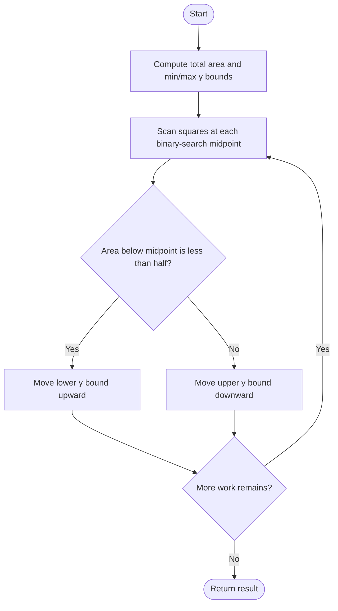
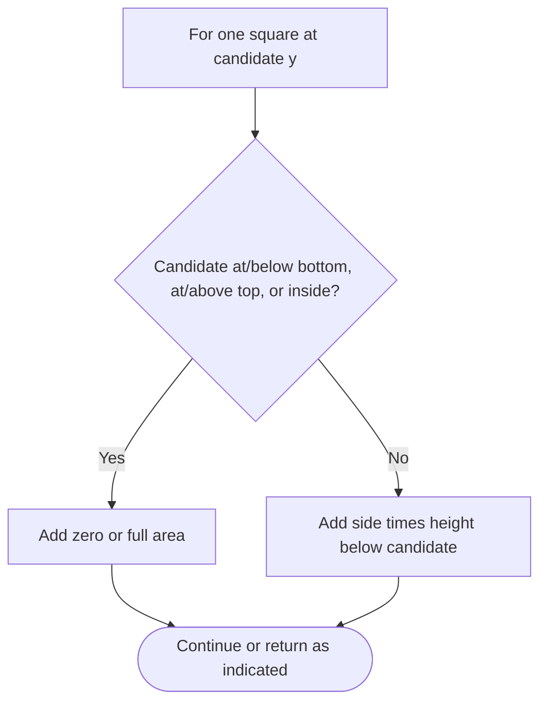

# Separate Squares I — LeetCode 3453

## Problem and judge interface

double separateSquares(vector<vector<int>>& squares); return the horizontal y-coordinate splitting the sum of square areas equally.

## Identification evidence

The code sums side-squared areas and binary-searches the y-coordinate whose below-line area is half. Overlaps are counted per square, identifying problem 3453 rather than union-area problem 3454.

## Main flow



## Important branch / loop



## Core logic and invariants

Basic and preprocessed methods each evaluate every square at each midpoint; fully-below squares contribute full area, intersected squares contribute side times covered height. Bounds move according to whether accumulated area is below half. The source performs 100 or 70 iterations.

## Complexity

O(S times I) time for S squares and fixed iteration count I; O(1) auxiliary space basic and O(S) preprocessed.

## Comparison and optimization

The source methods are named `separateSquares_Basic` and `separateSquares_Optimized`; rename the selected method for the judge. The optimized method caches square bounds, sides, and areas; both have the same asymptotic work. Result is approximate.

## Compile and run

The `.cpp` is the original standalone source, including its local `main()` demonstration where present. Compile and run from the repository root with a C++17 compiler:

```text
g++ -std=c++17 LeetCode\3453\3453.cpp -o solution.exe
.\solution.exe
```

For LeetCode, adapt the implementation to the required class/method signature and omit the local `main()` and demonstration helpers; use the judge-provided node types. Notes above identify method-name or behavior differences. The moved source bytes have not been edited.
