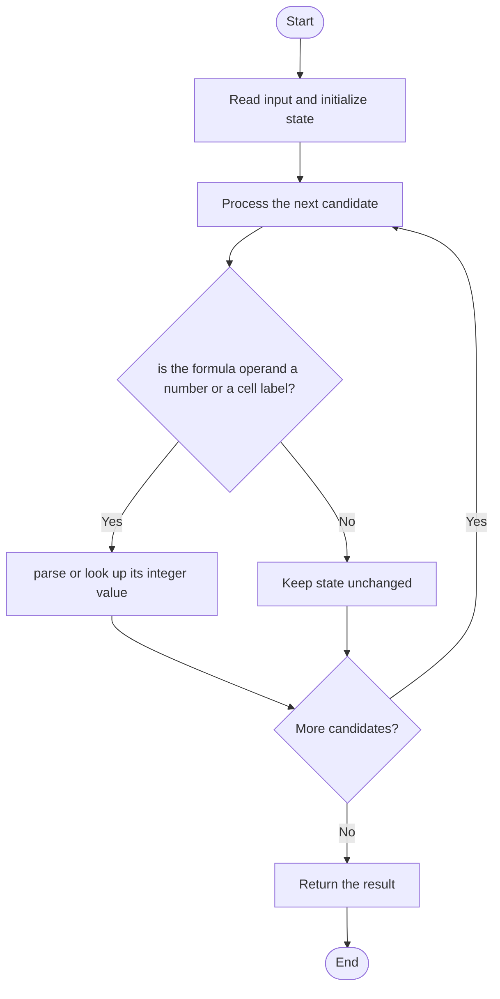

# 3484 — Design Spreadsheet

## 1. Problem understanding and constraints

Design a spreadsheet with a fixed number of rows and columns. Support setting/resetting a cell and evaluating formulas that add two operands; operands may be integers or cell references. **थोडक्यात:** काय मोजायचे/निवडायचे ते आधी स्पष्ट करा; मगच code निवडा.

## 2. Stepwise example and edge cases

> **मराठी:** प्रश्नात काय दिले आहे आणि नेमके काय शोधायचे आहे, हे आधी स्पष्ट करा.
> Set A1=5, B1=3; evaluate `=A1+B1` → 8. Resetting A1 makes its value 0. **Edge cases:** check smallest valid input, ties/boundaries, and empty/no-match outcomes where constraints allow them.

## 3. Pattern identification — clue table

Design API with 2D state and small formula parser. हा मुख्य pattern आहे.
| Clue | What it suggests |
|---|---|
| Output depends on design api with 2d state and small formula parser. | Keep only the relevant state; avoid unrelated recomputation |
| Need to preserve the stated condition | State an invariant before coding |
| Input scan/order matters | Update once per item and test boundaries |

## 4. Multiple approaches

Recomputing formula operands from scratch is appropriate because formulas are evaluated on request. A dependency graph is unnecessary for this API. Source stores cell values and parses the `+` expression. **योग्य निवड:** source मध्ये असलेली method आणि तिच्या मर्यादा वेगळ्या ओळखा.

## 5. Flowchart

Flow समजताना decision condition आणि update invariant शी जुळतात का ते तपासा.

## 6. Selected algorithm and intuition

> **मराठी:** मुख्य observation समजल्यावर algorithm चे steps लक्षात ठेवणे सोपे होते.
> Map a label such as A1 to row/column; resolve each operand as either a number or a stored cell value, then add.

## 7. Code-specific explanation

> **मराठी:** Code मधील variable आणि condition यांचा algorithm मधील उद्देश समजून घ्या.
> `LeetCode\3484\3484.cpp` — `setCell`, `resetCell`, and `getValue` implement the API. `getOperandValue` parses direct numbers versus cell names; cells not explicitly set default to zero.

## 8. Dry run

> **मराठी:** प्रत्येक महत्त्वाच्या step नंतर variable ची value trace करा.
> | Step | State / action |
> |---:|---|
> | 1 | Set A1=5, B1=3 → `getValue("=A1+B1")`: resolve 5 and 3, sum 8. |

## 9. Complexity

> **मराठी:** Input size आणि प्रत्येक operation कितीदा चालतो यावरून complexity ठरवा.
> Set/reset `O(1)` for a fixed 2D table; formula evaluation `O(L)` where L is formula length, with O(1) table lookup. Space `O(rows×cols)`.

## 10. Correctness

> **मराठी:** Invariant किंवा तर्क वापरून algorithm योग्य उत्तर देतो हे समजून घ्या.
> Each cell label is translated to its stored coordinate; direct numeric tokens parse to their value and cell tokens resolve through the table. Adding the two resolved values follows the supported formula grammar exactly.

## 11. Mistakes and interview traps

> **मराठी:** Boundary, duplicate आणि off-by-one cases स्वतंत्रपणे तपासा.

- Column labels are letters; row numbering is usually 1-based.
- Reset means zero, not deletion of the spreadsheet.
- Source supports the specified simple addition grammar, not arbitrary expressions.

## 12. Quick revision

**झटपट:** Map a label such as A1 to row/column; resolve each operand as either a number or a stored cell value, then add. Pattern ओळखा, condition तपासा, आणि answer एकदाच योग्य पद्धतीने update करा.

## 13. Related patterns and variations

> **मराठी:** या clues मुळे योग्य pattern ओळखता येतो; constraints आणि relations नीट तपासा.
> API design; parsers; 2D arrays and coordinate encoding.

## 14. Self-assessment

> **मराठी:** उत्तर न पाहता प्रश्न सोडवा आणि तुमच्या निवडीचे कारण सांगा.

1. How is A1 mapped to the table?
2. What value does an unset cell have?
3. Which formula grammar is supported?
