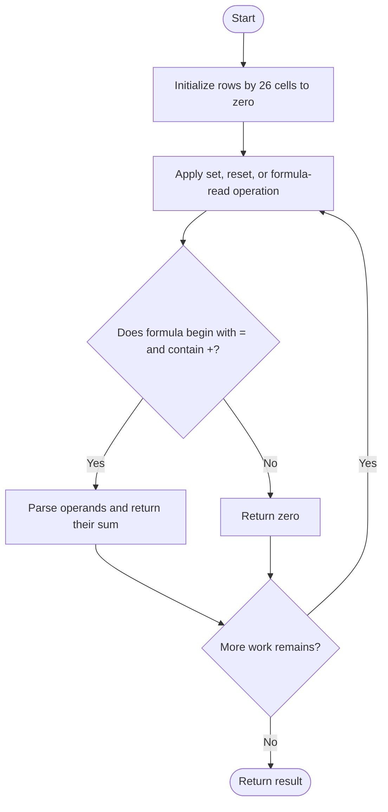
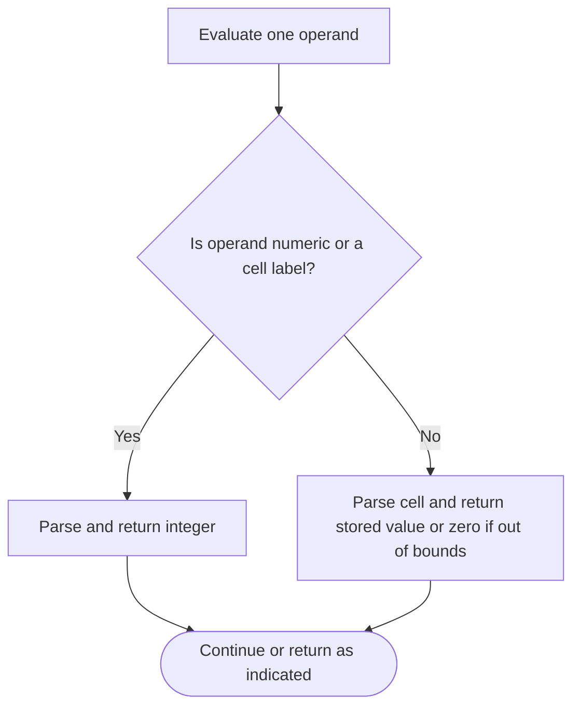

# Design Spreadsheet — LeetCode 3484

## Problem and judge interface

Spreadsheet(rows), setCell(cell,value), resetCell(cell), getValue(formula); formulas are a single =operand+operand sum.

## Identification evidence

The Spreadsheet design class parses A-Z cell labels and evaluates two plus-separated operands, matching problem 3484.

## Main flow



## Important branch / loop



## Core logic and invariants

The grid starts at zero. Operands are signed or unsigned integers or references; invalid/out-of-grid references evaluate as zero. getValue returns zero for malformed formula shape, otherwise sums the two operands.

## Complexity

Grid initialization/storage O(rows*26); cell update O(1), formula evaluation O(L) in formula length L.

## Comparison and optimization

Values are stored literally; formula results are computed on demand with no dependency graph.

## Compile and run

The `.cpp` is the original standalone source, including its local `main()` demonstration where present. Compile and run from the repository root with a C++17 compiler:

```text
g++ -std=c++17 LeetCode\3484\3484.cpp -o solution.exe
.\solution.exe
```

For LeetCode, adapt the implementation to the required class/method signature and omit the local `main()` and demonstration helpers; use the judge-provided node types. Notes above identify method-name or behavior differences. The moved source bytes have not been edited.
