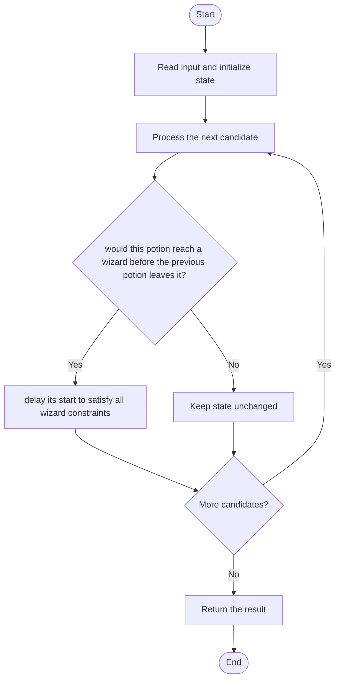

# 3494 — Find the Minimum Amount of Time to Brew Potions

## 1. Problem understanding and constraints

Wizards process potions in order; potion i takes `skill[j]*mana[i]` time on wizard j, and a potion cannot pause between wizards. Find the minimum completion time while preserving order and no overlap on each wizard. **थोडक्यात:** काय मोजायचे/निवडायचे ते आधी स्पष्ट करा; मगच code निवडा.

## 2. Stepwise example and edge cases

> **मराठी:** प्रश्नात काय दिले आहे आणि नेमके काय शोधायचे आहे, हे आधी स्पष्ट करा.
> For one wizard with skill 3 and mana values `[2,4]`, finish times are 6 then 18; the second potion starts after the first completes. **Edge cases:** check smallest valid input, ties/boundaries, and empty/no-match outcomes where constraints allow them.

## 3. Pattern identification — clue table

Pipeline scheduling; propagate earliest feasible start times backward. हा मुख्य pattern आहे.
| Clue | What it suggests |
|---|---|
| Output depends on pipeline scheduling | Keep only the relevant state; avoid unrelated recomputation |
| Need to preserve the stated condition | State an invariant before coding |
| Input scan/order matters | Update once per item and test boundaries |

## 4. Multiple approaches

Simulating all idle gaps is error-prone. The source uses a recurrence over wizard finish times; it is efficient and avoids per-time-step simulation. **योग्य निवड:** source मध्ये असलेली method आणि तिच्या मर्यादा वेगळ्या ओळखा.

## 5. Flowchart

Flow समजताना decision condition आणि update invariant शी जुळतात का ते तपासा.

## 6. Selected algorithm and intuition

> **मराठी:** मुख्य observation समजल्यावर algorithm चे steps लक्षात ठेवणे सोपे होते.
> For each new potion, compute its required processing durations and shift its start so every wizard begins only after the previous potion cleared that wizard.

## 7. Code-specific explanation

> **मराठी:** Code मधील variable आणि condition यांचा algorithm मधील उद्देश समजून घ्या.
> `LeetCode\3494\3494.cpp` — `minTime` maintains finish-time offsets for each wizard. It first advances across the new potion's skill×mana durations, then adjusts start/finish constraints backward to avoid collisions.

## 8. Dry run

> **मराठी:** प्रत्येक महत्त्वाच्या step नंतर variable ची value trace करा.
> | Step | State / action |
> |---:|---|
> | 1 | One wizard: potion durations 6 and 12 |
> | 2 | potion 1 completes at 6, potion 2 follows and completes at 18. |

## 9. Complexity

> **मराठी:** Input size आणि प्रत्येक operation कितीदा चालतो यावरून complexity ठरवा.
> `O(nm)` time for n wizards and m potions; `O(n)` auxiliary space.

## 10. Correctness

> **मराठी:** Invariant किंवा तर्क वापरून algorithm योग्य उत्तर देतो हे समजून घ्या.
> The recurrence enforces each wizard's non-overlap constraint while preserving potion order. The backward adjustment finds the earliest start satisfying every wizard; any earlier start would violate at least one constraint, so the resulting schedule is minimum.

## 11. Mistakes and interview traps

> **मराठी:** Boundary, duplicate आणि off-by-one cases स्वतंत्रपणे तपासा.

- Potion order cannot change.
- Multiplication uses both skill and mana.
- A potion's timing must be consistent across all wizards; independent per-wizard greedy starts are invalid.

## 12. Quick revision

**झटपट:** For each new potion, compute its required processing durations and shift its start so every wizard begins only after the previous potion cleared that wizard. Pattern ओळखा, condition तपासा, आणि answer एकदाच योग्य पद्धतीने update करा.

## 13. Related patterns and variations

> **मराठी:** या clues मुळे योग्य pattern ओळखता येतो; constraints आणि relations नीट तपासा.
> Flow-shop scheduling; pipeline DP; earliest-start propagation.

## 14. Self-assessment

> **मराठी:** उत्तर न पाहता प्रश्न सोडवा आणि तुमच्या निवडीचे कारण सांगा.

1. Why can a potion not start independently at each wizard?
2. What does the backward adjustment enforce?
3. How does time scale with wizard and potion counts?
