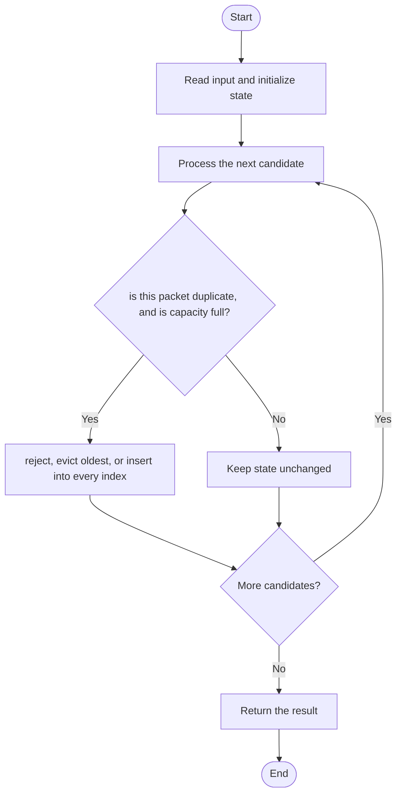

# 3508 — Implement Router

## 1. Problem understanding and constraints

Maintain a bounded FIFO packet queue. Reject duplicate `(source,destination,timestamp)` packets; on capacity overflow, evict the oldest. Support forwarding oldest packet and counting destination packets in a timestamp range. **थोडक्यात:** काय मोजायचे/निवडायचे ते आधी स्पष्ट करा; मगच code निवडा.

## 2. Stepwise example and edge cases

> **मराठी:** प्रश्नात काय दिले आहे आणि नेमके काय शोधायचे आहे, हे आधी स्पष्ट करा.
> With capacity 2, add A then B; adding C evicts A. Forward then returns B. **Edge cases:** check smallest valid input, ties/boundaries, and empty/no-match outcomes where constraints allow them.

## 3. Pattern identification — clue table

Queue + duplicate set + destination/time index. हा मुख्य pattern आहे.
| Clue | What it suggests |
|---|---|
| Output depends on queue + duplicate set + destination/time index. | Keep only the relevant state; avoid unrelated recomputation |
| Need to preserve the stated condition | State an invariant before coding |
| Input scan/order matters | Update once per item and test boundaries |

## 4. Multiple approaches

Scanning all stored packets is correct but range queries cost `O(p)`. The source includes a simple version and an indexed version. The indexed version is faster for narrow ranges, but its removal code erases an entire destination/timestamp bucket instead of decrementing its count, so same-destination same-timestamp packets from different sources can be miscounted. **योग्य निवड:** source मध्ये असलेली method आणि तिच्या मर्यादा वेगळ्या ओळखा.

## 5. Flowchart

Flow समजताना decision condition आणि update invariant शी जुळतात का ते तपासा.

## 6. Selected algorithm and intuition

> **मराठी:** मुख्य observation समजल्यावर algorithm चे steps लक्षात ठेवणे सोपे होते.
> Use FIFO order for eviction/forwarding, a tuple key set for duplicates, and a per-destination ordered timestamp structure for range counts.

## 7. Code-specific explanation

> **मराठी:** Code मधील variable आणि condition यांचा algorithm मधील उद्देश समजून घ्या.
> `LeetCode\3508\3508.cpp` — The file contains two `Router` definitions and two `main()` functions, so it cannot compile as one translation unit without separating the examples. Both versions expose `addPacket`, `forwardPacket`, and `getCount`. The indexed variant uses `map<timestamp,count>` and starts queries with `lower_bound`; however, eviction/forwarding call `erase(timestamp)` rather than decrementing the count, which is incorrect when that bucket contains multiple active packets.

## 8. Dry run

> **मराठी:** प्रत्येक महत्त्वाच्या step नंतर variable ची value trace करा.
> | Step | State / action |
> |---:|---|
> | 1 | Capacity 2: add A, add B, add C → evict A |
> | 2 | queue `[B,C]` |
> | 3 | forward returns B. |

## 9. Complexity

> **मराठी:** Input size आणि प्रत्येक operation कितीदा चालतो यावरून complexity ठरवा.
> Simple range count `O(p)`. Indexed add/forward are `O(log p)` for the ordered timestamp map plus expected hash work; `getCount` is `O(log u+r)` for u timestamps and r entries visited in range. Space `O(p)`.

## 10. Correctness

> **मराठी:** Invariant किंवा तर्क वापरून algorithm योग्य उत्तर देतो हे समजून घ्या.
> The FIFO structure determines the oldest packet exactly, and the tuple key tracks active duplicates. The indexed range query is correct only if each removal decrements its timestamp count and erases the key only at zero; the current indexed source does not preserve that invariant for shared timestamps.

## 11. Mistakes and interview traps

> **मराठी:** Boundary, duplicate आणि off-by-one cases स्वतंत्रपणे तपासा.

- Duplicate identity uses all three fields.
- Eviction and forwarding must decrement, not blindly erase, shared destination/timestamp counts.
- Timestamp interval endpoints are inclusive.
- Separate the two demo implementations before compiling this combined source file.

## 12. Quick revision

**झटपट:** Use FIFO order for eviction/forwarding, a tuple key set for duplicates, and a per-destination ordered timestamp structure for range counts. Pattern ओळखा, condition तपासा, आणि answer एकदाच योग्य पद्धतीने update करा.

## 13. Related patterns and variations

> **मराठी:** या clues मुळे योग्य pattern ओळखता येतो; constraints आणि relations नीट तपासा.
> Queue design; hash indexing; ordered multisets; binary-search range queries.

## 14. Self-assessment

> **मराठी:** उत्तर न पाहता प्रश्न सोडवा आणि तुमच्या निवडीचे कारण सांगा.

1. What fields identify a duplicate?
2. Which packet is evicted at capacity?
3. Why must indexes be updated on forward?
