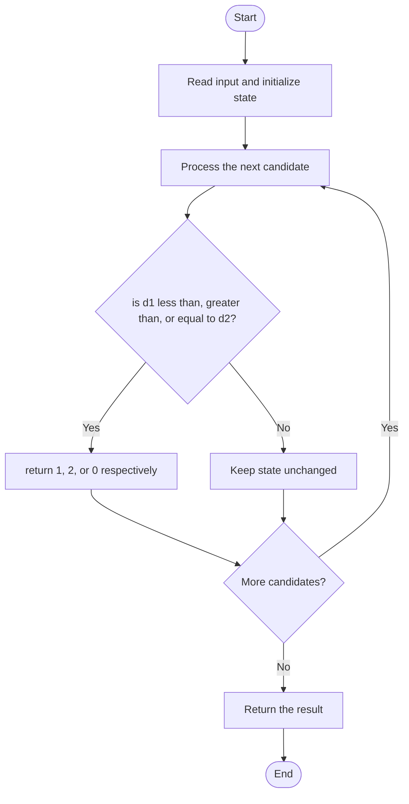

# 3516 — Find Closest Person

## 1. Problem understanding and constraints

Compare distances from people at x and y to a meeting point z; return 1, 2, or 0 if tied. **थोडक्यात:** काय मोजायचे/निवडायचे ते आधी स्पष्ट करा; मगच code निवडा.

## 2. Stepwise example and edge cases

> **मराठी:** प्रश्नात काय दिले आहे आणि नेमके काय शोधायचे आहे, हे आधी स्पष्ट करा.
> `x=2,y=7,z=4`: distances 2 and 3, so person 1 is closer. **Edge cases:** check smallest valid input, ties/boundaries, and empty/no-match outcomes where constraints allow them.

## 3. Pattern identification — clue table

Absolute-distance comparison. हा मुख्य pattern आहे.
| Clue | What it suggests |
|---|---|
| Output depends on absolute-distance comparison. | Keep only the relevant state; avoid unrelated recomputation |
| Need to preserve the stated condition | State an invariant before coding |
| Input scan/order matters | Update once per item and test boundaries |

## 4. Multiple approaches

The source has original, optimal, and one-line versions; all are correct. More elaborate geometry is unnecessary on a number line. **योग्य निवड:** source मध्ये असलेली method आणि तिच्या मर्यादा वेगळ्या ओळखा.

## 5. Flowchart

Flow समजताना decision condition आणि update invariant शी जुळतात का ते तपासा.

## 6. Selected algorithm and intuition

> **मराठी:** मुख्य observation समजल्यावर algorithm चे steps लक्षात ठेवणे सोपे होते.
> Compute `abs(x-z)` and `abs(y-z)` and compare.

## 7. Code-specific explanation

> **मराठी:** Code मधील variable आणि condition यांचा algorithm मधील उद्देश समजून घ्या.
> `LeetCode\3516\3516.cpp` — `findClosest`, `findClosestOptimal`, and `findClosestOneLine` return the same label; tie must return 0.

## 8. Dry run

> **मराठी:** प्रत्येक महत्त्वाच्या step नंतर variable ची value trace करा.
> | Step | State / action |
> |---:|---|
> | 1 | x=2,y=7,z=4 → d1=2,d2=3 → 1. |

## 9. Complexity

> **मराठी:** Input size आणि प्रत्येक operation कितीदा चालतो यावरून complexity ठरवा.
> `O(1)` time and `O(1)` space.

## 10. Correctness

> **मराठी:** Invariant किंवा तर्क वापरून algorithm योग्य उत्तर देतो हे समजून घ्या.
> Absolute differences are precisely the two distances. Their three possible comparisons map directly to the requested result labels.

## 11. Mistakes and interview traps

> **मराठी:** Boundary, duplicate आणि off-by-one cases स्वतंत्रपणे तपासा.

- Use absolute distances, not signed subtraction.
- Handle equality explicitly.
- Verify label 1 refers to x and label 2 to y.

## 12. Quick revision

**झटपट:** Compute `abs(x-z)` and `abs(y-z)` and compare. Pattern ओळखा, condition तपासा, आणि answer एकदाच योग्य पद्धतीने update करा.

## 13. Related patterns and variations

> **मराठी:** या clues मुळे योग्य pattern ओळखता येतो; constraints आणि relations नीट तपासा.
> Absolute value; comparisons; number-line distance.

## 14. Self-assessment

> **मराठी:** उत्तर न पाहता प्रश्न सोडवा आणि तुमच्या निवडीचे कारण सांगा.

1. What does a tie return?
2. Why is signed subtraction wrong?
3. Which distance maps to person 1?
