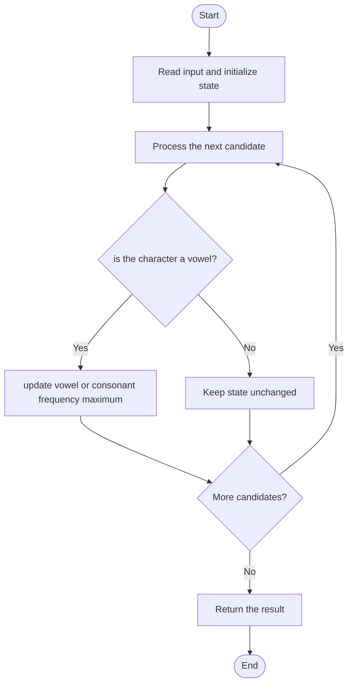

# 3541 — Find Most Frequent Vowel and Consonant

## 1. Problem understanding and constraints

In a lowercase English string, find the greatest frequency among vowels and the greatest frequency among consonants; return their sum. If one category has no present character, its contribution is zero. **थोडक्यात:** काय मोजायचे/निवडायचे ते आधी स्पष्ट करा; मगच code निवडा.

## 2. Stepwise example and edge cases

> **मराठी:** प्रश्नात काय दिले आहे आणि नेमके काय शोधायचे आहे, हे आधी स्पष्ट करा.
> For `"successes"`, count each letter; take the most frequent vowel count plus the most frequent consonant count. **Edge cases:** check smallest valid input, ties/boundaries, and empty/no-match outcomes where constraints allow them.

## 3. Pattern identification — clue table

Fixed alphabet frequency array; separate categories. हा मुख्य pattern आहे.
| Clue | What it suggests |
|---|---|
| Output depends on fixed alphabet frequency array | Keep only the relevant state; avoid unrelated recomputation |
| Need to preserve the stated condition | State an invariant before coding |
| Input scan/order matters | Update once per item and test boundaries |

## 4. Multiple approaches

Nested character counting works but is slower. Source has four variants that count or identify vowels differently; the frequency-table approach is simplest and linear. **योग्य निवड:** source मध्ये असलेली method आणि तिच्या मर्यादा वेगळ्या ओळखा.

## 5. Flowchart

Flow समजताना decision condition आणि update invariant शी जुळतात का ते तपासा.

## 6. Selected algorithm and intuition

> **मराठी:** मुख्य observation समजल्यावर algorithm चे steps लक्षात ठेवणे सोपे होते.
> Count all letters once, then take one maximum in each category.

## 7. Code-specific explanation

> **मराठी:** Code मधील variable आणि condition यांचा algorithm मधील उद्देश समजून घ्या.
> `LeetCode\3541\3541.cpp` — `approach1`–`approach4` compare variants; `isVowel` centralizes vowel membership for one approach. Avoid assuming a vowel and consonant are both present unless guarded.

## 8. Dry run

> **मराठी:** प्रत्येक महत्त्वाच्या step नंतर variable ची value trace करा.
> | Step | State / action |
> |---:|---|
> | 1 | Counts e=2,u=1,s=4,c=2: max vowel=2, max consonant=4 |
> | 2 | sum=6. |

## 9. Complexity

> **मराठी:** Input size आणि प्रत्येक operation कितीदा चालतो यावरून complexity ठरवा.
> `O(n+σ)` time and `O(σ)` space for σ=26 lowercase letters.

## 10. Correctness

> **मराठी:** Invariant किंवा तर्क वापरून algorithm योग्य उत्तर देतो हे समजून घ्या.
> Every occurrence contributes to exactly one character count, and every lowercase letter belongs to exactly one category. Taking the maximum count in each category and adding them gives the requested sum.

## 11. Mistakes and interview traps

> **मराठी:** Boundary, duplicate आणि off-by-one cases स्वतंत्रपणे तपासा.

- Vowels are a,e,i,o,u.
- Use each category's maximum, not total category frequency.
- Missing category contributes zero.

## 12. Quick revision

**झटपट:** Count all letters once, then take one maximum in each category. Pattern ओळखा, condition तपासा, आणि answer एकदाच योग्य पद्धतीने update करा.

## 13. Related patterns and variations

> **मराठी:** या clues मुळे योग्य pattern ओळखता येतो; constraints आणि relations नीट तपासा.
> Frequency arrays; classification; maximum bucket count.

## 14. Self-assessment

> **मराठी:** उत्तर न पाहता प्रश्न सोडवा आणि तुमच्या निवडीचे कारण सांगा.

1. Which five letters are vowels?
2. Do you sum all vowels or take a maximum?
3. What if there is no consonant?
