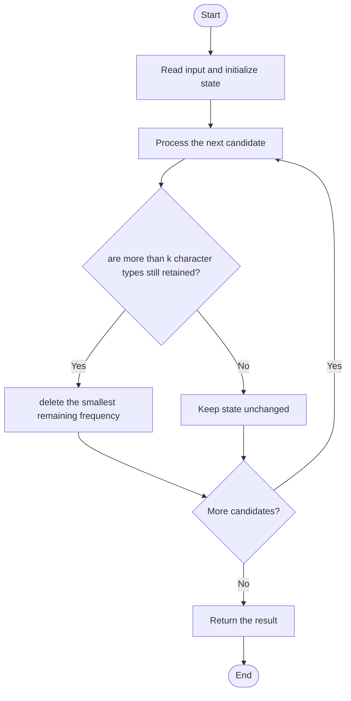

# 3545 — Minimum Deletions for at Most K Distinct Characters

## 1. Problem understanding and constraints

Delete the fewest characters so the string contains at most k distinct characters. Character frequencies determine which symbols are cheapest to remove entirely. **थोडक्यात:** काय मोजायचे/निवडायचे ते आधी स्पष्ट करा; मगच code निवडा.

## 2. Stepwise example and edge cases

> **मराठी:** प्रश्नात काय दिले आहे आणि नेमके काय शोधायचे आहे, हे आधी स्पष्ट करा.
> `s="abc", k=2`: delete any one character; answer 1. **Edge cases:** check smallest valid input, ties/boundaries, and empty/no-match outcomes where constraints allow them.

## 3. Pattern identification — clue table

Frequency counting; remove least frequent distinct characters. हा मुख्य pattern आहे.
| Clue | What it suggests |
|---|---|
| Output depends on frequency counting | Keep only the relevant state; avoid unrelated recomputation |
| Need to preserve the stated condition | State an invariant before coding |
| Input scan/order matters | Update once per item and test boundaries |

## 4. Multiple approaches

Trying subsets of character types is exponential in alphabet size. Sort distinct-character frequencies ascending and delete the smallest counts until only k types remain; source implements this greedy. **योग्य निवड:** source मध्ये असलेली method आणि तिच्या मर्यादा वेगळ्या ओळखा.

## 5. Flowchart

Flow समजताना decision condition आणि update invariant शी जुळतात का ते तपासा.

## 6. Selected algorithm and intuition

> **मराठी:** मुख्य observation समजल्यावर algorithm चे steps लक्षात ठेवणे सोपे होते.
> To minimize deleted characters, retain the k most frequent character types.

## 7. Code-specific explanation

> **मराठी:** Code मधील variable आणि condition यांचा algorithm मधील उद्देश समजून घ्या.
> `LeetCode\3545\3545.cpp` — `minDeletionsToLimitDistinctChars` counts each char, sorts frequencies, and sums the `distinct-k` smallest. If distinct≤k, answer is zero.

## 8. Dry run

> **मराठी:** प्रत्येक महत्त्वाच्या step नंतर variable ची value trace करा.
> | Step | State / action |
> |---:|---|
> | 1 | Frequencies `[1,1,1]`, k=2: delete smallest 1 → two types remain |
> | 2 | answer 1. |

## 9. Complexity

> **मराठी:** Input size आणि प्रत्येक operation कितीदा चालतो यावरून complexity ठरवा.
> `O(n+u log u)` time and `O(u)` space for u distinct characters.

## 10. Correctness

> **मराठी:** Invariant किंवा तर्क वापरून algorithm योग्य उत्तर देतो हे समजून घ्या.
> Keeping any k types with higher frequencies cannot require more deletions than replacing one with a lower-frequency type. Thus the optimal choice is the k most frequent types, and deleting the other frequencies gives the minimum.

## 11. Mistakes and interview traps

> **मराठी:** Boundary, duplicate आणि off-by-one cases स्वतंत्रपणे तपासा.

- Delete entire character types, not arbitrary copies while still counting them as distinct.
- If distinct≤k, answer is 0.
- Sort frequencies, not characters.

## 12. Quick revision

**झटपट:** To minimize deleted characters, retain the k most frequent character types. Pattern ओळखा, condition तपासा, आणि answer एकदाच योग्य पद्धतीने update करा.

## 13. Related patterns and variations

> **मराठी:** या clues मुळे योग्य pattern ओळखता येतो; constraints आणि relations नीट तपासा.
> Greedy by frequency; top-k selection; distinct-count minimization.

## 14. Self-assessment

> **मराठी:** उत्तर न पाहता प्रश्न सोडवा आणि तुमच्या निवडीचे कारण सांगा.

1. Why keep the most frequent k types?
2. What happens when distinct≤k?
3. Which frequencies are summed?
