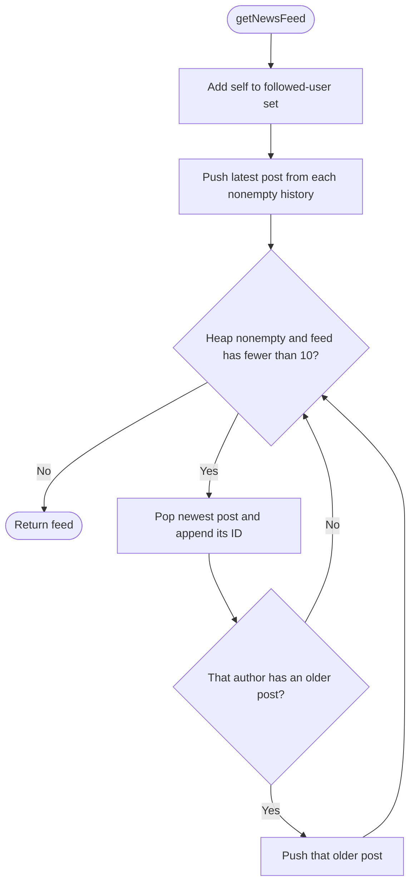

# 355. Design Twitter

Source: `355.cpp` (`Twitter` design class and demo `main`).

## 1. Understanding

> **मराठी:** प्रश्नात काय दिले आहे आणि नेमके काय शोधायचे आहे, हे आधी स्पष्ट करा.
> Implement `postTweet`, `getNewsFeed`, `follow`, and `unfollow`. A feed contains up to 10 newest tweets from the user and followed users. Tweet IDs can repeat; chronological order comes from the post timestamp, not the ID.

## 2. Worked examples and edges

> **मराठी:** प्रश्नात काय दिले आहे आणि नेमके काय शोधायचे आहे, हे आधी स्पष्ट करा.
> If user 1 posts `5`, then `3`, own feed is `[3,5]`. After following user 2 and user 2 posting `6`, it is `[6,3,5]`. No follows means own posts only; no posts means empty feed; self-follow is ignored.

## 3. Pattern identification + cheat sheet

> **मराठी:** या clues मुळे योग्य pattern ओळखता येतो; constraints आणि relations नीट तपासा.
> This is a design/stream-merge problem: many individually sorted tweet histories, request only the global top 10.
> | Need | Pattern |
> |---|---|
> | Merge newest items across users | Max-heap / k-way merge |
> | Maintain relationships | Hash set per user |
> | Order posts independent of IDs | Monotonic timestamp |

## 4. Approaches

> **मराठी:** सोप्या उपायापासून सुरुवात करा आणि constraints नुसार योग्य optimization निवडा.

- **Heap (`getNewsFeed`) — best:** seed each visible user's latest tweet, pop newest, then add that author's previous tweet. `O(F + 10 log F)`.
- **Collect + sort (`getNewsFeedSorting`) — correct, less efficient:** sort all `T` visible posts, `O(T log T)` time and `O(T)` extra space.
- **Repeated top-10 (`getNewsFeedTop10`) — correct, bounded work per post:** sorts a vector capped at 10 after each insertion; `O(10T)` (effectively `O(T)` for fixed feed size).

## 5. Flowchart

> **मराठी:** Flowchart मधील decision, loop आणि termination condition क्रमाने समजून घ्या.

The heap contains only the next unreported post from each user's reverse-time stream; therefore its top is globally newest.

## 6. Algorithm and intuition

> **मराठी:** मुख्य observation समजल्यावर algorithm चे steps लक्षात ठेवणे सोपे होते.
> Store `(timestamp, tweetId)` per author and a set of followees. A max-heap merges streams lazily, so the algorithm never examines posts older than the tenth result unless needed.

## 7. Code explanation

> **मराठी:** Code मधील variable आणि condition यांचा algorithm मधील उद्देश समजून घ्या.
> `postTweet` increments one global timestamp. `getNewsFeed` seeds the heap with `(time,user,index)`; popping a tweet and pushing `index-1` advances that author's stream. Following/unfollowing uses set insert/erase. Two comparison methods live in the same class.

## 8. Dry run

> **मराठी:** प्रत्येक महत्त्वाच्या step नंतर variable ची value trace करा.
> | Event | Heap action | Feed |
> |---|---|---|
> | User 1 posts 5, then 3 | latest is `(2,1,1)` | — |
> | User 2 followed; posts 6 | seed `(3,2,0),(2,1,1)` | — |
> | Pop 6, then 3, then 5 | advance user 1 after 3 | `[6,3,5]` |

## 9. Complexity

> **मराठी:** Input size आणि प्रत्येक operation कितीदा चालतो यावरून complexity ठरवा.
> Let `F` be visible users and `T` their total tweets. Heap feed: `O(F + 10 log F)` time, `O(F)` temporary heap; tweet/follow storage is additional persistent space.

## 10. Correctness

> **मराठी:** Invariant किंवा तर्क वापरून algorithm योग्य उत्तर देतो हे समजून घ्या.
> Each stream is timestamp-sorted. The heap holds the largest remaining timestamp from every nonempty stream, so each pop is the globally newest remaining tweet. Advancing only the popped stream preserves this invariant; stopping at 10 returns exactly the required prefix.

## 11. Mistakes / interview traps

> **मराठी:** Boundary, duplicate आणि off-by-one cases स्वतंत्रपणे तपासा.

- Include the requesting user's own tweets.
- Don't sort by tweet ID; IDs are arbitrary.
- Prevent duplicate/self follow as appropriate.
- The demo `main` is not part of LeetCode's design-class submission.

## 12. Quick revision

Per-user history + follow set + global clock; seed one latest post per visible user; pop at most 10 and advance that stream.
Lakshat theva: feed मध्ये स्वतःचे tweets आणि followed users चे tweets दोन्ही येतात.

## 13. Related problems / variations

> **मराठी:** प्रश्नात काय दिले आहे आणि नेमके काय शोधायचे आहे, हे आधी स्पष्ट करा.
> K-way merge of sorted lists; merge K sorted arrays; design a social feed with pagination or bounded history.

## 14. Self-assessment

> **मराठी:** उत्तर न पाहता प्रश्न सोडवा आणि तुमच्या निवडीचे कारण सांगा.

1. Why is one heap entry per user enough?
2. Why must the clock be global?
3. What changes if the feed limit is `K` instead of 10?
4. Compare heap merging with collect-and-sort when users have long histories.
