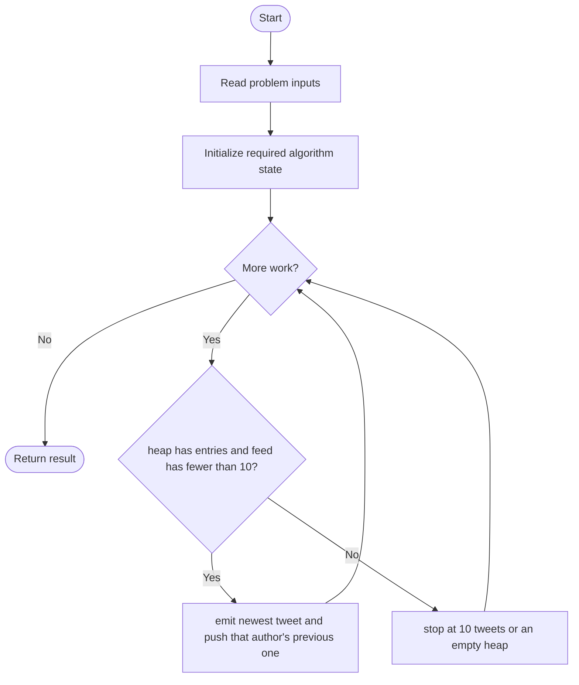
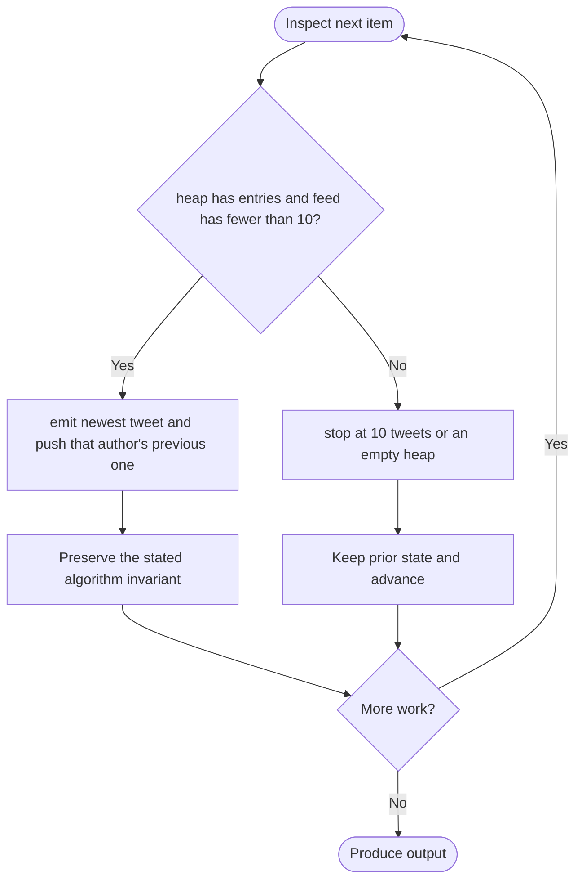

# Design Twitter

**LeetCode ID:** 355

**Source file(s):** `355.cpp` (originally `355.cpp`)

**Identification evidence:** The original filename, declared signature, and distinctive behavior described below uniquely identify this problem; no number was inferred from a filename alone.

## Expected input/output or judge interface

Twitter API: postTweet, getNewsFeed, follow, unfollow. Inputs follow the problem constraints; the output is the documented scalar, sequence, or design-object behavior. The description below reflects the implementation actually present in the source.

## Main flow



## Important branch and loop flow



## Core logic and invariant

Stores per-user timestamped tweets and follow sets; a max-heap merges visible users' reverse-chronological streams to return at most ten tweet IDs. Sorting-all and repeated-top-ten variants are also included.

The key branch/loop rule above is applied once per relevant item; the algorithm relies on that rule to preserve its state and produce the required result.

## Optimization / comparison

Heap visits only the first ten items from F streams, versus sorting all T visible tweets in O(T log T).

## Complexity

Heap feed O(F + 10 log F); O(F) heap, plus stored tweets.

## Compile and run

The repository file includes a standalone demonstration `main()`; it is not a raw LeetCode submission unit. From the repository root, with a C++17 compiler:

```powershell
g++ -std=c++17 LeetCode\355\355.cpp -o solution.exe
.\solution.exe
```

For LeetCode's class-method judge, copy the relevant class/method or design-class API and omit the demo `main()` and local harness. Adapt free-function implementations to the requested `Solution` class signature where necessary. See the source caveat above for any compile blocker.
