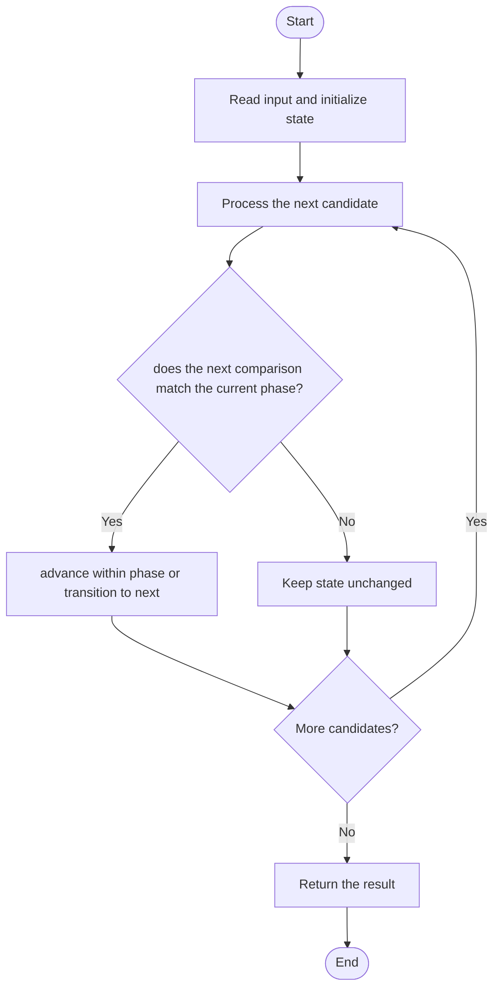

# 3637 — Trionic Array I

## 1. Problem understanding and constraints

A trionic array has three strict phases: increasing, then decreasing, then increasing again, each with a non-empty phase. Determine whether the whole array has that shape. **थोडक्यात:** काय मोजायचे/निवडायचे ते आधी स्पष्ट करा; मगच code निवडा.

## 2. Stepwise example and edge cases

> **मराठी:** प्रश्नात काय दिले आहे आणि नेमके काय शोधायचे आहे, हे आधी स्पष्ट करा.
> `[1,3,2,4]`: rise 1<3, fall 3>2, rise 2<4 → true. **Edge cases:** check smallest valid input, ties/boundaries, and empty/no-match outcomes where constraints allow them.

## 3. Pattern identification — clue table

Finite-state scan for monotonic phases. हा मुख्य pattern आहे.
| Clue | What it suggests |
|---|---|
| Output depends on finite-state scan for monotonic phases. | Keep only the relevant state; avoid unrelated recomputation |
| Need to preserve the stated condition | State an invariant before coding |
| Input scan/order matters | Update once per item and test boundaries |

## 4. Multiple approaches

Explicitly trying all split points is correct but `O(n²)`. Source provides a one-pass greedy state machine, a brute-force split check, and a precomputed DP-style alternative. **योग्य निवड:** source मध्ये असलेली method आणि तिच्या मर्यादा वेगळ्या ओळखा.

## 5. Flowchart

Flow समजताना decision condition आणि update invariant शी जुळतात का ते तपासा.

## 6. Selected algorithm and intuition

> **मराठी:** मुख्य observation समजल्यावर algorithm चे steps लक्षात ठेवणे सोपे होते.
> Consume a non-empty rising run, then a non-empty falling run, then require a non-empty rising run through the final element.

## 7. Code-specific explanation

> **मराठी:** Code मधील variable आणि condition यांचा algorithm मधील उद्देश समजून घ्या.
> `LeetCode\3637\3637.cpp` — `isTrionicGreedy` transitions among three phases and rejects missing/empty phases. Brute-force checks candidate p,q; DP arrays mark increasing prefixes/suffixes and descending middle.

## 8. Dry run

> **मराठी:** प्रत्येक महत्त्वाच्या step नंतर variable ची value trace करा.
> | Step | State / action |
> |---:|---|
> | 1 | `[1,3,2,4]`: state rise consumes 1→3 |
> | 2 | fall consumes 3→2 |
> | 3 | final rise consumes 2→4 |
> | 4 | all phases exist. |

## 9. Complexity

> **मराठी:** Input size आणि प्रत्येक operation कितीदा चालतो यावरून complexity ठरवा.
> Greedy `O(n)` time, `O(1)` space. Brute force `O(n²)` time; DP variant `O(n)` time and `O(n)` space.

## 10. Correctness

> **मराठी:** Invariant किंवा तर्क वापरून algorithm योग्य उत्तर देतो हे समजून घ्या.
> The greedy scan accepts only when each phase has at least one strict edge and all adjacent comparisons follow the required order. Every valid trionic array has exactly such a left-to-right phase sequence; invalid or missing transitions are rejected.

## 11. Mistakes and interview traps

> **मराठी:** Boundary, duplicate आणि off-by-one cases स्वतंत्रपणे तपासा.

- All inequalities are strict; equal adjacent values break a phase.
- Each of the three runs must be non-empty.
- End in the final increasing phase, not immediately after the decrease.

## 12. Quick revision

**झटपट:** Consume a non-empty rising run, then a non-empty falling run, then require a non-empty rising run through the final element. Pattern ओळखा, condition तपासा, आणि answer एकदाच योग्य पद्धतीने update करा.

## 13. Related patterns and variations

> **मराठी:** या clues मुळे योग्य pattern ओळखता येतो; constraints आणि relations नीट तपासा.
> Finite-state machines; monotonic runs; peak/valley arrays.

## 14. Self-assessment

> **मराठी:** उत्तर न पाहता प्रश्न सोडवा आणि तुमच्या निवडीचे कारण सांगा.

1. What are the three required directions?
2. Why must each phase have an edge?
3. What happens on equal adjacent values?
