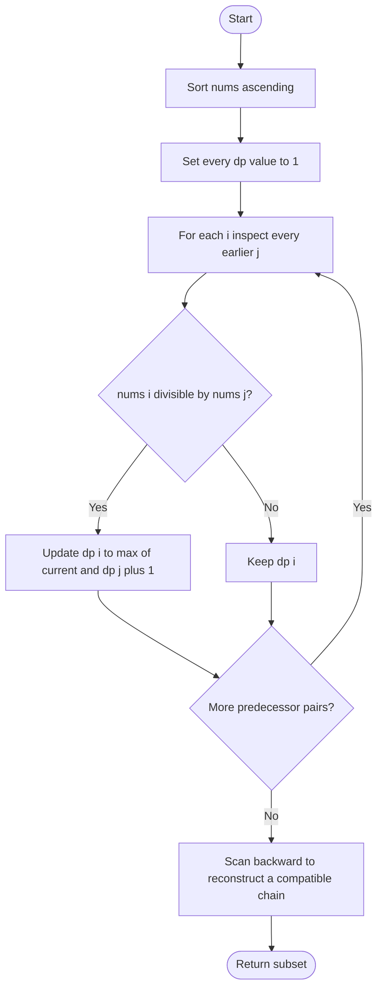

# 368. Largest Divisible Subset

Source: `368.cpp`; `largestDivisibleSubset(vector<int>& nums)`. The program also prints intermediate diagnostics.

## 1. Understanding

Return a largest subset where every pair is divisible in one direction. For positive values, after sorting, it is enough that each later value is divisible by its predecessor in the chosen chain. Mhanje sorted divisibility-chain शोधायची.

## 2. Worked examples and edges

> **मराठी:** प्रश्नात काय दिले आहे आणि नेमके काय शोधायचे आहे, हे आधी स्पष्ट करा.
> `[1,2,3]` can return `[1,2]` or `[1,3]`; both have size 2. `[1,2,4,8]` yields the full chain. A one-element input returns itself; the problem constrains values to positive integers.

## 3. Pattern identification + cheat sheet

> **मराठी:** या clues मुळे योग्य pattern ओळखता येतो; constraints आणि relations नीट तपासा.
> Sorting makes divisibility order monotonic; the remaining task is a longest-path/subsequence DP.
> | Clue | Pattern |
> |---|---|
> | Best chain ending at each index | 1D DP |
> | Need actual subset, not just length | Parent/reconstruction |
> | Pair relationship after sorting | LIS-style `O(n²)` transitions |

## 4. Approaches

> **मराठी:** सोप्या उपायापासून सुरुवात करा आणि constraints नुसार योग्य optimization निवडा.

- **Enumerating all subsets — correct but exponential:** test pairwise divisibility; not scalable.
- **Sort + DP — used and optimal for the standard constraints:** `O(n²)` transitions; reconstruct by scanning backward.
- A `parent[]` array is an equally efficient alternative and may make reconstruction clearer; source stores no parent array.

## 5. Flowchart

Each `dp[i]` is the longest valid chain ending at `i`; backward scan madhun compatible endpoints choose होतात.

## 6. Algorithm and intuition

> **मराठी:** मुख्य observation समजल्यावर algorithm चे steps लक्षात ठेवणे सोपे होते.
> Sort first. Initialize `dp[i]=1`; if `nums[i] % nums[j] == 0`, extend the chain ending at `j`. Record the maximum length, then scan from largest values down, accepting a value if it divides the previously chosen value and has the next required DP length.

## 7. Code explanation

> **मराठी:** Code मधील variable आणि condition यांचा algorithm मधील उद्देश समजून घ्या.
> The code sorts `nums` in place, computes `dp`, tracks `maxi`, then uses `num` as the previously selected larger value during backward reconstruction. `num == -1` means no value selected yet. It prints debug output as part of this standalone program.

## 8. Dry run

> **मराठी:** प्रत्येक महत्त्वाच्या step नंतर variable ची value trace करा.
> | Sorted nums | DP update | Reconstruction |
> |---|---|---|
> | `[1,2,4,8]` | `[1,2,3,4]` | choose `8`, then `4`, `2`, `1` |
> | result | — | `[8,4,2,1]` (valid; order need not be ascending) |

## 9. Complexity

> **मराठी:** Input size आणि प्रत्येक operation कितीदा चालतो यावरून complexity ठरवा.
> Time `O(n²)`; DP and result use `O(n)` auxiliary space. Sorting is `O(n log n)` and dominated by DP.

## 10. Correctness

> **मराठी:** Invariant किंवा तर्क वापरून algorithm योग्य उत्तर देतो हे समजून घ्या.
> For every ending index `i`, the recurrence considers every earlier value that divides `nums[i]`; thus it finds the longest chain ending there. The maximum DP value is an optimal subset size. Backtracking chooses a divisible predecessor with the required preceding DP length, so it returns a chain of that size.

## 11. Mistakes / interview traps

> **मराठी:** Boundary, duplicate आणि off-by-one cases स्वतंत्रपणे तपासा.

- Sort before applying the one-direction divisibility check.
- Values must be positive; modulo by zero is invalid (original constraints guarantee positivity).
- Multiple optimal subsets are possible; exact output/order may differ.
- This function mutates input order by sorting and prints diagnostics.

## 12. Quick revision

Sort → `dp[i]=1` → extend from all divisible earlier `j` → reconstruct a maximum chain backward. He chain pattern lakshat theva.
अनेक valid answers असू शकतात; maximum length हाच मुख्य निकष.

## 13. Related problems / variations

> **मराठी:** प्रश्नात काय दिले आहे आणि नेमके काय शोधायचे आहे, हे आधी स्पष्ट करा.
> Longest Increasing Subsequence; Largest Divisible Subset with parent pointers; count or return all maximum chains.

## 14. Self-assessment

> **मराठी:** उत्तर न पाहता प्रश्न सोडवा आणि तुमच्या निवडीचे कारण सांगा.

1. Why does sorting let us check only `nums[i] % nums[j]`?
2. What does `dp[i]` represent?
3. How would a `parent[]` array alter reconstruction?
4. Why can two correct outputs differ?
