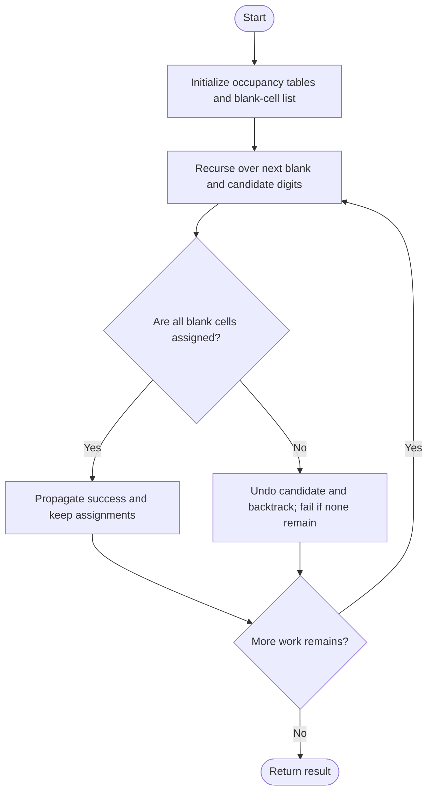
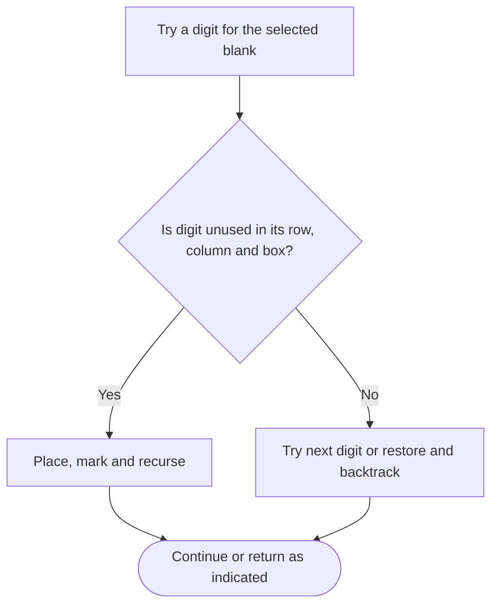

# Sudoku Solver — LeetCode 37

## Problem and judge interface

void solveSudoku(vector<vector<char>>& board); mutate a 9x9 board, filling blanks under row, column, and 3x3-box constraints.

## Identification evidence

The method signature, 9x9 representation and recursive candidate backtracking identify problem 37.

## Main flow



## Important branch / loop



## Core logic and invariants

Optimized mode collects blanks and initializes row, column and box occupancy tables. Recursion tries unused digits, marks constraints, and undoes the choice when later cells cannot be solved. A naive scanning implementation is also included; main calls optimized mode.

## Complexity

Worst-case O(9^E) search for E blanks; candidate checks O(1) optimized. Space O(E+81) plus recursion.

## Comparison and optimization

Occupancy tables and a precollected blank list avoid rescanning constraints and locating each next blank. No MRV heuristic is used.

## Compile and run

The `.cpp` is the original standalone source, including its local `main()` demonstration where present. Compile and run from the repository root with a C++17 compiler:

```text
g++ -std=c++17 LeetCode\37\37.cpp -o solution.exe
.\solution.exe
```

For LeetCode, adapt the implementation to the required class/method signature and omit the local `main()` and demonstration helpers; use the judge-provided node types. Notes above identify method-name or behavior differences. The moved source bytes have not been edited.
