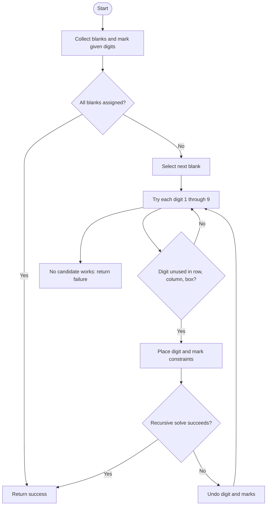

# Sudoku Solver — LeetCode 37

## 1. Understanding

दिलेला 9×9 Sudoku board mutate करून blanks (`.`) भरा. प्रत्येक row, column आणि 3×3 box मध्ये `1`–`9` एकदाच असावेत. Source मध्ये naive आणि occupancy-table backtracking आहे.

## 2. Worked examples and edges

- रिकाम्या cell मध्ये row/column/box मध्ये नसलेला digitच ठेवता येतो.
- Candidate नसल्यास मागील choice undo करा; valid puzzle मध्ये recursion शेवटी पूर्ण board मिळवते.
- पूर्ण board असल्यास रिकामी cell नाही; success. Source input puzzle valid आणि solvable असल्याचे गृहीत धरतो.

## 3. Pattern identification + cheat sheet

| Clue                               | Pattern             | कारण                            |
| ---------------------------------- | ------------------- | ------------------------------- |
| Constraints + choices with undo    | Backtracking        | एक choice पुढचे state अडवू शकते |
| Fixed small domains per cell       | Constraint tracking | Row/column/box occupancy        |
| Complete valid assignment required | DFS search          | Blank-by-blank candidate trial  |

## 4. Approaches

> **मराठी:** सोप्या उपायापासून सुरुवात करा आणि constraints नुसार योग्य optimization निवडा.

- Naive: board scan, each candidate check by scanning row/column/box — exponential search; each validity test O(9).
- Optimized source: collect blanks and row/column/box boolean tables — O(1) candidate check, still exponential worst-case.
- MRV (fewest candidates first) is a possible further optimization, but source does not use it.
- Greedy first-valid digit without backtracking can fail; candidate choice must be undone if later conflict occurs.

## 5. Flowchart

Failed branch वर board आणि तिन्ही occupancy marks restore करणे आवश्यक.

## 6. Algorithm / intuition

प्रत्येक रिकामी cell साठी legal digits वापरून DFS करा. Digit place/mark करा; पुढची cell solve झाली तर success, नाहीतर undo करून पुढचा digit try करा.

## 7. Code explanation

`solveSudoku(board, mode)` default ने `OPTIMIZED` आहे. `emptyCells` क्रमाने blanks ठेवते; `rows`, `cols`, `boxes` digit `d` (0–8) वापरला आहे का track करतात. `getBoxIndex=(i/3)*3+j/3`. `solveNaive` board पुन्हा scan करतो. LeetCode मध्ये judge signature `void solveSudoku(vector<vector<char>>& board)` प्रमाणे adapt करा.

## 8. Dry run

एका blank `(r,c)` वर:
| candidate | row used? | col used? | box used? | action |
|---:|:---:|:---:|:---:|---|
| 1 | yes | — | — | skip |
| 2 | no | no | no | place, mark, recurse |
| deeper state fails | | | | restore `.` and all marks |
| 3 | no | no | no | try next |

## 9. Complexity

`E` blanks असतील तर worst case O(9^E) search; practical branching constraintsमुळे कमी. Optimized candidate lookup O(1), occupancy storage O(81), blanks/recursion O(E). Naive legality check O(9) per attempted digit.

## 10. Correctness

प्रत्येक branch मध्ये फक्त row/column/box constraints पाळणारे digits ठेवले जातात. Search सर्व legal candidates enumerate करते; recursion पूर्ण झाल्यास valid completion सापडतो. Failure वर state restore केल्याने इतर branchesही संपूर्ण तपासले जातात; म्हणून solvable input साठी solution मिळतो.

## 11. Mistakes and interview traps

- Backtrack करताना board आणि occupancy तिन्ही reset करा.
- Box index formula अचूक ठेवा.
- Given clues मधील contradictions source आधी validate करत नाही.
- Member arrays clear होतात; helper object पुन्हा वापरताना state reset महत्त्वाचा.
- Source recursion result `solveSudoku` मधून परत देत नाही; LeetCode signature तरीही board mutate करणे अपेक्षित.

## 12. Quick revision

Blanks → occupancy initialize → candidate try → mark/recurse → failure वर undo. Main method optimized mode चालवतो.

## 13. Related problems / variations

> **मराठी:** प्रश्नात काय दिले आहे आणि नेमके काय शोधायचे आहे, हे आधी स्पष्ट करा.
> N-Queens, Word Search, combination sum, exact-cover / constraint-satisfaction puzzles.

## 14. Self-assessment

1. Backtracking मध्ये कोणता state undo होतो?
2. 3×3 box index कसा मिळतो?
3. Precomputed occupancy candidate check कसा वेगवान करतो?
4. MRV heuristic काय निवडेल?
