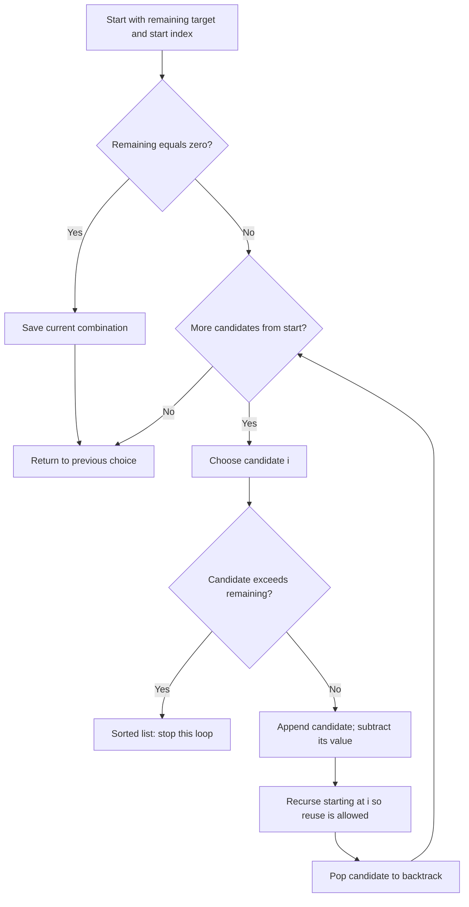

# 39. Combination Sum

## 1. Problem Understanding

Given distinct positive candidate numbers and a target, return all unique combinations summing to the target. A candidate may be reused unlimited times. Order inside a combination does not create a new answer: `[2,3,2]` and `[2,2,3]` represent the same multiset.

## 2. Example Understanding

- `[2,3,6,7]`, target `7`: `[2,2,3]` and `[7]`.
- `[2,3,5]`, target `8`: `[2,2,2,2]`, `[2,3,3]`, `[3,5]`.
- `[2]`, target `1`: no combination.
- Since candidates are positive, once running sum exceeds target, that branch can stop.

## 3. Problem Identification

### Pattern Recognition Cheat Sheet

| Clue in Question             | Possible Pattern                | Why?                                      |
| ---------------------------- | ------------------------------- | ----------------------------------------- |
| Return all combinations      | Backtracking                    | Must enumerate valid choices              |
| Candidate reuse allowed      | Recurse with same index         | Same value can be selected again          |
| Avoid permutation duplicates | Nondecreasing index progression | Each combination gets one canonical order |
| Positive values and target   | Remaining-target pruning        | Overshoot cannot be undone                |

Ask: Is this one answer or all answers? Can an element repeat? How will I avoid generating the same set in a different order?

## 4. Different Approaches

1. **Pick / skip recursion (provided):** At index `i`, either select it and recurse at `i` (reuse), or skip to `i+1`. Correct and covers possibilities.
2. **Sorted backtracking (provided optimized):** Loop over candidates from `start`; choose one and recurse with the same index. Sorting enables `break` when a candidate exceeds remaining target. Both are exponential in the output/search tree; this is inherent when many combinations must be returned.
   | Approach | Time | Space | Pros | Cons |
   |---|---:|---:|---|---|
   | Pick / skip recursion | Exponential, output-sensitive | O(T/min) stack + output | Direct decision tree | Explores skip branches; no sorted pruning |
   | Sorted backtracking | Exponential, output-sensitive | O(T/min) stack + output | Clear combination construction and pruning | Sorting and recursion; output can be large |
   `T` is target. Dynamic programming can count/decide more compactly, but returning every combination still requires output enumeration.

## 5. Flowchart

Same index `i` ठेवला की reuse शक्य; पुढच्या index ने recursive call केल्यास candidate फक्त एकदाच वापरता येईल.

## 6. Algorithm / Intuition

Maintain `current`, `remaining`, and `start`. Select candidate `i`, subtract it, and recurse from `i`; after returning, pop it. The nondecreasing index rule gives each multiset one order, so permutations are not duplicated.

## 7. Code Explanation

[`39.cpp`](./39.cpp) has `solveRecursive` (pick/skip) and `solveBacktracking` (sorted loop). The recursive selection passes `idx` again because reuse is allowed; the loop variant similarly recurses with `i`. `current.pop_back()` undoes the choice. Sorting a copy avoids changing caller input and permits the early `break`. The provided methods assume LeetCode's positive distinct candidates.

## 8. Dry Run

Candidates `[2,3]`, target `7`:
| Step | Variables | Condition | Action | Result |
|---|---|---|---|---|
| 1 | `start=0, rem=7` | Choose `2` | Append 2; recurse from 0, rem 5 | `[2]` |
| 2 | `rem=5` | Choose 2 twice more | Continue same index | `[2,2,2]`, rem 1 |
| 3 | `rem=1` | Next 2 is too large | Backtrack | Remove last 2 |
| 4 | prior `rem=3` | Choose 3 | Complete target | Save `[2,2,3]` |
| 5 | root | Choose 3 path | No further valid combination | Return |

## 9. Complexity Analysis

The search tree is exponential in the worst case (e.g., small candidates produce many branches). For each returned combination, construction costs its length; include output size in the total. Recursion depth is at most `target/minCandidate`, so auxiliary stack/current path is O(T/minCandidate). Sorting is O(C log C).

## 10. Why This Solution Works

At every state, any valid combination either uses the current candidate at least once or not at all. Pick/skip recursion covers both. In loop form, the first chosen value has some index `i`; recurse from `i` to allow repetitions and prevent going backward. Because candidates are positive, the remaining target decreases on each pick and cannot become valid after overshooting; recursion terminates and the base `remaining==0` records exactly valid combinations.

## 11. Common Mistakes & Interview Traps

- Recurse with `i+1` by mistake: that changes the problem to single-use candidates.
- Recurse from `0` each time: creates reordered duplicate combinations.
- Forget to pop after recursion: corrupts sibling branches.
- Sorting-based `break` is valid only because all candidates are positive.
- Constraints guarantee positive values; zero/negative candidates need different termination/pruning.
- Follow-up: return the number of combinations rather than materializing them.

## 12. Revision Notes (Quick Recall)

- **Pattern:** Backtracking combination enumeration.
- **Clues:** All combinations, target sum, unlimited reuse.
- **Intuition:** Build one canonical nondecreasing path; choose again at same index.
- **Steps:** Pick → reduce remaining → recurse → pop; save at zero.
- **Complexity:** Exponential/output-sensitive; depth O(T/min).
- **Trap:** Same index allows reuse; advancing index forbids it.
- **Takeaway:** Index policy defines whether picks repeat and whether permutations duplicate.

## 13. Similar Problem Recognition

Combination Sum II changes one rule: each candidate index is usable once, and duplicate values exist; sort, recurse with `i+1`, and skip same-level duplicates. Coin Change asks for min/count, usually DP. Subset Sum uses each element once. Always identify reuse policy and whether output needs combinations or permutations.

## 14. Final Self-Assessment

1. Why does recursion continue from `i` rather than `i+1`?
2. How does `start` prevent duplicate orderings?
3. When is the sorted `break` safe?
4. Why is the search exponential?
5. What exact change makes this Combination Sum II?
