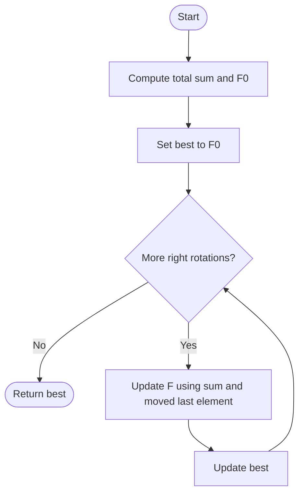

# 396. Rotate Function

Source: `396.cpp`; includes `maxRotateFunctionBrute` and `maxRotateFunctionOptimized`.

## 1. Understanding

> **मराठी:** प्रश्नात काय दिले आहे आणि नेमके काय शोधायचे आहे, हे आधी स्पष्ट करा.
> For each right rotation, score `F(k)=Σ(i * rotated[i])`; return the maximum score. The source defines `F(0)=Σ(i*nums[i])`.

## 2. Worked examples and edges

> **मराठी:** प्रश्नात काय दिले आहे आणि नेमके काय शोधायचे आहे, हे आधी स्पष्ट करा.
> For `[4,3,2,6]`, `F(0)=25`; one right rotation `[6,4,3,2]` scores 16. The recurrence makes the full maximum 26. A one-item array has score 0; zeros and negative values work too.

## 3. Pattern identification + cheat sheet

Repeatedly recomputing a weighted rotation suggests deriving the delta between consecutive states—repeated work avoid करायचं.
| Clue | Pattern |
|---|---|
| Neighboring rotations overlap | Incremental recurrence |
| Same total participates each step | Aggregate reuse |
| Need maximum over all states | Rolling state + best-so-far |

## 4. Approaches

> **मराठी:** सोप्या उपायापासून सुरुवात करा आणि constraints नुसार योग्य optimization निवडा.

- **Direct brute force (`maxRotateFunctionBrute`) — correct, inefficient:** score each of `n` rotations from scratch: `O(n²)`.
- **Recurrence (`maxRotateFunctionOptimized`) — optimal:** precompute sum and `F(0)`, then update each rotation in `O(1)`: `O(n)`.

## 5. Flowchart

Array rotate न करता फक्त score update होतो.

## 6. Algorithm and intuition

> **मराठी:** मुख्य observation समजल्यावर algorithm चे steps लक्षात ठेवणे सोपे होते.
> When rotating right once, every old element's index increases by one, adding `sum(nums)`. The old last item wraps from weight `n-1` to weight `0`, so subtract `n * last`. Thus `F(k)=F(k-1)+sum-n*nums[n-k]`.

## 7. Code explanation

> **मराठी:** Code मधील variable आणि condition यांचा algorithm मधील उद्देश समजून घ्या.
> The optimized function uses `long long` for `sum` and `F`; loop index `k` identifies the element that wraps on the kth rotation. The brute variant indexes a rotated array mathematically without building it.

## 8. Dry run

> **मराठी:** प्रत्येक महत्त्वाच्या step नंतर variable ची value trace करा.
> | State for `[4,3,2,6]` | Calculation | Score |
> |---|---|---:|
> | `F(0)` | `0·4+1·3+2·2+3·6` | 25 |
> | `F(1)` | `25+15-4·6` | 16 |
> | `F(2)` | `16+15-4·2` | 23 |
> | `F(3)` | `23+15-4·3` | 26 |

## 9. Complexity

> **मराठी:** Input size आणि प्रत्येक operation कितीदा चालतो यावरून complexity ठरवा.
> Optimized: `O(n)` time, `O(1)` auxiliary space. Brute: `O(n²)` time, `O(1)` auxiliary space.

## 10. Correctness

> **मराठी:** Invariant किंवा तर्क वापरून algorithm योग्य उत्तर देतो हे समजून घ्या.
> The recurrence accounts for every element's +1 index shift and exactly cancels the wrapped element's old weight. Starting from the exact `F(0)` generates every rotation score. Taking their maximum gives the required answer.

## 11. Mistakes / interview traps

> **मराठी:** Boundary, duplicate आणि off-by-one cases स्वतंत्रपणे तपासा.

- Use the last element of the previous orientation in the recurrence (`nums[n-k]` here).
- Include `F(0)` in the maximum.
- Use a wide intermediate type for products/sums; the function casts the final answer to `int` per constraints.

## 12. Quick revision

`sum = Σnums`, `F0=Σi·nums[i]`; each right turn: `F += sum - n*wrapped`; update max. Formula लक्षात ठेवा.
प्रत्येक rotation पुन्हा score करू नका—delta वापरून वेळ वाचवा.

## 13. Related problems / variations

> **मराठी:** प्रश्नात काय दिले आहे आणि नेमके काय शोधायचे आहे, हे आधी स्पष्ट करा.
> Maximum sum circular subarray; cyclic shifts with incremental score updates; range rotation queries.

## 14. Self-assessment

> **मराठी:** उत्तर न पाहता प्रश्न सोडवा आणि तुमच्या निवडीचे कारण सांगा.

1. Why is `sum(nums)` added at every right rotation?
2. Why subtract `n * wrappedValue`?
3. What makes the recurrence O(1) per rotation?
4. How would you adapt it to a left-rotation convention?
