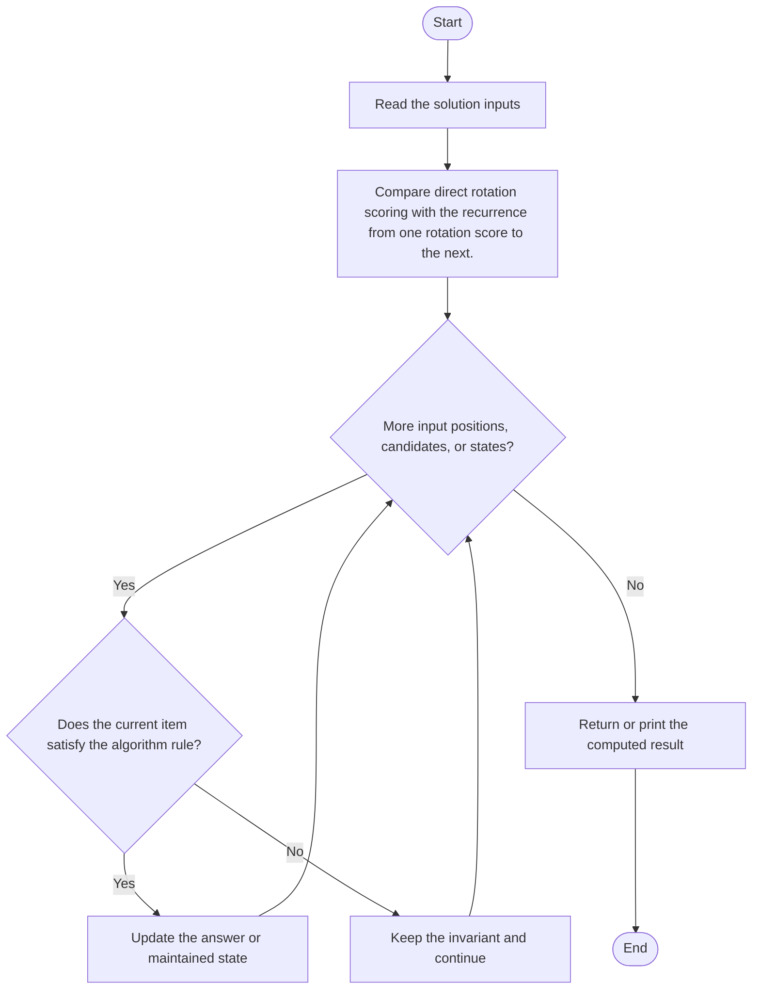
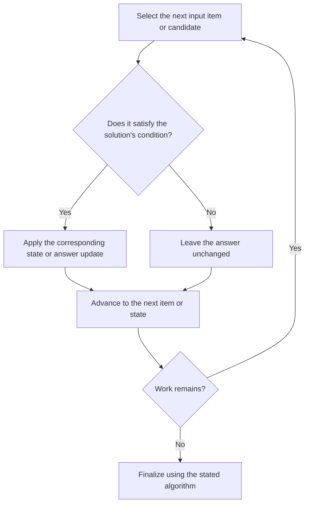
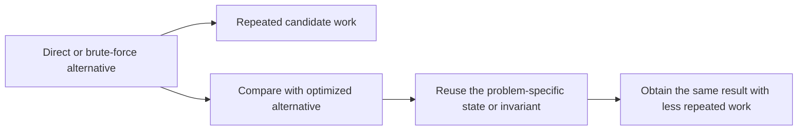

# Rotate Function

**Problem ID:** 396  
**Source:** `maxRotateFunction.cpp`  
**Expected format:** C++ class-method solution with a local demonstration `main()`; see compile guidance below.

## Expected input and output / judge signature

Solution-facing declarations extracted from the source:

- `int maxRotateFunctionBrute(vector<int>& nums)`
- `int maxRotateFunctionOptimized(vector<int>& nums)`
  The inputs and return value are described by these parameter and return types. The local `main()` runs test examples; it does not define a judge stdin/stdout protocol.

## Identification evidence

The filename, solution-facing signature, and implemented behavior support the mapping: Compare direct rotation scoring with the recurrence from one rotation score to the next.

## Main flow

Compare direct rotation scoring with the recurrence from one rotation score to the next.



## Important branch and loop flow

The repeated step processes the next input item, candidate, or state. The branch either applies the algorithm's update or leaves the state unchanged, then continues until no work remains.



## Core logic and invariant

Compare direct rotation scoring with the recurrence from one rotation score to the next.
After each processed item or recursive state, the algorithm's maintained state represents the work accepted so far under the rule above; the final result is read from that accumulated state or returned by the terminal case.

## Complexity

- **Time:** O(n) optimized; O(n^2) brute.
- **Auxiliary space:** O(1).

## Approach comparison

The source contains multiple implementations for comparison:

- `int maxRotateFunctionBrute(vector<int>& nums)`
- `int maxRotateFunctionOptimized(vector<int>& nums)`
  The approach described above is the primary strategy; where a direct/brute-force alternative is present, the optimized version reduces repeated work by reusing the state, ordering, or invariant described above. Complexity is qualified by variant where known.



## Compile and run

This source includes a demonstration `main()` and can be compiled with a C++17 compiler from the repository root:

```powershell
g++ -std=c++17 "LeetCode\396\396.cpp" -o solution.exe
.\solution.exe
```

For LeetCode's class-method judge, use the relevant method signature above and adapt the local harness: remove the demonstration `main()` and reconcile locally declared node/helper types with judge-provided definitions. Source bytes were preserved exactly during the move.
