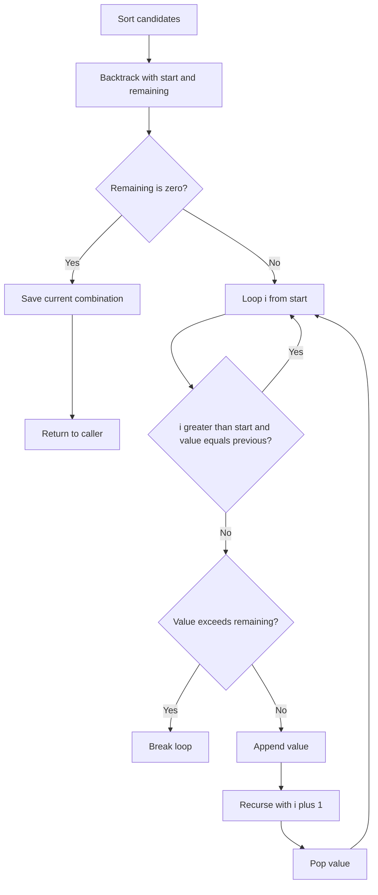

# 40. Combination Sum II

## 1. Problem Understanding

Given candidates that may contain duplicate values and a target, find unique combinations summing to target. Each **array element/index** can be used at most once. Duplicate values at different indexes exist, but identical value-combinations should appear only once.

## 2. Example Understanding

- `[10,1,2,7,6,1,5]`, target `8` → `[1,1,6]`, `[1,2,5]`, `[1,7]`, `[2,6]`.
- Two `1`s may both be selected in `[1,1,6]`, but choosing either identical `1` as the first choice must not create duplicate `[1,7]` answers.
- If all candidates exceed target, output is empty.

## 3. Problem Identification

### Pattern Recognition Cheat Sheet

| Clue in Question               | Possible Pattern                     | Why?                                     |
| ------------------------------ | ------------------------------------ | ---------------------------------------- |
| Return unique combinations     | Backtracking with canonical ordering | Enumerate without permutation duplicates |
| Each element at most once      | Advance to `i+1`                     | No index reuse                           |
| Input has repeated values      | Sort and skip same-level duplicates  | Equivalent choices at one decision level |
| Target sum and positive values | Remaining-target pruning             | Overshoot cannot recover                 |

Ask: Are duplicate values equivalent at this depth? Have I distinguished skipping an index from skipping all identical values at this level?

## 4. Different Approaches

1. **Generate then deduplicate (provided brute variant):** Sort, recursively use each index once, collect results, sort/unique all answers. Correct but stores duplicate results and spends time deduplicating.
2. **Skip duplicates during backtracking (optimized):** At a recursion level, if `i>start` and `a[i]==a[i-1]`, skip. Recurse from `i+1` so each index is used once. Sorted order also allows breaking when `a[i]>remaining`.
   | Approach | Time | Space | Pros | Cons |
   |---|---:|---:|---|---|
   | Generate + deduplicate | Exponential plus output sorting | Search + duplicate output | Easy correctness baseline | Wasteful memory/time |
   | Skip same-level duplicates | Exponential/output-sensitive | O(n) stack/path + output | Avoids duplicate branches early | Skip condition needs correct level |

## 5. Flowchart

Duplicate skip फक्त **same recursion depth** साठी आहे. पुढच्या depth ला equal value निवडणे valid आहे—जसे `[1,1,6]`.

## 6. Algorithm / Intuition

Sort first. At each depth, choose one candidate index. Identical values at later indexes would create the same branch if chosen as the first pick at this same depth, so skip them. Recurse with `i+1` to ensure no element index is reused.

## 7. Code Explanation

[`40.cpp`](./40.cpp) implements both versions. `solveBrute` gathers duplicates and `combinationSum2Brute` sorts/uniques the result. `solveOptimized` uses `if (i > start && candidates[i] == candidates[i-1]) continue;`, breaks on overshoot, and recurses with `i+1`. The `ans1`/`ans2` members are cleared before each public call, so repeated calls do not leak old answers.

## 8. Dry Run

Sorted `[1,1,2]`, target `3`:
| Step | Variables | Condition | Action | Result |
|---|---|---|---|---|
| 1 | `start=0, rem=3, i=0` | First 1 at level | Choose; recurse at 1 | Path `[1]`, rem 2 |
| 2 | `start=1, rem=2, i=1` | First choice at this level | Choose 1; recurse | `[1,1]`, rem 1 |
| 3 | deeper | 2 exceeds rem 1 | Break | Backtrack |
| 4 | `start=1, rem=2, i=2` | Choose 2 | Complete target | Save `[1,2]` |
| 5 | root `i=1` | Duplicate 1 at same level | Skip | No duplicate `[1,2]` branch |

## 9. Complexity Analysis

Worst-case search remains exponential, as subsets may need exploration. Sorting costs O(n log n); each returned combination incurs output-copy cost. Auxiliary recursion/current path is O(n), excluding result storage. The optimized approach avoids generating duplicate branches, but does not change exponential worst-case order.

## 10. Why This Solution Works

Every valid answer corresponds to choosing increasing indices, so recursion with `i+1` considers it. Sorting makes equal values adjacent. If two equal values are chosen as alternative first picks at the same depth, they produce the same value-combinations; keeping only the first removes duplicates. At deeper levels, selecting the next equal value remains allowed, preserving combinations that need repeated values. Positivity ensures pruning and termination.

## 11. Common Mistakes & Interview Traps

- Use `i > start`, not just `i > 0`; equal values may be selected on a later level.
- Recurse with `i+1` because each index is single-use.
- Not sorting makes duplicate skipping and overshoot break invalid.
- Skipping every repeat globally would lose `[1,1,...]` combinations.
- Early `target==0` return is correct because candidates are positive.
- Follow-up: compare with Combination Sum I, where reuse is allowed and duplicate values are absent by constraint.

## 12. Revision Notes (Quick Recall)

- **Pattern:** Sort + backtracking + same-level duplicate skip.
- **Clues:** Unique combinations, repeated values, each index once.
- **Intuition:** Increasing index order canonicalizes; skip equivalent choices at the same depth.
- **Steps:** Sort → choose → recurse at `i+1` → pop; break on overshoot.
- **Complexity:** Exponential worst case; O(n) auxiliary space plus output.
- **Trap:** Same-level duplicates are skipped; deeper duplicates may be chosen.
- **Takeaway:** Deduplicate decisions, not values globally.

## 13. Similar Problem Recognition

Combination Sum I permits unlimited reuse and uses recursion index `i`; this problem uses `i+1` and same-depth duplicate skipping. Subsets II uses the same duplicate rule but no target. If candidates can be negative, overshoot pruning is no longer safe.

## 14. Final Self-Assessment

1. Why is duplicate skipping conditioned on `i > start`?
2. Why can `[1,1,6]` still be generated?
3. What ensures an index is used only once?
4. Why must candidates be sorted before `break`?
5. How does this differ from Combination Sum I?
