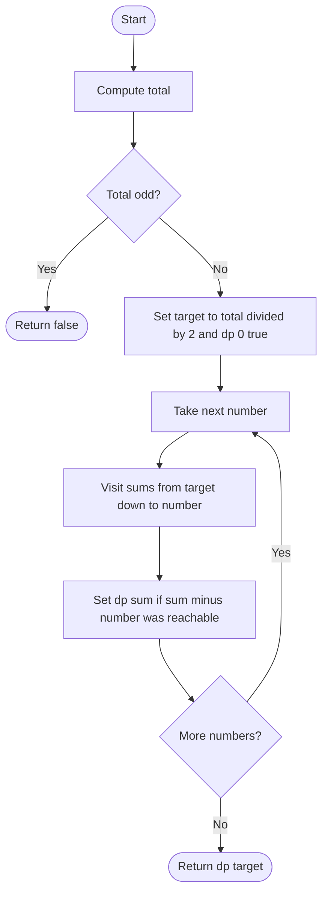

# 416. Partition Equal Subset Sum

Source: `416.cpp`; `canPartition(vector<int>& nums)`.

## 1. Understanding

> **मराठी:** प्रश्नात काय दिले आहे आणि नेमके काय शोधायचे आहे, हे आधी स्पष्ट करा.
> Can the numbers be divided into two disjoint groups with equal sums? This is equivalent to finding a subset summing to half the total. Mhanje subset-sum decision.

## 2. Worked examples and edges

> **मराठी:** प्रश्नात काय दिले आहे आणि नेमके काय शोधायचे आहे, हे आधी स्पष्ट करा.
> `[1,5,11,5]` has total 22 and subset `{11}` → true. `[1,2,3,5]` has odd total 11 → false immediately. The original constraints use positive values.

## 3. Pattern identification + cheat sheet

> **मराठी:** या clues मुळे योग्य pattern ओळखता येतो; constraints आणि relations नीट तपासा.
> Equal partition is a 0/1 subset-sum problem.
> | Clue | Pattern |
> |---|---|
> | Choose each number zero or one time | 0/1 knapsack |
> | Reach a target sum | Boolean subset DP |
> | Compress memory | 1D DP, iterate downward |

## 4. Approaches

> **मराठी:** सोप्या उपायापासून सुरुवात करा आणि constraints नुसार योग्य optimization निवडा.

- **Try all subsets — correct but exponential:** `O(2^n)`.
- **2D subset DP — correct:** `O(n·target)` time and space.
- **1D descending DP — used and space-optimal:** `O(n·target)` time, `O(target)` space.
- An ascending loop is incorrect for 0/1 use because it can reuse the current number.

## 5. Flowchart

> **मराठी:** Flowchart मधील decision, loop आणि termination condition क्रमाने समजून घ्या.

Descending sums ensure the current number contributes at most once.

## 6. Algorithm and intuition

> **मराठी:** मुख्य observation समजल्यावर algorithm चे steps लक्षात ठेवणे सोपे होते.
> `dp[s]` means some processed subset totals `s`. `dp[0]=true`; for each value `x`, update `dp[s] |= dp[s-x]` from high to low. Odd total means equal halves ashakya.

## 7. Code explanation

> **मराठी:** Code मधील variable आणि condition यांचा algorithm मधील उद्देश समजून घ्या.
> `accumulate` computes total; the method rejects odd totals, allocates `target+1` booleans, then performs the in-place 0/1 transition. It returns reachability of `target`.

## 8. Dry run

> **मराठी:** प्रत्येक महत्त्वाच्या step नंतर variable ची value trace करा.
> | Number processed | Reachable sums up to 11 |
> |---|---|
> | Start | `{0}` |
> | 1 | `{0,1}` |
> | 5 | `{0,1,5,6}` |
> | 11 | target 11 becomes reachable |
> | final 5 | remains true; answer `true` |

## 9. Complexity

> **मराठी:** Input size आणि प्रत्येक operation कितीदा चालतो यावरून complexity ठरवा.
> Let `target=total/2`: `O(n·target)` time and `O(target)` auxiliary space.

## 10. Correctness

> **मराठी:** Invariant किंवा तर्क वापरून algorithm योग्य उत्तर देतो हे समजून घ्या.
> Initially only sum zero is reachable. For each number `x`, every new reachable sum either was already reachable or is an old reachable sum plus `x`; descending order prevents reusing `x`. Hence `dp[target]` exactly signals a half-total subset, whose complement has the same sum.

## 11. Mistakes / interview traps

> **मराठी:** Boundary, duplicate आणि off-by-one cases स्वतंत्रपणे तपासा.

- Reject odd totals first.
- Iterate `s` downward; ascending is unbounded-knapsack behavior.
- `dp[0]` must start true.
- Complexity depends on numeric target (pseudo-polynomial), not only `n`.

## 12. Quick revision

Odd sum → false. Else target half; boolean DP; each `x` updates target-to-`x` descending; return `dp[target]`. One-dimensional trick विसरू नका.
Descending update मुळे एक number पुन्हा वापरला जात नाही.

## 13. Related problems / variations

> **मराठी:** प्रश्नात काय दिले आहे आणि नेमके काय शोधायचे आहे, हे आधी स्पष्ट करा.
> Subset Sum; Target Sum; 0/1 Knapsack; minimum difference partition; count subsets reaching a target.

## 14. Self-assessment

> **मराठी:** उत्तर न पाहता प्रश्न सोडवा आणि तुमच्या निवडीचे कारण सांगा.

1. Why is equal partition equivalent to target `total/2`?
2. What goes wrong with ascending updates?
3. Why is this pseudo-polynomial?
4. How would you return an actual partition, not just a boolean?
