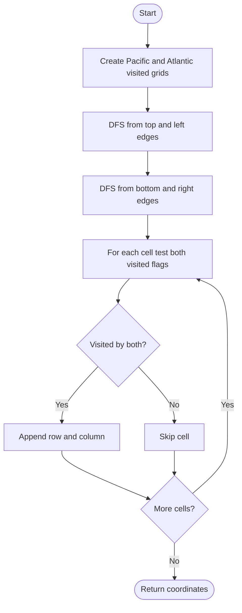

# 417. Pacific Atlantic Water Flow

Source: `417.cpp`; DFS helper and `pacificAtlantic(vector<vector<int>>& heights)`.

## 1. Understanding

> **मराठी:** प्रश्नात काय दिले आहे आणि नेमके काय शोधायचे आहे, हे आधी स्पष्ट करा.
> Return grid cells from which water can flow to both the Pacific (top/left edges) and Atlantic (bottom/right edges). Water flows downhill or level.

## 2. Worked examples and edges

> **मराठी:** प्रश्नात काय दिले आहे आणि नेमके काय शोधायचे आहे, हे आधी स्पष्ट करा.
> From a cell of height 3, a neighboring height 4 can flow back to it only in reverse search; equal-height neighbors are allowed. A single cell touches both oceans and belongs in the answer. Source assumes a nonempty rectangular grid.

## 3. Pattern identification + cheat sheet

> **मराठी:** या clues मुळे योग्य pattern ओळखता येतो; constraints आणि relations नीट तपासा.
> Instead of checking a path outward from every cell, reverse edges and search inward from each destination boundary.
> | Clue | Pattern |
> |---|---|
> | Reach a boundary destination from many cells | Reverse graph traversal |
> | Reachability to two destinations | Two visited sets + intersection |
> | Grid neighbors | DFS/BFS, 4 directions |

## 4. Approaches

> **मराठी:** सोप्या उपायापासून सुरुवात करा आणि constraints नुसार योग्य optimization निवडा.

- **DFS from every cell toward each ocean — correct but potentially `O((RC)^2)`** due to repeated exploration.
- **Reverse DFS/BFS from ocean boundaries — used and optimal:** each cell marked at most once per ocean, `O(RC)`.

## 5. Flowchart

Reverse flow मध्ये current cellपेक्षा उंच किंवा समान neighbor कडे जाता येते.

## 6. Algorithm and intuition

> **मराठी:** मुख्य observation समजल्यावर algorithm चे steps लक्षात ठेवणे सोपे होते.
> If water can flow from cell `X` to ocean-side cell `Y`, reverse search from `Y` can reach `X` when `height[X] >= height[Y]`. Mark cells reachable backward from each ocean; their intersection is the answer.

## 7. Code explanation

> **मराठी:** Code मधील variable आणि condition यांचा algorithm मधील उद्देश समजून घ्या.
> `dfs` marks a cell, checks four neighbors, and rejects out-of-bounds, visited, or lower neighbors. `pacificAtlantic` starts two traversals from all boundary cells and scans both boolean matrices.

## 8. Dry run

> **मराठी:** प्रत्येक महत्त्वाच्या step नंतर variable ची value trace करा.
> | Reverse-search step | Height test | Result |
> |---|---|---|
> | At boundary `(0,0)`, height 1 | neighbor height 2 ≥ 1 | mark `(0,1)` |
> | From `(0,1)`, height 2 | neighbor height 1 < 2 | do not visit it |
> | Final scan | both visited flags true | include that cell |

## 9. Complexity

> **मराठी:** Input size आणि प्रत्येक operation कितीदा चालतो यावरून complexity ठरवा.
> For `R×C`: `O(RC)` time and `O(RC)` visited/recursion space. Recursion depth can reach `O(RC)`.

## 10. Correctness

> **मराठी:** Invariant किंवा तर्क वापरून algorithm योग्य उत्तर देतो हे समजून घ्या.
> Reverse DFS visits exactly cells that can reach the chosen ocean: each step reverses a legal downhill-or-level edge, and every valid reverse path is explored. A cell can reach both iff it appears in both reverse reachable sets; intersection returns precisely those cells.

## 11. Mistakes / interview traps

> **मराठी:** Boundary, duplicate आणि off-by-one cases स्वतंत्रपणे तपासा.

- Reverse traversal must use `neighbor >= current`, not downhill.
- Start searches on all four boundary sides; duplicate corner visits are harmless.
- Keep independent visited grids for the two oceans.
- Recursive DFS may risk stack depth; iterative BFS/DFS avoids it.

## 12. Quick revision

DFS from each ocean inward; climb-or-flat only; intersect reachability. Direction उलटी करायची.
दोन्ही visited grids चा intersection हाच final answer आहे.

## 13. Related problems / variations

> **मराठी:** प्रश्नात काय दिले आहे आणि नेमके काय शोधायचे आहे, हे आधी स्पष्ट करा.
> Surrounded Regions; Number of Islands; multi-source BFS; reachability to multiple graph sinks.

## 14. Self-assessment

> **मराठी:** उत्तर न पाहता प्रश्न सोडवा आणि तुमच्या निवडीचे कारण सांगा.

1. Why reverse the direction of water flow?
2. Why use two visited matrices?
3. What height relation permits a reverse move?
4. How would multi-source BFS replace DFS here?
