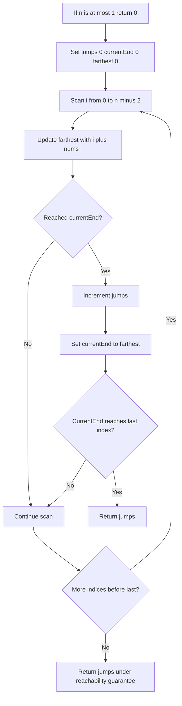

# 45. Jump Game II

## 1. Problem Understanding

`nums[i]` is the maximum forward jump length from index `i`. Return the minimum jumps needed to reach the last index. You may jump any distance from `1` to `nums[i]`; the original problem guarantees the end is reachable.

## 2. Example Understanding

- `[2,3,1,1,4]` → `2`: jump index `0→1`, then `1→4`.
- `[2,3,0,1,4]` → `2`: same optimal reach.
- `[0]` → `0`: already at the destination.
- Unreachable `[3,2,1,0,4]` is **outside the original problem guarantee**; code variants may return different sentinel/incorrect results there.

## 3. Problem Identification

### Pattern Recognition Cheat Sheet

| Clue in Question                     | Possible Pattern                   | Why?                                     |
| ------------------------------------ | ---------------------------------- | ---------------------------------------- |
| Minimum number of jumps              | Shortest-path/BFS layers or greedy | Each jump is one move                    |
| Index offers a range of next indices | Reachable interval                 | One layer covers a contiguous frontier   |
| Asked minimum, not path              | Greedy range expansion             | Track farthest next reach per jump layer |

Ask: What indices can be reached with the current number of jumps? When have I finished scanning that frontier?

## 4. Different Approaches

1. **Brute recursion:** Try every legal jump and take the minimum; exponential due to repeated destinations.
2. **Memoization / tabulation:** State is minimum jumps from index `i` to end; evaluate reachable successors. O(n²), O(n) memory.
3. **Greedy layer expansion (provided final):** `currentEnd` is the end of the current jump-count layer; `farthest` is the next layer's farthest reachable index. When scan reaches `currentEnd`, commit one jump and set the next boundary.
   | Approach | Time | Space | Pros | Cons |
   |---|---:|---:|---|---|
   | Recursive search | Exponential | O(n) stack | Clear choices | Repeats work |
   | Memoization/tabulation | O(n²) | O(n) | Easy to reason about optimality | Slower than necessary |
   | Greedy | O(n) | O(1) | Optimal and simple | Needs layer invariant and reachable-input guarantee |

## 5. Flowchart

Current layer chi boundary संपेपर्यंत पुढच्या layer मधील maximum reach जमा करतो. Boundary वर पोचल्यावरच एक jump count करतो.

## 6. Algorithm / Intuition

Think of BFS without explicitly queuing indices. All indices in `[previousEnd+1, currentEnd]` represent positions reachable with the same jump count; scanning them finds the next farthest boundary. Increment jumps only when the current layer ends.

## 7. Code Explanation

[`45.cpp`](./45.cpp) provides recursion, memoization, tabulation, and `solveGreedy`. `farthest=max(farthest,i+nums[i])`; at `i==currentEnd`, increment `jumps` and advance the boundary. The loop stops before the last index because reaching it ends the answer. Important: the greedy function relies on LeetCode’s guarantee that the end is reachable. The local demo includes an unreachable test, which violates that guarantee; in such a generalized API, return an explicit unreachable result rather than this method’s fallback.

## 8. Dry Run

`[2,3,1,1,4]`:
| Step | Variables | Condition | Action | Result |
|---|---|---|---|---|
| 1 | `i=0,end=0,far=0,jumps=0` | Scan index 0 | `far=max(0,0+2)=2`; at boundary | jumps=1, end=2 |
| 2 | `i=1,end=2` | Inside current layer | `far=max(2,1+3)=4` | Next layer reaches index 4 |
| 3 | `i=2,end=2` | Boundary reached | jumps=2, end=4 | Destination reached |
| 4 | — | end ≥ last index | Return | `2` |

## 9. Complexity Analysis

The loop visits at most `n-1` indices once: **O(n)** time, **O(1)** extra space. The DP variants take O(n²) time because each index may examine O(n) reachable destinations; memoization uses O(n) cache plus recursion.

## 10. Why This Solution Works

At each layer boundary, all positions reachable in the current number of jumps have been considered. `farthest` is the maximum next index reachable from any of them, so choosing it as the next layer boundary cannot miss a position reachable with one more jump. Committing only at the boundary guarantees no earlier jump count could reach the next layer. Repeating yields the minimum number of jumps. It terminates as the problem guarantees progress to the end.

## 11. Common Mistakes & Interview Traps

- Incrementing jumps for every index instead of once per layer.
- Updating `currentEnd` for each index rather than at layer boundary.
- Use `i < n-1`; scanning the destination can overcount.
- Distinguish Jump Game I (reachability) from Jump Game II (minimum jumps).
- In generalized inputs, unreachable arrays need explicit detection (`farthest <= currentEnd` at a boundary).
- The sample's unreachable case is outside LC45's guarantee; don't treat its returned value as meaningful.

## 12. Revision Notes (Quick Recall)

- **Pattern:** Greedy BFS-layer / range expansion.
- **Clue:** Minimum jumps; each index reaches a contiguous range.
- **Intuition:** Scan current layer, find farthest next boundary, count one jump.
- **Variables:** `currentEnd` = current layer limit; `farthest` = next layer reach.
- **Complexity:** O(n) time, O(1) space.
- **Trap:** Increment only when `i == currentEnd`.
- **Takeaway:** Compress BFS levels into interval boundaries.

## 13. Similar Problem Recognition

Jump Game I asks whether an end is reachable and tracks max reachable index. Jump Game II adds minimum levels. This greedy works because all destinations from an index form an interval; arbitrary graph edges would generally need BFS/Dijkstra. If path reconstruction is needed, store which index extended the farthest reach.

## 14. Final Self-Assessment

1. What do `currentEnd` and `farthest` represent?
2. Why is the count incremented at a boundary?
3. Why can the destination be excluded from the scan?
4. What changes if unreachable inputs are permitted?
5. Compare this with Jump Game I.
