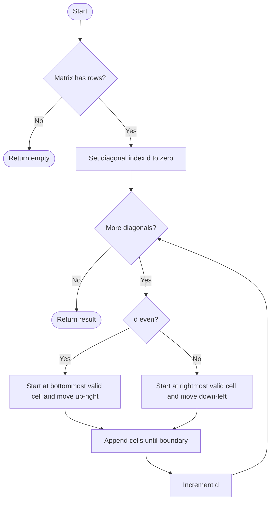

# 498. Diagonal Traverse

Source: `498.cpp`; `findDiagonalOrder(vector<vector<int>>& mat)`.

## 1. Understanding

> **मराठी:** प्रश्नात काय दिले आहे आणि नेमके काय शोधायचे आहे, हे आधी स्पष्ट करा.
> Visit every matrix element by diagonals running top-right to bottom-left, alternating direction. Output is one flattened vector.

## 2. Worked examples and edges

> **मराठी:** प्रश्नात काय दिले आहे आणि नेमके काय शोधायचे आहे, हे आधी स्पष्ट करा.
> For `[[1,2,3],[4,5,6],[7,8,9]]`, order is `[1,2,4,7,5,3,6,8,9]`. A `1×N` or `N×1` matrix stays in natural order. Code returns empty for zero rows; expected input has nonempty rows.

## 3. Pattern identification + cheat sheet

> **मराठी:** या clues मुळे योग्य pattern ओळखता येतो; constraints आणि relations नीट तपासा.
> Matrix elements share diagonal index `d=r+c`; parity controls direction.
> | Clue | Pattern |
> |---|---|
> | Same `r+c` | Diagonal grouping |
> | Alternating sweep direction | Parity-based traversal |
> | Need each cell once | Boundary-clamped coordinates |

## 4. Approaches

> **मराठी:** सोप्या उपायापासून सुरुवात करा आणि constraints नुसार योग्य optimization निवडा.

- **Group all cells by `r+c` then reverse alternating groups — correct, extra storage:** `O(mn)` time/space.
- **Walk each diagonal directly — used and optimal:** `O(mn)` time; only output storage beyond constant working variables.

## 5. Flowchart

> **मराठी:** Flowchart मधील decision, loop आणि termination condition क्रमाने समजून घ्या.

The start is clamped to the last row or column so rectangular matrices work.

## 6. Algorithm and intuition

> **मराठी:** मुख्य observation समजल्यावर algorithm चे steps लक्षात ठेवणे सोपे होते.
> There are `m+n-1` diagonals. For even `d`, choose `r=min(d,m-1), c=d-r` then move `(-1,+1)`. For odd `d`, choose `c=min(d,n-1), r=d-c` then move `(+1,-1)`.

## 7. Code explanation

> **मराठी:** Code मधील variable आणि condition यांचा algorithm मधील उद्देश समजून घ्या.
> The outer loop selects a diagonal; each parity branch emits its coordinates while both indices remain valid. `res` is the output. `mat[0].size()` supplies column count.

## 8. Dry run

> **मराठी:** प्रत्येक महत्त्वाच्या step नंतर variable ची value trace करा.
> | `d` | Cells visited | Direction |
> |---:|---|---|
> | 0 | `(0,0)` | up-right |
> | 1 | `(0,1),(1,0)` | down-left |
> | 2 | `(2,0),(1,1),(0,2)` | up-right |

## 9. Complexity

> **मराठी:** Input size आणि प्रत्येक operation कितीदा चालतो यावरून complexity ठरवा.
> `O(mn)` time; `O(1)` traversal workspace, excluding the `O(mn)` returned vector.

## 10. Correctness

> **मराठी:** Invariant किंवा तर्क वापरून algorithm योग्य उत्तर देतो हे समजून घ्या.
> Every cell belongs to exactly one diagonal `r+c`. The loop covers every valid diagonal index; its starting point is the boundary endpoint for the requested direction, and each step visits all cells on that diagonal once. Thus all cells appear once in alternating required order.

## 11. Mistakes / interview traps

> **मराठी:** Boundary, duplicate आणि off-by-one cases स्वतंत्रपणे तपासा.

- Rectangular matrix starts differ from square-matrix assumptions; clamp with `min`.
- `d` ranges through `m+n-2`.
- Distinguish auxiliary space from the returned output.

## 12. Quick revision

Diagonal id `r+c`; even goes up-right, odd goes down-left; clamp start, then walk to edge.
प्रत्येक cell एकदाच भेटतो; फक्त direction parity नुसार बदलते.

## 13. Related problems / variations

> **मराठी:** प्रश्नात काय दिले आहे आणि नेमके काय शोधायचे आहे, हे आधी स्पष्ट करा.
> Diagonal Traverse II; spiral matrix; zigzag level-order traversal.

## 14. Self-assessment

> **मराठी:** उत्तर न पाहता प्रश्न सोडवा आणि तुमच्या निवडीचे कारण सांगा.

1. How many diagonals does an `m×n` matrix have?
2. Why does `r+c` identify a diagonal?
3. How do you adapt the start for a wide matrix?
4. What is extra space if output is not counted?
