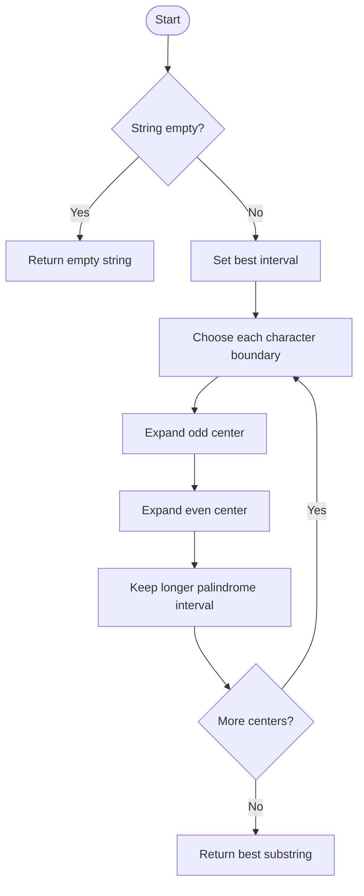

# Longest Palindromic Substring — LeetCode 5

## 1. Understanding

दिलेल्या string मधील सर्वात लांब contiguous palindrome परत करा. Code मध्ये तीन brute-force checks आणि center expansion आहे; equal-length answers पैकी कोणताही वैध आहे.

## 2. Worked examples and edges

- `"babad"` → `"bab"` किंवा `"aba"`.
- `"cbbd"` → `"bb"` (even-length केंद्र).
- `"a"` → `"a"`; `""` → `""`; `"ac"` → length 1 पैकी एक.

## 3. Pattern identification + cheat sheet

| Clue                                | Pattern              | कारण                              |
| ----------------------------------- | -------------------- | --------------------------------- |
| Palindrome substring                | Two-ended comparison | बाहेरील chars समान असले पाहिजेत   |
| प्रत्येक possible palindrome center | Expand around center | Odd आणि even centers तपासता येतात |
| सर्व substrings enumerate           | Brute force / DP     | तुलना करून वेळ वाचवता येतो        |

## 4. Approaches

- Brute force + iterative/recursive palindrome check: O(n³) time, O(1) extra (recursive stack O(n)).
- Memoized interval checks: O(n²) time/space; source मध्ये प्रत्येक `(l,r)` check cache होतो.
- `CenterExpand`: O(n²) time, O(1) extra; practical optimal simple solution.
- चुकीचा उपाय: फक्त `i,i` center तपासल्यास `"bb"` सारखे even palindrome सुटतात.

## 5. Flowchart

प्रत्येक character आणि प्रत्येक adjacent pair center म्हणून तपासला जातो.

## 6. Algorithm / intuition

Palindrome चे दोन्ही टोक center पासून बाहेर वाढतात. Characters समान असताना expand करा; थांबल्यावर त्या center ची length काढून global best राखा.

## 7. Code explanation

`expandFromCenter(s,l,r)` ला odd (`i,i`) किंवा even (`i,i+1`) center दिला जातो. `CenterExpand` length वरून `start/end` बदलतो. इतर methods `isPalindromeIter`, `isPalindromeRec`, `isPalindromeMemo` वापरून substrings enumerate करतात. Empty input साठी optimized method explicit return करतो.

## 8. Dry run

> **मराठी:** प्रत्येक महत्त्वाच्या step नंतर variable ची value trace करा.
> `"cbbd"`:
> | center | kind | expansion | length | best |
> |---:|---|---|---:|---|
> | 1 | even (1,2) | `"bb"` then mismatch | 2 | `"bb"` |
> | 0,1,2,3 | odd/even others | single chars or empty | ≤1 | `"bb"` |

## 9. Complexity

> **मराठी:** Input size आणि प्रत्येक operation कितीदा चालतो यावरून complexity ठरवा.
> Center expansion O(n²) time, O(1) auxiliary space. Memoized approach O(n²) time and O(n²) memory; uncached brute force O(n³), recursive check stack up to O(n).

## 10. Correctness

प्रत्येक palindrome ला एक center असतो: odd length साठी मध्य अक्षर, even साठी दोन मध्य अक्षरांमधील जागा. दोन्ही center types पूर्णपणे expand केल्याने प्रत्येक संभाव्य palindrome तपासला जातो; maximum interval उत्तर आहे.

## 11. Mistakes and interview traps

- Even centers विसरू नका.
- `r-l-1` ही expansion नंतरची length आहे; mismatch indices समाविष्ट नसतात.
- Tie असताना code `>` वापरतो, त्यामुळे पहिला longest interval राहतो.
- Longest palindrome substring शोधायचा, palindrome subsequence नाही.

## 12. Quick revision

प्रत्येक index वर odd आणि gap वर even expansion; best interval update. Time O(n²), extra O(1).

## 13. Related problems / variations

> **मराठी:** प्रश्नात काय दिले आहे आणि नेमके काय शोधायचे आहे, हे आधी स्पष्ट करा.
> Palindromic Substrings, palindrome partitioning, longest palindromic subsequence, Manacher’s algorithm.

## 14. Self-assessment

1. `"cbbd"` साठी even center कुठे?
2. प्रत्येक center मधून विस्तार का पुरेसा?
3. Code कसा tie resolve करतो?
4. Memoization ची time/space trade-off काय?
