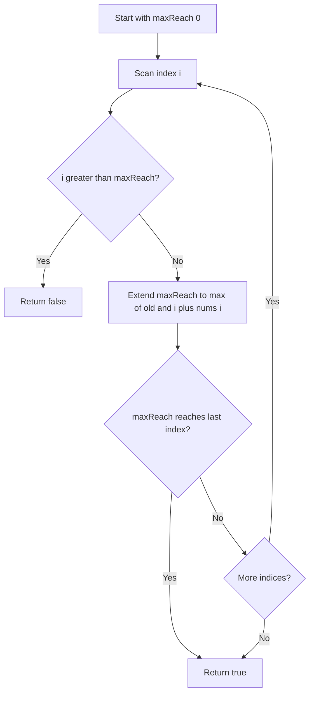

# 55. Jump Game

## 1. Problem Understanding

Given `nums`, start at index `0`; `nums[i]` is the maximum distance you may jump forward. Return whether the last index is reachable. You can choose any jump length from `0` through `nums[i]`.

## 2. Example Understanding

- `[2,3,1,1,4]` → true: `0→1→4`.
- `[3,2,1,0,4]` → false: reachable positions stop at index `3`; its zero jump cannot advance.
- `[0]` → true: start is already the last index.
- A zero is not automatically failure; it is failure only when it blocks every route to the end.

## 3. Problem Identification

### Pattern Recognition Cheat Sheet

| Clue in Question              | Possible Pattern    | Why?                                        |
| ----------------------------- | ------------------- | ------------------------------------------- |
| Maximum jump from each index  | Greedy reachability | Maintain farthest reachable position        |
| Only asks possible/impossible | Boolean decision    | No need to minimize path length             |
| Forward-only positions        | Prefix frontier     | If current index lies beyond frontier, stop |

Ask: What is the farthest index reachable using all positions seen so far? If my scan index exceeds it, can any later position be reached?

## 4. Different Approaches

1. **Recursive DFS:** Try each jump length; correct but exponential.
2. **Memoization:** Cache whether each index can reach the end; O(n²) worst-case.
3. **Greedy (provided):** Scan left to right. If `i>maxReach`, this position is unreachable and so is the end. Otherwise extend `maxReach=max(maxReach,i+nums[i])`. O(n).
   | Approach | Time | Space | Pros | Cons |
   |---|---:|---:|---|---|
   | Recursion | Exponential | O(n) stack | Directly models jumps | Repeats many routes |
   | Memoization | O(n²) | O(n) + stack | Avoids repeated states | More work than needed |
   | Greedy | O(n) | O(1) | Fast and compact | Need reachability invariant |

## 5. Flowchart

Reachable frontier च्या आत असलेलेच index process करतो. Frontier पुढे वाढत नसेल आणि पुढचा index त्यापलीकडे असेल, answer false.

## 6. Algorithm / Intuition

`maxReach` summarizes all previously reachable positions. Process index `i` only when it is within this frontier; its jump may extend the frontier. If frontier reaches `n-1`, return true.

## 7. Code Explanation

[`55.cpp`](./55.cpp) has `solveRecursive`, `solveMemo`, and `solveGreedy`. In greedy, `i>maxReach` is an unreachable gap; otherwise update max reach. Returning true after the loop is valid because if the last index was not passed, every scanned index was reachable and the final scan reaches the end. The LC contract has a non-empty array. `main` is comparison/testing code.

## 8. Dry Run

`[3,2,1,0,4]`:
| Step | Variables | Condition | Action | Result |
|---|---|---|---|---|
| 1 | `i=0,maxReach=0` | `0<=0` | Extend to `max(0,3)` | 3 |
| 2 | `i=1,maxReach=3` | Reachable | Extend to `max(3,3)` | 3 |
| 3 | `i=2,maxReach=3` | Reachable | Extend to `max(3,3)` | 3 |
| 4 | `i=3,maxReach=3` | Reachable, value 0 | Reach unchanged | 3 |
| 5 | `i=4,maxReach=3` | `4>3` | Stop | false |

## 9. Complexity Analysis

One pass gives **O(n)** time and **O(1)** extra space. Recursive DFS may branch up to `nums[i]` choices and be exponential; memoization evaluates n states, each potentially checking O(n) jumps.

## 10. Why This Solution Works

Invariant: before processing index `i`, every index at or before `maxReach` that has been reached is reachable from the start. If `i>maxReach`, no path can reach `i`, and forward-only movement means no later index can be reached either. Otherwise, jumping from `i` extends the set of reachable positions to `i+nums[i]`. Thus the frontier captures all possible progress, and checking whether it covers the destination is sufficient.

## 11. Common Mistakes & Interview Traps

- Treating every zero as failure; earlier jumps may leap over it.
- Confusing max jump length with exact jump length.
- Checking only `nums[n-1]`; reachability depends on the whole prefix.
- For empty arrays in a generalized API, define behavior separately; LeetCode input is non-empty.
- Do not use Jump Game II's jump counter when only reachability is required.
- Follow-up: return minimum jumps (Jump Game II) or produce a path.

## 12. Revision Notes (Quick Recall)

- **Pattern:** Greedy prefix reachability.
- **Clue:** Each position expands a forward interval.
- **Intuition:** Maintain one farthest-reachable frontier.
- **Algorithm:** If `i>maxReach`, false; otherwise expand; end reached → true.
- **Complexity:** O(n) time, O(1) space.
- **Trap:** Zero matters only when it blocks the frontier.
- **Takeaway:** A frontier is enough when movement is forward and intervals overlap.

## 13. Similar Problem Recognition

Jump Game II uses the same reach boundary but counts layer transitions. Minimum refueling / interval coverage may also use greedy frontiers, but require a proof tailored to their choices. If moves are not contiguous ranges or can go backward, use graph search or DP instead.

## 14. Final Self-Assessment

1. What invariant does `maxReach` maintain?
2. Why does `i>maxReach` prove failure?
3. Is a zero always a dead end for the whole problem?
4. What is the time/space complexity?
5. What additional state is needed for Jump Game II?
