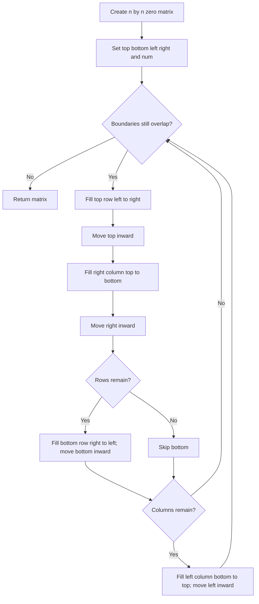

# 59. Spiral Matrix II

## 1. Problem Understanding

Given positive integer `n`, create an `n×n` matrix containing `1..n²` in clockwise spiral order, starting at top-left. We construct values and return the matrix; no input matrix is given.

## 2. Example Understanding

For `n=3`, fill top row `1,2,3`, right edge `4,5`, bottom edge backward `6,7`, then left edge upward `8`, and center `9`:

```text
1 2 3
8 9 4
7 6 5
```

For `n=1`, answer is `[[1]]`; boundary checks prevent visiting a cell twice.

## 3. Problem Identification

### Pattern Recognition Cheat Sheet

| Clue in Question          | Possible Pattern                | Why?                                     |
| ------------------------- | ------------------------------- | ---------------------------------------- |
| Clockwise spiral order    | Simulation / boundary traversal | Direction changes at edges               |
| Fill every cell once      | Layer-by-layer traversal        | Each ring can be processed independently |
| Square output of size `n` | Matrix construction             | Allocate then write sequential values    |

Ask: Should I rotate direction at each step, or consume one row/column boundary at a time? Which boundaries shrink after each side?

## 4. Different Approaches

1. **Direction simulation (provided):** Move right/down/left/up, turn if next cell is out of bounds or already filled. Intuitive, requires visited detection.
2. **Four boundaries (provided optimized):** Maintain `top,bottom,left,right`; fill each perimeter in four runs, shrink boundaries. Check remaining rows/columns before lower sides to avoid duplicates.
3. **Layer traversal (provided):** Derive each ring's first/last coordinates and fill its four sides.
   | Approach | Time | Space | Pros | Cons |
   |---|---:|---:|---|---|
   | Direction simulation | O(n²) | O(n²) output | Mirrors movement | Direction/visited checks |
   | Boundary traversal | O(n²) | O(n²) output | Clear no-visited logic | Careful boundary conditions |
   | Layer traversal | O(n²) | O(n²) output | Ring-centric | Center/single-row guards |

## 5. Flowchart



प्रत्येक full round मध्ये top/right/bottom/left edges भरतो; नंतर boundaries आत सरकतात. Single row/column उरल्यास guard duplicate writes टाळतो.

## 6. Algorithm / Intuition

Initialize zero matrix and `num=1`. Fill top, right, bottom if rows remain, left if columns remain; shrink the corresponding boundary after each side. Repeat until `top>bottom` or `left>right`.

## 7. Code Explanation

[`59.cpp`](./59.cpp) has three equivalents: `generateMatrixDirection`, `generateMatrixSpiral`, and `generateMatrixLayer`. In boundary traversal, `top`/`bottom` bound rows and `left`/`right` bound columns; `num++` after each placement. The conditional bottom and left traversals are essential for odd centers. The demo prints all approaches; LeetCode method is `generateMatrix`.

## 8. Dry Run

`n=2`:
| Step | Variables | Condition | Action | Result |
|---|---|---|---|---|
| 1 | `top=0,bottom=1,left=0,right=1,num=1` | Boundaries overlap | Fill top row | `1 2` |
| 2 | — | — | `top=1`; fill right column | bottom-right = 3 |
| 3 | `top=1<=bottom=1` | Row remains | Fill bottom right-to-left | bottom-left = 4 |
| 4 | `left=0<=right=0` | Column remains | Left edge has no extra cell | No duplicate |
| 5 | `top=2>bottom=1` | Stop | Return | `[[1,2],[4,3]]` |

## 9. Complexity Analysis

Every one of `n²` cells is written once: **O(n²)** time. The returned matrix takes **O(n²)** space; extra traversal variables are **O(1)**.

## 10. Why This Solution Works

At each round, the four traversal segments cover exactly the current outer ring, in clockwise order. Shrinking a boundary removes the cells already filled. Conditional checks ensure a remaining single row/column is traversed only once. Therefore every cell receives one increasing value, and the process terminates as the unfilled rectangle shrinks.

## 11. Common Mistakes & Interview Traps

- Forgetting to shrink boundary after filling a side.
- Writing center row/column twice if no guard is used.
- Bottom row direction is right-to-left; left column is bottom-to-top.
- `num` must increase exactly once per cell.
- Direction simulation must check both bounds and visited state before moving.
- Follow-up: generate spiral values for rectangular dimensions or traverse an existing matrix.

## 12. Revision Notes (Quick Recall)

- **Pattern:** Matrix simulation / boundary traversal.
- **Clue:** Clockwise spiral fill.
- **Intuition:** Fill one ring, shrink its four limits, repeat.
- **Steps:** Top → right → bottom guarded → left guarded.
- **Complexity:** O(n²) time, O(n²) result, O(1) extra.
- **Trap:** Check for remaining row/column before bottom/left.
- **Takeaway:** Boundaries convert spiral movement into four simple loops.

## 13. Similar Problem Recognition

Spiral Matrix (read existing matrix) uses the same boundary pattern. For rectangular matrices, initialize separate row and column limits. Diagonal/zigzag traversal uses different movement rules; identify whether traversal is ring-based or direction/state-based.

## 14. Final Self-Assessment

1. Why do we check `top <= bottom` before bottom traversal?
2. What does each of the four boundaries represent?
3. How does `n=1` terminate correctly?
4. Why is the time complexity quadratic?
5. What changes for a rectangular matrix?
