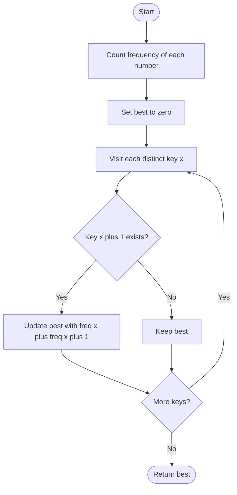

# 594. Longest Harmonious Subsequence

Source: `594.cpp`; `findLHS(vector<int>& nums)`.

## 1. Understanding

> **मराठी:** प्रश्नात काय दिले आहे आणि नेमके काय शोधायचे आहे, हे आधी स्पष्ट करा.
> Find the longest subsequence whose maximum and minimum differ by exactly 1. Elements need not be contiguous; duplicates count.

## 2. Worked examples and edges

> **मराठी:** प्रश्नात काय दिले आहे आणि नेमके काय शोधायचे आहे, हे आधी स्पष्ट करा.
> `[1,3,2,2,5,2,3,7]`: frequencies of 2 and 3 are 3 and 2, giving length 5. `[1,1,1]` returns 0 because a difference of exactly 1 is required. Empty input also returns 0.

## 3. Pattern identification + cheat sheet

> **मराठी:** या clues मुळे योग्य pattern ओळखता येतो; constraints आणि relations नीट तपासा.
> When order is irrelevant and answer depends on equal-value counts, build a frequency map.
> | Clue | Pattern |
> |---|---|
> | Duplicates contribute to length | Frequency counting |
> | Difference exactly 1 | Pair keys `x` and `x+1` |
> | Subsequence, not subarray | Input order can be ignored |

## 4. Approaches

> **मराठी:** सोप्या उपायापासून सुरुवात करा आणि constraints नुसार योग्य optimization निवडा.

- **Sort and scan adjacent value groups — correct:** `O(n log n)` time, `O(n)` or in-place extra space.
- **Frequency map — used and expected average-optimal:** `O(n)` average time, `O(u)` space for `u` distinct values.
- Checking only whether a value occurs twice is incorrect; both adjacent distinct values must exist.

## 5. Flowchart

> **मराठी:** Flowchart मधील decision, loop आणि termination condition क्रमाने समजून घ्या.

Same-value-only groups are skipped because their range is zero.

## 6. Algorithm and intuition

> **मराठी:** मुख्य observation समजल्यावर algorithm चे steps लक्षात ठेवणे सोपे होते.
> Count values, then for every key `x`, combine its frequency with `x+1` if present. This constructs the largest subsequence with min `x` and max `x+1`.

## 7. Code explanation

> **मराठी:** Code मधील variable आणि condition यांचा algorithm मधील उद्देश समजून घ्या.
> The first loop fills `freqMap`; the second tests `freqMap.count(key + 1)` and updates `maxLength`. Hash iteration order does not affect the result.

## 8. Dry run

> **मराठी:** प्रत्येक महत्त्वाच्या step नंतर variable ची value trace करा.
> | Key `x` | `freq[x]` | `freq[x+1]` | Candidate |
> |---:|---:|---:|---:|
> | 1 | 1 | 3 | 4 |
> | 2 | 3 | 2 | 5 |
> | 3 | 2 | absent | — |
> | best | — | — | 5 |

## 9. Complexity

> **मराठी:** Input size आणि प्रत्येक operation कितीदा चालतो यावरून complexity ठरवा.
> Average `O(n)` time and `O(u)` auxiliary space; worst-case hash behavior can degrade, as with unordered maps generally.

## 10. Correctness

> **मराठी:** Invariant किंवा तर्क वापरून algorithm योग्य उत्तर देतो हे समजून घ्या.
> Any harmonious subsequence has two distinct values `x` and `x+1`; it can use at most all occurrences of those values, and using all of them is valid. The map evaluates every such adjacent pair, so the maximum candidate is exactly the longest length.

## 11. Mistakes / interview traps

> **मराठी:** Boundary, duplicate आणि off-by-one cases स्वतंत्रपणे तपासा.

- Difference must be exactly 1, not at most 1.
- Must include duplicate counts.
- This is a subsequence, so original ordering is irrelevant.

## 12. Quick revision

Frequency map; for each `x`, if `x+1` exists, candidate is `freq[x]+freq[x+1]`; max starts at zero.
फक्त adjacent valuesच्या frequencies जोडायच्या; input order महत्त्वाचा नाही.

## 13. Related problems / variations

> **मराठी:** प्रश्नात काय दिले आहे आणि नेमके काय शोधायचे आहे, हे आधी स्पष्ट करा.
> Longest consecutive sequence; degree of an array; frequency-based pair counting; longest subsequence with value difference at most `k`.

## 14. Self-assessment

> **मराठी:** उत्तर न पाहता प्रश्न सोडवा आणि तुमच्या निवडीचे कारण सांगा.

1. Why does an all-equal array return zero?
2. Why is map iteration independent of input order?
3. How would you solve with sorted values?
4. What changes if the required difference is exactly `k`?
