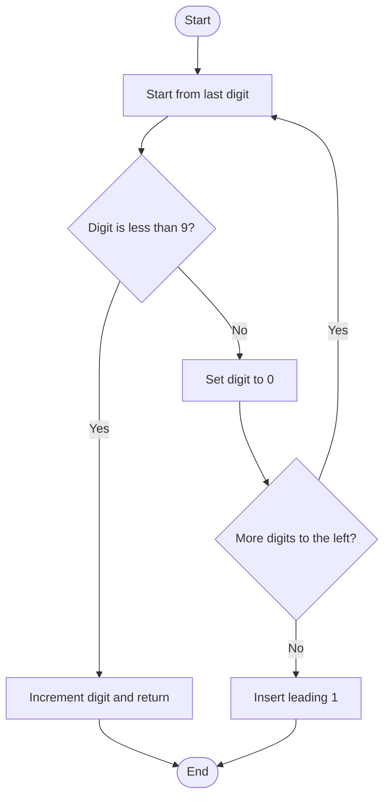

# Plus One — LeetCode 66

## 1. Understanding

Non-negative integer चे decimal digits vector मध्ये दिले आहेत; त्यात one add करून digits परत करा. Leading zero नसतो (zero स्वतः `[0]`).

## 2. Worked examples and edges

> **मराठी:** प्रश्नात काय दिले आहे आणि नेमके काय शोधायचे आहे, हे आधी स्पष्ट करा.

- `[1,2,3]` → `[1,2,4]`.
- `[1,2,9]` → `[1,3,0]`.
- `[9,9,9]` → `[1,0,0,0]`; `[0]` → `[1]`.

## 3. Pattern identification + cheat sheet

| Clue                     | Pattern           | कारण                           |
| ------------------------ | ----------------- | ------------------------------ |
| Digit array + add one    | Carry propagation | उजवीकडून addition              |
| Decimal digit bounds 0–9 | Local arithmetic  | प्रत्येक digit remainder/carry |
| Leading overflow         | Grow output       | शेवटी carry उरल्यास prepend 1  |

## 4. Approaches

- Integer conversion (`Approach1`): number बनवून +1, नंतर digits — O(n) but fixed-width overflow risk; recursion stack O(n).
- Carry simulation (`Approach2`): O(n) time; copy/vector output O(n).
- `Approach3`: 9 च्या run ला zero करा, पहिले `<9` digit increment करून return — O(n) worst case, O(1) extra besides returned vector; source by-value inputमुळे copy.
- Wrong: digits ला integer मध्ये convert करणे arbitrary-length input साठी सुरक्षित नाही.

## 5. Flowchart

9 असेल तर carry पुढे; पहिला non-9 digit मिळताच बाकी बदलत नाहीत.

## 6. Algorithm / intuition

Rightmost digit ला 1 add करा. 9 नसल्यास काम संपते; 9 असल्यास 0 करा आणि डावीकडे carry द्या. सर्व digits 9 असतील तर सुरुवातीला 1 घाला.

## 7. Code explanation

`plusOne_Approach1` recursive `getNum` ने `long long` बनवतो; मोठ्या input साठी unsafe. `Approach2` carry loop करतो. `Approach3` early-return optimization; `vector<int>` by value असल्याने caller inputची copy आहे.

## 8. Dry run

> **मराठी:** प्रत्येक महत्त्वाच्या step नंतर variable ची value trace करा.
> `[1,9,9]`:
> | index (right→left) | digit | update | next |
> |---:|---:|---|---|
> | 2 | 9 | set to 0 | carry left |
> | 1 | 9 | set to 0 | carry left |
> | 0 | 1 | set to 2, return | `[2,0,0]` |

## 9. Complexity

> **मराठी:** Input size आणि प्रत्येक operation कितीदा चालतो यावरून complexity ठरवा.
> Carry/optimized methods O(n) worst-case; at most n digits visit. Source pass-by-value needs O(n) copy storage; carry method may prepend. Integer conversion also O(n) but `long long` limits correctness.

## 10. Correctness

> **मराठी:** Invariant किंवा तर्क वापरून algorithm योग्य उत्तर देतो हे समजून घ्या.
> Loop right-to-left maintains the invariant that processed suffix equals the corresponding suffix of original number plus one modulo its digit place, with carry propagated left. A non-9 absorbs carry; all-9 input leaves a carry, represented by leading 1.

## 11. Mistakes and interview traps

- Carry right-to-left जाते.
- 9 reset to 0; all-9 case adds a new digit.
- Empty vector हा LeetCode contract नाही; source methods त्यासाठी सुरक्षित नाहीत.
- Integer conversion can overflow and leading zeros are not a concern under the stated input format.

## 12. Quick revision

> **मराठी:** दोन मिनिटांच्या revision साठी pattern, मुख्य कल्पना आणि complexity आठवा.
> From end: if `<9`, increment and stop; else zero. If all 9, prepend 1.

## 13. Related problems / variations

> **मराठी:** प्रश्नात काय दिले आहे आणि नेमके काय शोधायचे आहे, हे आधी स्पष्ट करा.
> Add Binary, Add Strings, Plus One Linked List, increment arbitrary-base digit arrays.

## 14. Self-assessment

1. `[9,9]` कसा बदलतो?
2. First non-9 digit मिळाल्यावर पुढे का जाऊ नये?
3. Integer-conversion method ची मर्यादा काय?
4. Worst-case time आणि अतिरिक्त storage काय?
