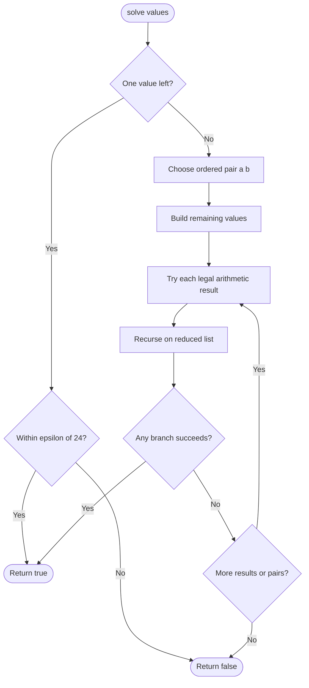

# 679. 24 Game

Source: `679.cpp`; `judgePoint24` converts cards to doubles and calls recursive `solve`.

## 1. Understanding

> **मराठी:** प्रश्नात काय दिले आहे आणि नेमके काय शोधायचे आहे, हे आधी स्पष्ट करा.
> Use all four card values, with `+ - * /` and parentheses, to make 24. Division is real-valued; intermediate results need not be integers.

## 2. Worked examples and edges

> **मराठी:** प्रश्नात काय दिले आहे आणि नेमके काय शोधायचे आहे, हे आधी स्पष्ट करा.
> `[4,1,8,7]` can make 24: `(8-4)*(7-1)`. `[1,2,1,2]` has no expression. Division by zero must be skipped; floating-point comparison needs a tolerance.

## 3. Pattern identification + cheat sheet

> **मराठी:** या clues मुळे योग्य pattern ओळखता येतो; constraints आणि relations नीट तपासा.
> Small input plus arbitrary operation order/parentheses suggests exhaustive backtracking over pairs.
> | Clue | Pattern |
> |---|---|
> | Any two values may combine next | Pairwise search |
> | Operations change remaining state size | Backtracking |
> | Floating arithmetic | Epsilon comparison |

## 4. Approaches

> **मराठी:** सोप्या उपायापासून सुरुवात करा आणि constraints नुसार योग्य optimization निवडा.

- **Enumerate expression trees/permutations manually — correct but error-prone.**
- **Recursive pair-reduction search — used:** try every ordered pair and valid operation, recurse on the reduced multiset. The fixed four-card constraint makes exhaustive search practical.
- Greedy operator/order selection is not correct; a locally attractive operation can block a solution.

## 5. Flowchart

> **मराठी:** Flowchart मधील decision, loop आणि termination condition क्रमाने समजून घ्या.

Each branch shrinks the list by one and restores its temporary value after recursion.

## 6. Algorithm and intuition

> **मराठी:** मुख्य observation समजल्यावर algorithm चे steps लक्षात ठेवणे सोपे होते.
> Choose distinct indices `i,j`, remove both, append one of `a+b`, `a-b`, `b-a`, `a*b`, `a/b`, `b/a` when division is legal, and recurse. Ordered pairs cover both subtraction/division directions.

## 7. Code explanation

> **मराठी:** Code मधील variable आणि condition यांचा algorithm मधील उद्देश समजून घ्या.
> `solve` checks the base case at size one using `eps=0.1`. It builds `temp` from unselected entries, tests candidate results, and `pop_back`s after each recursive branch. `judgePoint24` converts integers to `double`.

## 8. Dry run

> **मराठी:** प्रत्येक महत्त्वाच्या step नंतर variable ची value trace करा.
> | Remaining values | Choice | Next state |
> |---|---|---|
> | `[4,1,8,7]` | combine `8-4` | `[1,7,4]` |
> | `[1,7,4]` | combine `7-1` | `[6,4]` |
> | `[6,4]` | multiply `6*4` | `[24]` → true |

## 9. Complexity

> **मराठी:** Input size आणि प्रत्येक operation कितीदा चालतो यावरून complexity ठरवा.
> For `n` values, branching is bounded by ordered pairs and at most 6 operations per level: `O((n²·6)^(n-1))` loose upper bound; recursion space `O(n)`. Here `n=4` is fixed.

## 10. Correctness

> **मराठी:** Invariant किंवा तर्क वापरून algorithm योग्य उत्तर देतो हे समजून घ्या.
> Every valid arithmetic expression can be represented by a final operation combining two subexpressions. The recursion tries every ordered pair and every legal operation, then recursively tries all expressions for the remaining values. Base case accepts exactly values within tolerance of 24; therefore it returns true iff a valid expression is found (subject to floating tolerance).

## 11. Mistakes / interview traps

> **मराठी:** Boundary, duplicate आणि off-by-one cases स्वतंत्रपणे तपासा.

- Try both subtraction and division orders.
- Never divide by a near-zero denominator.
- Do not use integer division.
- The source epsilon is `0.1`, relatively loose; a tighter epsilon is often preferable in production.

## 12. Quick revision

Pick two → remove → try arithmetic results → recurse → restore; base case `abs(value-24) <= epsilon`.
योग्य expression मिळेपर्यंत सर्व branches तपासा; greedy निवड पुरेशी नाही.

## 13. Related problems / variations

> **मराठी:** प्रश्नात काय दिले आहे आणि नेमके काय शोधायचे आहे, हे आधी स्पष्ट करा.
> Expression Add Operators; partition-to-target arithmetic games; backtracking with multiset states and memoization.

## 14. Self-assessment

> **मराठी:** उत्तर न पाहता प्रश्न सोडवा आणि तुमच्या निवडीचे कारण सांगा.

1. Why try ordered pairs?
2. Why can a greedy pair choice fail?
3. What is the base case?
4. How would memoization canonicalize equivalent remaining states?
